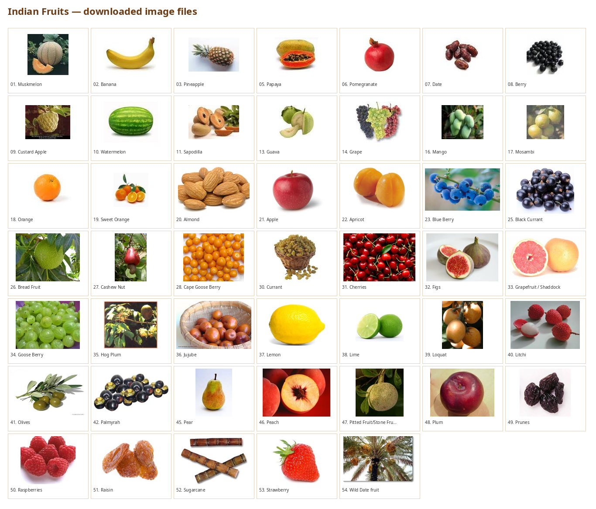

# Vegetable, Fruit & Spice Images — English & Telugu

Reference image collections with English and Telugu names, stored locally so the
documents work offline and do not depend on the original websites.

| Collection | Items | Images | Markdown | PDF |
|---|---:|---:|---|---|
| Fruits | 54 | 47 | [Open list](fruits/indian-fruits-english-telugu.md) | [Download PDF](fruits/indian-fruits-english-telugu.pdf) |
| Vegetables | 47 | 45 | [Open list](vegetables/vegetables-english-telugu.md) | [Download PDF](vegetables/vegetables-english-telugu.pdf) |
| Spices | 65 | 65 | [Open list](spices/spices-english-telugu.md) | [Download PDF](spices/spices-english-telugu.pdf) |



## Folder layout

```text
fruits/
  indian-fruits-english-telugu.md
  indian-fruits-english-telugu.pdf
  fruit-images-preview.png
  fruit-images/            # 47 JPG images
vegetables/
  vegetables-english-telugu.md
  vegetables-english-telugu.pdf
  vegetable-images/        # 45 PNG/JPG images
spices/
  spices-english-telugu.md
  spices-english-telugu.pdf
  spice-images/            # 65 JPG images
```

## Checks

- All 157 image links use relative paths and resolve on Linux, macOS, and Windows.
- Every image referenced in the Markdown tables also appears in the matching gallery.
- There are no missing, zero-byte, or corrupt image files, and no filename case conflicts.
- All 156 unique source URLs were reachable when this repository was prepared.
- The PDFs contain embedded images and embedded Telugu fonts, so they display correctly
  on a machine without the original fonts or images.
- PDF image links are stored as paths relative to the PDF file, so they no longer point
  to a machine-specific folder such as `/home/s3c/...`. The images themselves are
  embedded, so they are always visible.
- Total size is about 16 MB; no file exceeds 5 MB, so Git LFS is not required.

## Sources

- Fruits: [suresh-english.blogspot.com](https://suresh-english.blogspot.com/2013/11/50-more-names-of-indian-fruits-in.html)
- Vegetables: [osmanian.com](https://www.osmanian.com/2022/03/vegetable-names-in-english-and-telugu.html)
- Spices: [toolsnepal.com](https://www.toolsnepal.com/common-spices-name-in-telugu-english-with-pictures/)
