# Indian Fruits — English & Telugu Names with Images

**Source:** [50 more Names of Indian Fruits in English & Telugu](https://suresh-english.blogspot.com/2013/11/50-more-names-of-indian-fruits-in.html)  
**Extracted:** 2026-11-01  
**Total items:** 54 — 47 with images, 7 without images on the source page  
**Images folder:** [`fruit-images/`](fruit-images/) (47 downloaded images)

> Telugu spellings follow the source page; obvious English typos have been corrected. This is a separate fruits list and is **not merged** with the vegetable or spice lists.

## Quick reference

| # | English | Telugu | Image |
|---:|---|---|---|
| 1 | Muskmelon | kharbuja (ఖర్బుజ) | [Image](fruit-images/01-muskmelon.jpg) · [Source](https://blogger.googleusercontent.com/img/b/R29vZ2xl/AVvXsEgd1rVfy6SQB1vpfzR45RtqjUh68e006YFcUBPNphweZ4ou1Juxw8QElL5YusBqQBer4FxAXBldFkQ6D1Xe2k7j0aVbfJaVFAM-bO_EkVU7DZX7aQrwhG8TkpDh6HX7s5HWTQQ1wqNUOJCe/s1600/musk+melon) |
| 2 | Banana | Aarati pandu (ఆరటి పండు) | [Image](fruit-images/02-banana.jpg) · [Source](https://blogger.googleusercontent.com/img/b/R29vZ2xl/AVvXsEjYrc5lVkU3fWuqmaOjmiZTdeoFpY005dFXt-1MJaiomYbT-zmRkpNx75GqGM-3Rm-nYjF3ZrnokKBuopoAJvHtYuXOaHa61VHLZWMwFtQJAduAlm-ElM8n7sgaszB-uRh_p1gJKiw8tPj-/s1600/banana) |
| 3 | Pineapple | Anasa (అనాస) | [Image](fruit-images/03-pineapple.jpg) · [Source](https://blogger.googleusercontent.com/img/b/R29vZ2xl/AVvXsEheztA8Yc2_q2g0NvX8SoFHBwHizBzYTZFLaUnY_3q7JE5Ogv83uvQkupTUM5LfhxYh7EdGkGDwq5nIVE8HSKElDYZwjcX8lv7EazJLLFTlhg4LI4-7FsBhDCaKwOYJ_J_xG3t2B1Z5z_yR/s1600/pine+apple) |
| 4 | Jackfruit | Panasa pandu (పనస పండు) | — (no image on source page) |
| 5 | Papaya | Bobbaya (బొబ్బాయ) | [Image](fruit-images/05-papaya.jpg) · [Source](https://blogger.googleusercontent.com/img/b/R29vZ2xl/AVvXsEhrqxL39u_5eBZ_OjWAP78kWiLe6zlvhhmApb0RjNYkhO_LzR76-vtdYQbvrhGOIBKQCuCPlbOTMZr0_la2hTDqgp3pVwLHKvUWjXv1fR9jpa0zBKYrT8zQ3ZW-IJcoRsXRXYJC3aD9jCyb/s1600/papaya) |
| 6 | Pomegranate | Danimma (దానిమ్మ) | [Image](fruit-images/06-pomegranate.jpg) · [Source](https://blogger.googleusercontent.com/img/b/R29vZ2xl/AVvXsEgrxXwRG5FdtWspFPktAcY1cBdgqi1y7i4KAIku4JK_E-fmVameJF7rQ6emDoybLG2ERQP-uGvDgHL2Iz9NjQJImA_i55W24Wx8pkwkNqIJixVqvORDPbGHa2A7BQzUHtPV5MrtLG0c9V2V/s1600/pomegranate) |
| 7 | Date | Kharjuram (ఖర్జూరం) | [Image](fruit-images/07-date.jpg) · [Source](https://blogger.googleusercontent.com/img/b/R29vZ2xl/AVvXsEhnSCzvCVHzoafqC12u0AT5MyvDgnl0XQ4KrvBqJRXsO0Ntca49pSDwvC43XEw97aEWnouuMAx2vgHMt6SC9bHPGWmDFpPCppNfP6lwdIER8ohvzSY2XLFe0gGaLeBIUAOt6WoG6uNEvhVi/s1600/dates) |
| 8 | Berry | Neredu (నేరేడు) | [Image](fruit-images/08-berry.jpg) · [Source](https://blogger.googleusercontent.com/img/b/R29vZ2xl/AVvXsEgv5czko30aYoUYUzN8klxudlZXEhkehoAuPM3x13DcCavyX0-r6djjfosmNngkvRWKu1Ji8guCFyABQXWmodC3iaeL2NxUZ0s9p3wAI36wEe2qNTDRrYHklpBOStEl56K-eDOZkQ3epj-R/s1600/berry) |
| 9 | Custard Apple | Sitaphalam (సీతాఫలం) | [Image](fruit-images/09-custard-apple.jpg) · [Source](https://blogger.googleusercontent.com/img/b/R29vZ2xl/AVvXsEgdPZGBMmIQxLnR-d3zkHAGACHquQ-hm61pJKiScJFuPNWzNjbJEjmYSTJS95RS2CQ7hCQoOmvbM-9MSjporX7tOVTa5Wb5vxep5jYZymVt0wawEniaF_ceju0TF5NtwSZytSM3KnVGAvsC/s1600/custard+apple) |
| 10 | Watermelon | Puchha kaya (పుచ్చ కాయ) | [Image](fruit-images/10-watermelon.jpg) · [Source](https://blogger.googleusercontent.com/img/b/R29vZ2xl/AVvXsEjhPCYn7Yo7Z6wFdMDWkmapyb40dHnpyJI-q0dC66evtOec2Q0zvU6KbUZfLzqfplOCRGOrqkPBrpWy0WT-8wAYNKuaT_2mQMTbuuZauaiwOndz9U7P3E47GkI8LwgXapc6o18zaTp5_dtl/s1600/watermelon) |
| 11 | Sapodilla | Sapota (సపోటా) | [Image](fruit-images/11-sapodilla.jpg) · [Source](https://blogger.googleusercontent.com/img/b/R29vZ2xl/AVvXsEiR2XRpIuVvZtfc8rBxySrmyP0dZ2OkmGrF_gw7v1W97PhyUZHved3gwIEzp8TyQBtBptFmBSXI6TIHOYjRu07R2fzap2E5QJ_P40rtWueAlSNT1A9RyTiY_pmMbdplMqBP4w8E-zbV42y1/s1600/sopota) |
| 12 | Plum | Regu (రేగు) | — (no image on source page) |
| 13 | Guava | Jama (జామ) | [Image](fruit-images/13-guava.jpg) · [Source](https://blogger.googleusercontent.com/img/b/R29vZ2xl/AVvXsEid2IQe5CHOzrUks5i8XpKe9GVRXdS9_h_ZkMcaX3YqvHKOAdyux3uvX54aB63qGQquC1tJCOhFJ8QY7JmMCzexIx8dHY97ZaaVJoptOuX6zpBvfyag__KfA5vNsCcBNxqU0q7BfYRDeCni/s1600/guava) |
| 14 | Grape | Draksha (ద్రాక్ష) | [Image](fruit-images/14-grape.jpg) · [Source](https://blogger.googleusercontent.com/img/b/R29vZ2xl/AVvXsEjvCBr06R3BFEEsC4-AbvnT-4Ql2hApbAYIUuIRq8Kh2RiRIP8kT46XV0477kFLcRKGFGc7aUbjx0s9Wjf0C_2DSUw_c_XgkSc32zoi9KO2Nz42vMQgEnm8K63FFvaQki0sXGGFPe-Bceax/s1600/grape) |
| 15 | Bokhara Plum | Sema Regu (సీమరేగు) | — (no image on source page) |
| 16 | Mango | Mamidi (మామిడి) | [Image](fruit-images/16-mango.jpg) · [Source](https://blogger.googleusercontent.com/img/b/R29vZ2xl/AVvXsEhua9DBImPienVZNQrUiLwB-wqbGqpTHYG4oE-lKP6y7uqvuxiZQaeBzI80MQCef45WF_nq-8uBFQB4s8H2BQYieaSnfSTzR_cSoC4FuXImTQbSR24o_mXylv-gvWX9JVvZBSyTyyj-1PH2/s1600/mango) |
| 17 | Mosambi | Battaiah (బత్తయ్య) | [Image](fruit-images/17-mosambi.jpg) · [Source](https://blogger.googleusercontent.com/img/b/R29vZ2xl/AVvXsEjT-xfcSzMK5dG3kTTEcN-fA4wqQFamqp8jFZEnPhx8gZlHqOvlDI17XG6vUrIrHhmA2O1LtsUTK1g5ZBKIeatbWG5QSUgynIV3qi63tV1xZ-UvdOLtWAd_f62-K0wm9veYU6wmOgc3xB7e/s1600/mosambi) |
| 18 | Orange | Narinja (నారింజ) | [Image](fruit-images/18-orange.jpg) · [Source](https://blogger.googleusercontent.com/img/b/R29vZ2xl/AVvXsEj5IhFl-68eMk0KKv5EyqaF2PTTz8r6coPHEoIaBCQEuyrDAG46-gI_RtEG2Tsdd31lkasfHDKsZ-TZ-oCYOPLWepuSb93FJwCvjr6jOweTijUPaaJ8qtlgdxXCk7SaDpJsGMeH1A1N_NmI/s1600/orange) |
| 19 | Sweet Orange | Kamala phalam (కమల ఫలం) | [Image](fruit-images/19-sweet-orange.jpg) · [Source](https://blogger.googleusercontent.com/img/b/R29vZ2xl/AVvXsEh6l0C-6EilyJa6GFTpob0o2JDBI128UH9rMi0psAdZNU-BiEp_dQYosysSAkWx3qQK3XYfdjgwTug2ptXfc2Hp0-sXhjx2SMBOpNqrETuRxxKj8XvivZrSdzwV9cHSj5GC74qzj3xuk8YE/s1600/sweet+orange) |
| 20 | Almond | Badam (బాదం) | [Image](fruit-images/20-almond.jpg) · [Source](https://blogger.googleusercontent.com/img/b/R29vZ2xl/AVvXsEgrSB7c66a6q_XQBv-a2xMpEVoQ4dV92g7Tqxq_mFaIIpAnKIcEJjkOZqe2DBOoUi6Lh6hN-gprSYFNIVqHio0vxTdilDT8WJT-lAoH4zcIsGb0sl_uD24_33b7XvH1reLsE0ODs_O96BH-/s1600/almond.jpg) |
| 21 | Apple | (సేపు / సేమ రేగు) Sepu/ Sema Regu | [Image](fruit-images/21-apple.jpg) · [Source](https://blogger.googleusercontent.com/img/b/R29vZ2xl/AVvXsEie4M66PzYMU-S25VB14OXtAlKKfQg9shVNQQ2Bfak7-9C8vrfovvIPB8ighS7SUvOnrs5y290OLFl6RnUYNlJSf5oO4F8GMiH2qntWbyNHFXo2kbo4JA-g5MisRPPr2eflGdPQ2GRKIL5C/s1600/apple.jpg) |
| 22 | Apricot | Seema Badam/ Jallaru Pandu (సీమ బాదం/ జల్లారు పండు) | [Image](fruit-images/22-apricot.jpg) · [Source](https://blogger.googleusercontent.com/img/b/R29vZ2xl/AVvXsEjhsfcODpZSDRDupzdrQAoYjM_VVrUSNbGbmTICxm9eqwGY5DWtyWqP2yYHe4vkzyKZ9oA2ikePr297ZFi7BrSprGt0HqrxAIglj54ZFhHuZ9_ISDHAbK2Gu4FY8sAA4Po7dDJo4oa-xiBA/s1600/apricot.jpg) |
| 23 | Blue Berry | Fall Sa (ఫాల్ సా) | [Image](fruit-images/23-blue-berry.jpg) · [Source](https://blogger.googleusercontent.com/img/b/R29vZ2xl/AVvXsEhafFnzF8lrY-YDTiH9EXqx4d-3yYhARME3x9_1ESCY_G-73b0XuH0DaalTWW3XczrrBwJR8szoUn0edrzbPvwOT4R2eG0-lSUUGsz3ktTnVCBMmtJ_LsD7QP-FG5szGn7NIF-JajTn163t/s1600/blue+berry.jpg) |
| 24 | Bullock's Heart | Rama Phalam (రామా ఫలం) | — (no image on source page) |
| 25 | Black Currant | Nalla Kishmish (నల్ల కిష్మిష్) | [Image](fruit-images/25-black-currant.jpg) · [Source](https://blogger.googleusercontent.com/img/b/R29vZ2xl/AVvXsEgg7Kj0yOwb-itqSKC78fpVfuj3DArmfa3iBSV8RyX_x3Zc59IcB7LWQ0uvhWWZV6GyvZVD81EN8TjtAIF_fVpHoU2zTeXLfNKK0hSZZ1ZJ4aBkumvuIackFYgyh03MAmOlvsri0ZepgoOZ/s1600/black+current.jpg) |
| 26 | Bread Fruit | Seema Panasa (సీమ పనస) | [Image](fruit-images/26-bread-fruit.jpg) · [Source](https://blogger.googleusercontent.com/img/b/R29vZ2xl/AVvXsEixiFJmkLdnHJEKQq8iRrumCA1W_n5DjR-0vmZQmjbLy0ady9UzFKJb0hlQ2G98oSm0oAKEGThcLrB9VzlYth0VPcDoyAIaUTQH3qW6VkmI1EqZAlSdit_tQFNqjdHUhxHAwvL2G5YXpohg/s1600/bread+fruit.jpg) |
| 27 | Cashew Nut | Jeedi Mamidi (జీడి మామిడి) | [Image](fruit-images/27-cashew-nut.jpg) · [Source](https://blogger.googleusercontent.com/img/b/R29vZ2xl/AVvXsEjxJNEqXyvJPSl0GYLLv7qod2nZzVpaA_itDV7sz2dy2CYefLcHzERQcSRDHahg57ZElfP51ITTl9oORF-r_NqC19VyNJYOhOzy-y35BDmApzmyTeO2_OFKjGtWl_MXCxkp220trOnF7RRQ/s1600/cashew+nut.jpg) |
| 28 | Cape Goose Berry | Nela Usiri (నేల ఉసిరి) | [Image](fruit-images/28-cape-goose-berry.jpg) · [Source](https://blogger.googleusercontent.com/img/b/R29vZ2xl/AVvXsEhE9D6SePSdiFIADbe9MpO7oy2UQ8DYQ16yTIy5o1cvSCJxrf0i4wleKK6Mqm0M_YUtFOB-I_5_c9Igxg9NeV7KZQ3oPpjApv6SiW9fSesrftjMTpqS7m0Mui13CFHJcZ2Dulx5EonCm1qU/s1600/cape+gooseberry.jpg) |
| 29 | Citron | Madi Phalam (మాది ఫలం) | — (no image on source page) |
| 30 | Currant | Kishmish (కిష్మిష్) | [Image](fruit-images/30-currant.jpg) · [Source](https://blogger.googleusercontent.com/img/b/R29vZ2xl/AVvXsEgaIA5tR7OHbYoMKiGPxxZFQkfhYGWwyr0SzcCfnOuX3Evj6lXAOsu7WDOPNThE55j5cB8Qa2qvgv9uv1a7DXyPk0VndW9qDJyq33mJOuFd5DiWocC5TAiQzItNutzELewq0Lc0rntM7jKT/s1600/current.jpg) |
| 31 | Cherries | Cherry Pandu (చెర్రీ పండు) | [Image](fruit-images/31-cherries.jpg) · [Source](https://blogger.googleusercontent.com/img/b/R29vZ2xl/AVvXsEhmTHhoTN9nHl0wKfMaFveIYcn2yRD8RY_cjzb3yIIctRwPTWKQZXnxbXC6zncZbYDRdPJjVMIi-rDinoqoAEaklNfKnh8XC7PLucqFC5VOKtEAvqVwTni7EBcGdz4Cb1SxLAFODUH7KNb2/s1600/cherries.jpg) |
| 32 | Figs | Anjur (అంజూర్) | [Image](fruit-images/32-figs.jpg) · [Source](https://blogger.googleusercontent.com/img/b/R29vZ2xl/AVvXsEjRRMe4DV_DAXagBiegLnmyElhi2uk_O3mj6FHais9Ut8BzsaZpV2s2yh2xZkxegy19kV790R4EU96k_bmGz9CVT7KiMraoN2nUdmquIbEybcNJKSKJghaDQPkwsr4pFM9_qaqiLXFoxH79/s1600/figs.jpg) |
| 33 | Grapefruit / Shaddock | Pampar Panasa (పంపర్ పనస) | [Image](fruit-images/33-grapefruit-shaddock.jpg) · [Source](https://blogger.googleusercontent.com/img/b/R29vZ2xl/AVvXsEhJb55Fj4K8GzIx-rIQhY3o8D54BXSoyQOAsNDmFLKzxAa4d52fUc4uVIeZAxa5ADHANLUYP0vizakbaNWyPnuWPOokpqYHhPtVBmRzbKTTof3pn3LxwXJdFAV79P7JdgpquHI3rvFJAgVI/s1600/grape+fruit.jpg) |
| 34 | Goose Berry | Usiri (ఉసిరి) | [Image](fruit-images/34-goose-berry.jpg) · [Source](https://blogger.googleusercontent.com/img/b/R29vZ2xl/AVvXsEi7ziHEX1czlLbG6He2rL4bhseVnC_aH7ASgiJortiISCjvW_793Aj_OTp0khhwCEhGq2Uexep18HbuAtYhvF8dYOIdco5TBx33vZoP25y4XxWK_UjyfaCPOrCfqCYM_DqR0lXOI2nKapyb/s1600/usiri.jpg) |
| 35 | Hog Plum | Maredu (మారేడు) | [Image](fruit-images/35-hog-plum.jpg) · [Source](https://blogger.googleusercontent.com/img/b/R29vZ2xl/AVvXsEiFbWX4ralcr7D9IQgjuLcZRqgPdgNY-YAe5aEkYGbUHhG_PRh5_5pbjYT_aDPx1xs_JaY5AEu7-Z0Zyn2Yku-063XeSEVOGPIztzhv6tmKIEjhQrZuaF0vRWxr47D591XTRBWLgbWgLkJ3/s1600/maredu.jpg) |
| 36 | Jujube | Regu (రేగు) | [Image](fruit-images/36-jujube.jpg) · [Source](https://blogger.googleusercontent.com/img/b/R29vZ2xl/AVvXsEh-_Z-N75rA3mY0xAmVYjVi6CFXzdnNK-UySJlZ8W1ooP4oehdYKFn__44idFuri4EGg7ytEThoTlOO_IsofSZklqX1eYHl7L1WucnOKUOvm0Wh3imPBfUOyfgmbpMddjWrPPvyNhiPf_lZ/s1600/regu.jpg) |
| 37 | Lemon | Pedda Nimma (పెద్ద నిమ్మ) | [Image](fruit-images/37-lemon.jpg) · [Source](https://blogger.googleusercontent.com/img/b/R29vZ2xl/AVvXsEhPLoZnxaRIJPzgRjrVoM9BcsIkZMxUHaaFr7yPxY0jiYs6lwp4l26jkgpPItvQ2rLLMBgNEPngt_8kxDGyqiMGJzf661MJoKbCkZJybptGgrZYK93Mq-4Za4AEc1dAxkJDs_vTA1OF0AWC/s1600/lemon.jpg) |
| 38 | Lime | Nimma (నిమ్మ) | [Image](fruit-images/38-lime.jpg) · [Source](https://blogger.googleusercontent.com/img/b/R29vZ2xl/AVvXsEg-hcBa6_vc7piq98qkXqgZEAs76I3HdN0tuxh6xpgyy2A4kcOT4yzBx2zCsGzu9wxOAo_5izzx5w2BzAF_osldeHt-tKHrFBus93JH0hw8NR5ZieUEmqe9WG2MnBX0t7xDnYaslw62U52Q/s1600/lime.jpg) |
| 39 | Loquat | Lokata Pandu (లొకట పండు) | [Image](fruit-images/39-loquat.jpg) · [Source](https://blogger.googleusercontent.com/img/b/R29vZ2xl/AVvXsEgAj2l_QRqQtFdAvlDOfudkZGJVsy6olTPcxenxO1p8otJPjfBEBoporKwMO2wy16FDNS54zzwX-zAXD9yjI1-n41msGL_g60L1Fol5PeAKORq5CTDWeQ3khFodiPI8nHFSU7Y44T3oT1K9/s1600/loquat.jpg) |
| 40 | Litchi | Litchi Pandu (లిచి పండు) | [Image](fruit-images/40-litchi.jpg) · [Source](https://blogger.googleusercontent.com/img/b/R29vZ2xl/AVvXsEhvYg5bNgbjCpA5o4-8DL36VAxM_EUQV_rv0mWLrvIR0adeGtsMmEK_dQ5S1Medm5XBW8k6naARgPpNISTTfcsWzcLi433t6MFpghDbEookLK3DQdCRGIT7ylsTtX7HgGinMLQJ53ysQV3M/s1600/litchi.jpg) |
| 41 | Olives | Olive (ఆలివ్) | [Image](fruit-images/41-olives.jpg) · [Source](https://blogger.googleusercontent.com/img/b/R29vZ2xl/AVvXsEhYLU_MtU8lpVyun677fD4S5avzXsckh8Kydiq34SnTNDRvOQ_wa0iKqR1R-KZi6xgrDFx32OY_iTSYfsWHRWvMIZku37eNP1Mry-L279CQQR_xopoljsHmVYpmutcE2vXukrXbAmqOuHwA/s1600/olives.jpg) |
| 42 | Palmyrah | Thati (తాటి) | [Image](fruit-images/42-palmyrah.jpg) · [Source](https://blogger.googleusercontent.com/img/b/R29vZ2xl/AVvXsEiTpIWbTu27qiO3ZEzxvuVMtP4lRXE__UpM_sEHDJok87hPs1q75dN-eh0HqwSIyYMBWqaX19vqc8eyhywVC3Xfhw0iyzUPke4R1EtRBH2M6owq5SjfHG95WwRthlQlaWKe7lUytkttX5zH/s1600/palmyrah.jpg) |
| 43 | Tender Palm | Thati Munjelu (తాటి ముంజెలు) | — (no image on source page) |
| 44 | Tender Palm Shoots | Tegalu (తెగలు) | — (no image on source page) |
| 45 | Pear | Peri pandu (పెరి పండు) | [Image](fruit-images/45-pear.jpg) · [Source](https://blogger.googleusercontent.com/img/b/R29vZ2xl/AVvXsEjlrIIjQmvaQObujfW2j95NYrx9f-tiX0u8MDDpTDA7-Mj8yXpwSqhK4mpDylVN4KbaFSKEeQb_NzbAfQ7bQcwYS3hCLx1cRS4qklXZDItRoCBjGzzhyf1F0HU0vd8HU-C4xlOf1g1btCeY/s1600/pear.jpg) |
| 46 | Peach | Peach pandu (పీచ్ పండు) | [Image](fruit-images/46-peach.jpg) · [Source](https://blogger.googleusercontent.com/img/b/R29vZ2xl/AVvXsEiNkXzJ05Bj44AgRLxLias_1_TzWI6RptAdYsQSjoGnehGiyw-nl6tiJWLHFZzKMjdUffXthj3XZg1hPKIXQCDnNEqmSS7cuB4f5vmLRIOe9ZVowvQrhhKK0miaH-v9WBJg4z55DLQoC6gL/s1600/peach.jpg) |
| 47 | Pitted Fruit/Stone Fruit/Wood Apple | Velaga Pandu (వెలగ పండు) | [Image](fruit-images/47-pitted-fruit-stone-fruit-wood-apple.jpg) · [Source](https://blogger.googleusercontent.com/img/b/R29vZ2xl/AVvXsEjwiTWhF6ySOJeMdr-TECnMkk7wV8sr3JWBBWyKUfw2YGPiiwtpHBHcrVIr8ZOmyEQHXDBtBZoDScChJeKNUBnbnKrnPRPjA3M2-I8QYTiY17wCnn6bhu_u1xjxYXmLAmdTaAIGlmQP4x1W/s1600/wood+apple.jpg) |
| 48 | Plum | All Bokara (అల్ బొకార) | [Image](fruit-images/48-plum.jpg) · [Source](https://blogger.googleusercontent.com/img/b/R29vZ2xl/AVvXsEi8hWTiuxl4lGVcQQ5ZvAmLHlo8WRO06EYdMEoaPnwO3dT6Y5qcnnmPLsk13X8-h9-3eNNN8i8SP87LG7b447mWjmVXbbPt16srurdz7l1GYR22c1rZMOLg3K-Is5BHyrncW8WhikNNTS94/s1600/plum.jpg) |
| 49 | Prunes | Prunes (ప్రున్స్) | [Image](fruit-images/49-prunes.jpg) · [Source](https://blogger.googleusercontent.com/img/b/R29vZ2xl/AVvXsEhlomSEd7ZexJiwxEdPcoAR7Bw6WmjZoaEpisoLamuBpi2WIUmlAIc6yyMNwOGqynFiErBXHGQqqqhYI8apdxPcU4oFJ07BkHu2wUxn-eyGJkswBih2QeXFxgZH8fiDrIiZc4E2-ZFJZX5B/s1600/prunes.jpg) |
| 50 | Raspberries | Rasberries (రాస్ బెర్రీస్) | [Image](fruit-images/50-raspberries.jpg) · [Source](https://blogger.googleusercontent.com/img/b/R29vZ2xl/AVvXsEiQ8NpEBnpdWhrsvML_s6rrrgHD3evUXjlF9_mRxhyphenhyphen3jwf6NszZjwzOfEl6i1YLbwvKCcO1oZnHUV8-R6ewBTrRXb1HLI1-rQGPj3O884Pw7T2F2d4afDSNXQI4a9N5VbEG4K_IebvHGfs7/s1600/rasberries.jpg) |
| 51 | Raisin | Endu Draksha (ఎండు ద్రాక్ష) | [Image](fruit-images/51-raisin.jpg) · [Source](https://blogger.googleusercontent.com/img/b/R29vZ2xl/AVvXsEhpMRWeaAysWluFbY-dOZlmzGdC1sIoZ0gH3YWH7FqoOHvCGG7dQ7vjvkL11cUTboeC69-I7wa93_mmersJoku6XIyrDH4jyZ4Ges1XHBS0vjR-p0JfEbwe2MzP_i4cMOBrwNb6CDYhzYR3/s1600/raisin.jpg) |
| 52 | Sugarcane | Cheruku Gada (చెరుకు గడ) | [Image](fruit-images/52-sugarcane.jpg) · [Source](https://blogger.googleusercontent.com/img/b/R29vZ2xl/AVvXsEgBD6smjNK7tNV-_r9pTqmuxs8k9iDwktfwh9rKPl2k42TORQw595HNVfkAhbxiiQQ2bdttOeSpaY4sEreLupUD4TteNhPu3aTjfHhQDASr9n-t0XqRCp71Ocbi3LOGBHQEAS9qTuWIzZNq/s1600/sugar+cane.jpg) |
| 53 | Strawberry | Straw Berry (straw బెర్రీ) | [Image](fruit-images/53-strawberry.jpg) · [Source](https://blogger.googleusercontent.com/img/b/R29vZ2xl/AVvXsEhXKXBmAzl26QyhEgT3Ex15I0dFJwY72uK1aGofg0tDOz1Ru29b0uAZy9fTeoCgEzZoJdlyMF1vjIHhj0jVZ37rh2H8G80zpPgZ227JIiT5QIuGe0zZAvxmOd2N9Qk7uKrg8cqp25Uvgztn/s1600/straw+berry.jpg) |
| 54 | Wild Date fruit | Etha Pandu (ఈత పండు) | [Image](fruit-images/54-wild-date-fruit.jpg) · [Source](https://blogger.googleusercontent.com/img/b/R29vZ2xl/AVvXsEhFcvXxx8YkBvcFwylk6DwJLi85w_4P-aH9FKk0y9_MVqA2iFYMlESakdHZND1kurw6Vn9mbQG0H-R1YB8aw9gziel-0PCzSlQNsS2K3gB4jiseW4ErA67cthGdxlVpZ0mfJby3py7Ilare/s1600/wild+date+fruit.jpg) |

## Gallery

### 1. Muskmelon
**Telugu:** kharbuja (ఖర్బుజ)  
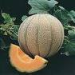

**Image file:** [`fruit-images/01-muskmelon.jpg`](fruit-images/01-muskmelon.jpg)  
**Original image:** [open full size](https://blogger.googleusercontent.com/img/b/R29vZ2xl/AVvXsEgd1rVfy6SQB1vpfzR45RtqjUh68e006YFcUBPNphweZ4ou1Juxw8QElL5YusBqQBer4FxAXBldFkQ6D1Xe2k7j0aVbfJaVFAM-bO_EkVU7DZX7aQrwhG8TkpDh6HX7s5HWTQQ1wqNUOJCe/s1600/musk+melon)

### 2. Banana
**Telugu:** Aarati pandu (ఆరటి పండు)  

**Image file:** [`fruit-images/02-banana.jpg`](fruit-images/02-banana.jpg)  
**Original image:** [open full size](https://blogger.googleusercontent.com/img/b/R29vZ2xl/AVvXsEjYrc5lVkU3fWuqmaOjmiZTdeoFpY005dFXt-1MJaiomYbT-zmRkpNx75GqGM-3Rm-nYjF3ZrnokKBuopoAJvHtYuXOaHa61VHLZWMwFtQJAduAlm-ElM8n7sgaszB-uRh_p1gJKiw8tPj-/s1600/banana)

### 3. Pineapple
**Telugu:** Anasa (అనాస)  
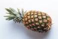

**Image file:** [`fruit-images/03-pineapple.jpg`](fruit-images/03-pineapple.jpg)  
**Original image:** [open full size](https://blogger.googleusercontent.com/img/b/R29vZ2xl/AVvXsEheztA8Yc2_q2g0NvX8SoFHBwHizBzYTZFLaUnY_3q7JE5Ogv83uvQkupTUM5LfhxYh7EdGkGDwq5nIVE8HSKElDYZwjcX8lv7EazJLLFTlhg4LI4-7FsBhDCaKwOYJ_J_xG3t2B1Z5z_yR/s1600/pine+apple)

### 4. Jackfruit
**Telugu:** Panasa pandu (పనస పండు)  
**Image:** none on the source page

### 5. Papaya
**Telugu:** Bobbaya (బొబ్బాయ)  
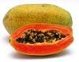

**Image file:** [`fruit-images/05-papaya.jpg`](fruit-images/05-papaya.jpg)  
**Original image:** [open full size](https://blogger.googleusercontent.com/img/b/R29vZ2xl/AVvXsEhrqxL39u_5eBZ_OjWAP78kWiLe6zlvhhmApb0RjNYkhO_LzR76-vtdYQbvrhGOIBKQCuCPlbOTMZr0_la2hTDqgp3pVwLHKvUWjXv1fR9jpa0zBKYrT8zQ3ZW-IJcoRsXRXYJC3aD9jCyb/s1600/papaya)

### 6. Pomegranate
**Telugu:** Danimma (దానిమ్మ)  
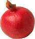

**Image file:** [`fruit-images/06-pomegranate.jpg`](fruit-images/06-pomegranate.jpg)  
**Original image:** [open full size](https://blogger.googleusercontent.com/img/b/R29vZ2xl/AVvXsEgrxXwRG5FdtWspFPktAcY1cBdgqi1y7i4KAIku4JK_E-fmVameJF7rQ6emDoybLG2ERQP-uGvDgHL2Iz9NjQJImA_i55W24Wx8pkwkNqIJixVqvORDPbGHa2A7BQzUHtPV5MrtLG0c9V2V/s1600/pomegranate)

### 7. Date
**Telugu:** Kharjuram (ఖర్జూరం)  
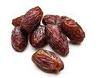

**Image file:** [`fruit-images/07-date.jpg`](fruit-images/07-date.jpg)  
**Original image:** [open full size](https://blogger.googleusercontent.com/img/b/R29vZ2xl/AVvXsEhnSCzvCVHzoafqC12u0AT5MyvDgnl0XQ4KrvBqJRXsO0Ntca49pSDwvC43XEw97aEWnouuMAx2vgHMt6SC9bHPGWmDFpPCppNfP6lwdIER8ohvzSY2XLFe0gGaLeBIUAOt6WoG6uNEvhVi/s1600/dates)

### 8. Berry
**Telugu:** Neredu (నేరేడు)  
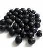

**Image file:** [`fruit-images/08-berry.jpg`](fruit-images/08-berry.jpg)  
**Original image:** [open full size](https://blogger.googleusercontent.com/img/b/R29vZ2xl/AVvXsEgv5czko30aYoUYUzN8klxudlZXEhkehoAuPM3x13DcCavyX0-r6djjfosmNngkvRWKu1Ji8guCFyABQXWmodC3iaeL2NxUZ0s9p3wAI36wEe2qNTDRrYHklpBOStEl56K-eDOZkQ3epj-R/s1600/berry)

### 9. Custard Apple
**Telugu:** Sitaphalam (సీతాఫలం)  
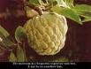

**Image file:** [`fruit-images/09-custard-apple.jpg`](fruit-images/09-custard-apple.jpg)  
**Original image:** [open full size](https://blogger.googleusercontent.com/img/b/R29vZ2xl/AVvXsEgdPZGBMmIQxLnR-d3zkHAGACHquQ-hm61pJKiScJFuPNWzNjbJEjmYSTJS95RS2CQ7hCQoOmvbM-9MSjporX7tOVTa5Wb5vxep5jYZymVt0wawEniaF_ceju0TF5NtwSZytSM3KnVGAvsC/s1600/custard+apple)

### 10. Watermelon
**Telugu:** Puchha kaya (పుచ్చ కాయ)  
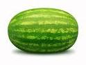

**Image file:** [`fruit-images/10-watermelon.jpg`](fruit-images/10-watermelon.jpg)  
**Original image:** [open full size](https://blogger.googleusercontent.com/img/b/R29vZ2xl/AVvXsEjhPCYn7Yo7Z6wFdMDWkmapyb40dHnpyJI-q0dC66evtOec2Q0zvU6KbUZfLzqfplOCRGOrqkPBrpWy0WT-8wAYNKuaT_2mQMTbuuZauaiwOndz9U7P3E47GkI8LwgXapc6o18zaTp5_dtl/s1600/watermelon)

### 11. Sapodilla
**Telugu:** Sapota (సపోటా)  
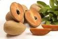

**Image file:** [`fruit-images/11-sapodilla.jpg`](fruit-images/11-sapodilla.jpg)  
**Original image:** [open full size](https://blogger.googleusercontent.com/img/b/R29vZ2xl/AVvXsEiR2XRpIuVvZtfc8rBxySrmyP0dZ2OkmGrF_gw7v1W97PhyUZHved3gwIEzp8TyQBtBptFmBSXI6TIHOYjRu07R2fzap2E5QJ_P40rtWueAlSNT1A9RyTiY_pmMbdplMqBP4w8E-zbV42y1/s1600/sopota)

### 12. Plum
**Telugu:** Regu (రేగు)  
**Image:** none on the source page

### 13. Guava
**Telugu:** Jama (జామ)  
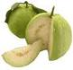

**Image file:** [`fruit-images/13-guava.jpg`](fruit-images/13-guava.jpg)  
**Original image:** [open full size](https://blogger.googleusercontent.com/img/b/R29vZ2xl/AVvXsEid2IQe5CHOzrUks5i8XpKe9GVRXdS9_h_ZkMcaX3YqvHKOAdyux3uvX54aB63qGQquC1tJCOhFJ8QY7JmMCzexIx8dHY97ZaaVJoptOuX6zpBvfyag__KfA5vNsCcBNxqU0q7BfYRDeCni/s1600/guava)

### 14. Grape
**Telugu:** Draksha (ద్రాక్ష)  
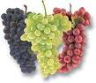

**Image file:** [`fruit-images/14-grape.jpg`](fruit-images/14-grape.jpg)  
**Original image:** [open full size](https://blogger.googleusercontent.com/img/b/R29vZ2xl/AVvXsEjvCBr06R3BFEEsC4-AbvnT-4Ql2hApbAYIUuIRq8Kh2RiRIP8kT46XV0477kFLcRKGFGc7aUbjx0s9Wjf0C_2DSUw_c_XgkSc32zoi9KO2Nz42vMQgEnm8K63FFvaQki0sXGGFPe-Bceax/s1600/grape)

### 15. Bokhara Plum
**Telugu:** Sema Regu (సీమరేగు)  
**Image:** none on the source page

### 16. Mango
**Telugu:** Mamidi (మామిడి)  
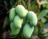

**Image file:** [`fruit-images/16-mango.jpg`](fruit-images/16-mango.jpg)  
**Original image:** [open full size](https://blogger.googleusercontent.com/img/b/R29vZ2xl/AVvXsEhua9DBImPienVZNQrUiLwB-wqbGqpTHYG4oE-lKP6y7uqvuxiZQaeBzI80MQCef45WF_nq-8uBFQB4s8H2BQYieaSnfSTzR_cSoC4FuXImTQbSR24o_mXylv-gvWX9JVvZBSyTyyj-1PH2/s1600/mango)

### 17. Mosambi
**Telugu:** Battaiah (బత్తయ్య)  
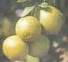

**Image file:** [`fruit-images/17-mosambi.jpg`](fruit-images/17-mosambi.jpg)  
**Original image:** [open full size](https://blogger.googleusercontent.com/img/b/R29vZ2xl/AVvXsEjT-xfcSzMK5dG3kTTEcN-fA4wqQFamqp8jFZEnPhx8gZlHqOvlDI17XG6vUrIrHhmA2O1LtsUTK1g5ZBKIeatbWG5QSUgynIV3qi63tV1xZ-UvdOLtWAd_f62-K0wm9veYU6wmOgc3xB7e/s1600/mosambi)

### 18. Orange
**Telugu:** Narinja (నారింజ)  
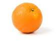

**Image file:** [`fruit-images/18-orange.jpg`](fruit-images/18-orange.jpg)  
**Original image:** [open full size](https://blogger.googleusercontent.com/img/b/R29vZ2xl/AVvXsEj5IhFl-68eMk0KKv5EyqaF2PTTz8r6coPHEoIaBCQEuyrDAG46-gI_RtEG2Tsdd31lkasfHDKsZ-TZ-oCYOPLWepuSb93FJwCvjr6jOweTijUPaaJ8qtlgdxXCk7SaDpJsGMeH1A1N_NmI/s1600/orange)

### 19. Sweet Orange
**Telugu:** Kamala phalam (కమల ఫలం)  
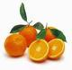

**Image file:** [`fruit-images/19-sweet-orange.jpg`](fruit-images/19-sweet-orange.jpg)  
**Original image:** [open full size](https://blogger.googleusercontent.com/img/b/R29vZ2xl/AVvXsEh6l0C-6EilyJa6GFTpob0o2JDBI128UH9rMi0psAdZNU-BiEp_dQYosysSAkWx3qQK3XYfdjgwTug2ptXfc2Hp0-sXhjx2SMBOpNqrETuRxxKj8XvivZrSdzwV9cHSj5GC74qzj3xuk8YE/s1600/sweet+orange)

### 20. Almond
**Telugu:** Badam (బాదం)  
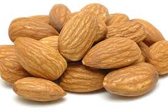

**Image file:** [`fruit-images/20-almond.jpg`](fruit-images/20-almond.jpg)  
**Original image:** [open full size](https://blogger.googleusercontent.com/img/b/R29vZ2xl/AVvXsEgrSB7c66a6q_XQBv-a2xMpEVoQ4dV92g7Tqxq_mFaIIpAnKIcEJjkOZqe2DBOoUi6Lh6hN-gprSYFNIVqHio0vxTdilDT8WJT-lAoH4zcIsGb0sl_uD24_33b7XvH1reLsE0ODs_O96BH-/s1600/almond.jpg)

### 21. Apple
**Telugu:** (సేపు / సేమ రేగు) Sepu/ Sema Regu  
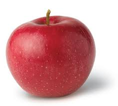

**Image file:** [`fruit-images/21-apple.jpg`](fruit-images/21-apple.jpg)  
**Original image:** [open full size](https://blogger.googleusercontent.com/img/b/R29vZ2xl/AVvXsEie4M66PzYMU-S25VB14OXtAlKKfQg9shVNQQ2Bfak7-9C8vrfovvIPB8ighS7SUvOnrs5y290OLFl6RnUYNlJSf5oO4F8GMiH2qntWbyNHFXo2kbo4JA-g5MisRPPr2eflGdPQ2GRKIL5C/s1600/apple.jpg)

### 22. Apricot
**Telugu:** Seema Badam/ Jallaru Pandu (సీమ బాదం/ జల్లారు పండు)  
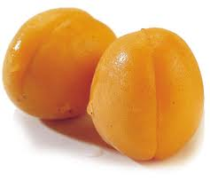

**Image file:** [`fruit-images/22-apricot.jpg`](fruit-images/22-apricot.jpg)  
**Original image:** [open full size](https://blogger.googleusercontent.com/img/b/R29vZ2xl/AVvXsEjhsfcODpZSDRDupzdrQAoYjM_VVrUSNbGbmTICxm9eqwGY5DWtyWqP2yYHe4vkzyKZ9oA2ikePr297ZFi7BrSprGt0HqrxAIglj54ZFhHuZ9_ISDHAbK2Gu4FY8sAA4Po7dDJo4oa-xiBA/s1600/apricot.jpg)

### 23. Blue Berry
**Telugu:** Fall Sa (ఫాల్ సా)  
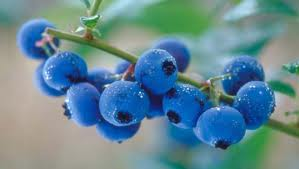

**Image file:** [`fruit-images/23-blue-berry.jpg`](fruit-images/23-blue-berry.jpg)  
**Original image:** [open full size](https://blogger.googleusercontent.com/img/b/R29vZ2xl/AVvXsEhafFnzF8lrY-YDTiH9EXqx4d-3yYhARME3x9_1ESCY_G-73b0XuH0DaalTWW3XczrrBwJR8szoUn0edrzbPvwOT4R2eG0-lSUUGsz3ktTnVCBMmtJ_LsD7QP-FG5szGn7NIF-JajTn163t/s1600/blue+berry.jpg)

### 24. Bullock's Heart
**Telugu:** Rama Phalam (రామా ఫలం)  
**Image:** none on the source page

### 25. Black Currant
**Telugu:** Nalla Kishmish (నల్ల కిష్మిష్)  
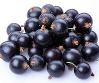

**Image file:** [`fruit-images/25-black-currant.jpg`](fruit-images/25-black-currant.jpg)  
**Original image:** [open full size](https://blogger.googleusercontent.com/img/b/R29vZ2xl/AVvXsEgg7Kj0yOwb-itqSKC78fpVfuj3DArmfa3iBSV8RyX_x3Zc59IcB7LWQ0uvhWWZV6GyvZVD81EN8TjtAIF_fVpHoU2zTeXLfNKK0hSZZ1ZJ4aBkumvuIackFYgyh03MAmOlvsri0ZepgoOZ/s1600/black+current.jpg)

### 26. Bread Fruit
**Telugu:** Seema Panasa (సీమ పనస)  
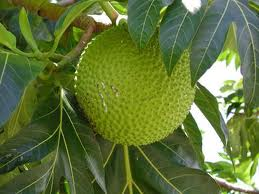

**Image file:** [`fruit-images/26-bread-fruit.jpg`](fruit-images/26-bread-fruit.jpg)  
**Original image:** [open full size](https://blogger.googleusercontent.com/img/b/R29vZ2xl/AVvXsEixiFJmkLdnHJEKQq8iRrumCA1W_n5DjR-0vmZQmjbLy0ady9UzFKJb0hlQ2G98oSm0oAKEGThcLrB9VzlYth0VPcDoyAIaUTQH3qW6VkmI1EqZAlSdit_tQFNqjdHUhxHAwvL2G5YXpohg/s1600/bread+fruit.jpg)

### 27. Cashew Nut
**Telugu:** Jeedi Mamidi (జీడి మామిడి)  
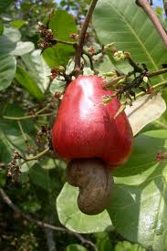

**Image file:** [`fruit-images/27-cashew-nut.jpg`](fruit-images/27-cashew-nut.jpg)  
**Original image:** [open full size](https://blogger.googleusercontent.com/img/b/R29vZ2xl/AVvXsEjxJNEqXyvJPSl0GYLLv7qod2nZzVpaA_itDV7sz2dy2CYefLcHzERQcSRDHahg57ZElfP51ITTl9oORF-r_NqC19VyNJYOhOzy-y35BDmApzmyTeO2_OFKjGtWl_MXCxkp220trOnF7RRQ/s1600/cashew+nut.jpg)

### 28. Cape Goose Berry
**Telugu:** Nela Usiri (నేల ఉసిరి)  
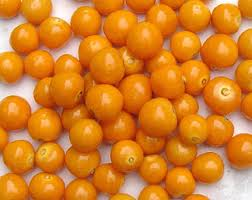

**Image file:** [`fruit-images/28-cape-goose-berry.jpg`](fruit-images/28-cape-goose-berry.jpg)  
**Original image:** [open full size](https://blogger.googleusercontent.com/img/b/R29vZ2xl/AVvXsEhE9D6SePSdiFIADbe9MpO7oy2UQ8DYQ16yTIy5o1cvSCJxrf0i4wleKK6Mqm0M_YUtFOB-I_5_c9Igxg9NeV7KZQ3oPpjApv6SiW9fSesrftjMTpqS7m0Mui13CFHJcZ2Dulx5EonCm1qU/s1600/cape+gooseberry.jpg)

### 29. Citron
**Telugu:** Madi Phalam (మాది ఫలం)  
**Image:** none on the source page

### 30. Currant
**Telugu:** Kishmish (కిష్మిష్)  
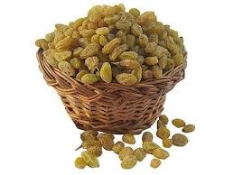

**Image file:** [`fruit-images/30-currant.jpg`](fruit-images/30-currant.jpg)  
**Original image:** [open full size](https://blogger.googleusercontent.com/img/b/R29vZ2xl/AVvXsEgaIA5tR7OHbYoMKiGPxxZFQkfhYGWwyr0SzcCfnOuX3Evj6lXAOsu7WDOPNThE55j5cB8Qa2qvgv9uv1a7DXyPk0VndW9qDJyq33mJOuFd5DiWocC5TAiQzItNutzELewq0Lc0rntM7jKT/s1600/current.jpg)

### 31. Cherries
**Telugu:** Cherry Pandu (చెర్రీ పండు)  
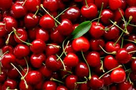

**Image file:** [`fruit-images/31-cherries.jpg`](fruit-images/31-cherries.jpg)  
**Original image:** [open full size](https://blogger.googleusercontent.com/img/b/R29vZ2xl/AVvXsEhmTHhoTN9nHl0wKfMaFveIYcn2yRD8RY_cjzb3yIIctRwPTWKQZXnxbXC6zncZbYDRdPJjVMIi-rDinoqoAEaklNfKnh8XC7PLucqFC5VOKtEAvqVwTni7EBcGdz4Cb1SxLAFODUH7KNb2/s1600/cherries.jpg)

### 32. Figs
**Telugu:** Anjur (అంజూర్)  
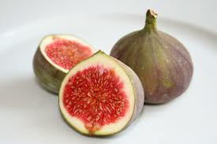

**Image file:** [`fruit-images/32-figs.jpg`](fruit-images/32-figs.jpg)  
**Original image:** [open full size](https://blogger.googleusercontent.com/img/b/R29vZ2xl/AVvXsEjRRMe4DV_DAXagBiegLnmyElhi2uk_O3mj6FHais9Ut8BzsaZpV2s2yh2xZkxegy19kV790R4EU96k_bmGz9CVT7KiMraoN2nUdmquIbEybcNJKSKJghaDQPkwsr4pFM9_qaqiLXFoxH79/s1600/figs.jpg)

### 33. Grapefruit / Shaddock
**Telugu:** Pampar Panasa (పంపర్ పనస)  
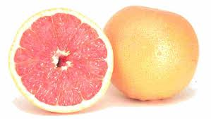

**Image file:** [`fruit-images/33-grapefruit-shaddock.jpg`](fruit-images/33-grapefruit-shaddock.jpg)  
**Original image:** [open full size](https://blogger.googleusercontent.com/img/b/R29vZ2xl/AVvXsEhJb55Fj4K8GzIx-rIQhY3o8D54BXSoyQOAsNDmFLKzxAa4d52fUc4uVIeZAxa5ADHANLUYP0vizakbaNWyPnuWPOokpqYHhPtVBmRzbKTTof3pn3LxwXJdFAV79P7JdgpquHI3rvFJAgVI/s1600/grape+fruit.jpg)

### 34. Goose Berry
**Telugu:** Usiri (ఉసిరి)  
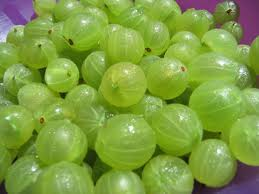

**Image file:** [`fruit-images/34-goose-berry.jpg`](fruit-images/34-goose-berry.jpg)  
**Original image:** [open full size](https://blogger.googleusercontent.com/img/b/R29vZ2xl/AVvXsEi7ziHEX1czlLbG6He2rL4bhseVnC_aH7ASgiJortiISCjvW_793Aj_OTp0khhwCEhGq2Uexep18HbuAtYhvF8dYOIdco5TBx33vZoP25y4XxWK_UjyfaCPOrCfqCYM_DqR0lXOI2nKapyb/s1600/usiri.jpg)

### 35. Hog Plum
**Telugu:** Maredu (మారేడు)  
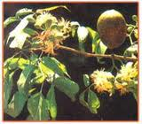

**Image file:** [`fruit-images/35-hog-plum.jpg`](fruit-images/35-hog-plum.jpg)  
**Original image:** [open full size](https://blogger.googleusercontent.com/img/b/R29vZ2xl/AVvXsEiFbWX4ralcr7D9IQgjuLcZRqgPdgNY-YAe5aEkYGbUHhG_PRh5_5pbjYT_aDPx1xs_JaY5AEu7-Z0Zyn2Yku-063XeSEVOGPIztzhv6tmKIEjhQrZuaF0vRWxr47D591XTRBWLgbWgLkJ3/s1600/maredu.jpg)

### 36. Jujube
**Telugu:** Regu (రేగు)  
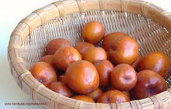

**Image file:** [`fruit-images/36-jujube.jpg`](fruit-images/36-jujube.jpg)  
**Original image:** [open full size](https://blogger.googleusercontent.com/img/b/R29vZ2xl/AVvXsEh-_Z-N75rA3mY0xAmVYjVi6CFXzdnNK-UySJlZ8W1ooP4oehdYKFn__44idFuri4EGg7ytEThoTlOO_IsofSZklqX1eYHl7L1WucnOKUOvm0Wh3imPBfUOyfgmbpMddjWrPPvyNhiPf_lZ/s1600/regu.jpg)

### 37. Lemon
**Telugu:** Pedda Nimma (పెద్ద నిమ్మ)  
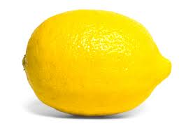

**Image file:** [`fruit-images/37-lemon.jpg`](fruit-images/37-lemon.jpg)  
**Original image:** [open full size](https://blogger.googleusercontent.com/img/b/R29vZ2xl/AVvXsEhPLoZnxaRIJPzgRjrVoM9BcsIkZMxUHaaFr7yPxY0jiYs6lwp4l26jkgpPItvQ2rLLMBgNEPngt_8kxDGyqiMGJzf661MJoKbCkZJybptGgrZYK93Mq-4Za4AEc1dAxkJDs_vTA1OF0AWC/s1600/lemon.jpg)

### 38. Lime
**Telugu:** Nimma (నిమ్మ)  
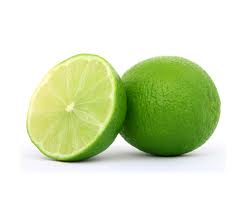

**Image file:** [`fruit-images/38-lime.jpg`](fruit-images/38-lime.jpg)  
**Original image:** [open full size](https://blogger.googleusercontent.com/img/b/R29vZ2xl/AVvXsEg-hcBa6_vc7piq98qkXqgZEAs76I3HdN0tuxh6xpgyy2A4kcOT4yzBx2zCsGzu9wxOAo_5izzx5w2BzAF_osldeHt-tKHrFBus93JH0hw8NR5ZieUEmqe9WG2MnBX0t7xDnYaslw62U52Q/s1600/lime.jpg)

### 39. Loquat
**Telugu:** Lokata Pandu (లొకట పండు)  
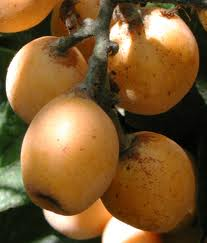

**Image file:** [`fruit-images/39-loquat.jpg`](fruit-images/39-loquat.jpg)  
**Original image:** [open full size](https://blogger.googleusercontent.com/img/b/R29vZ2xl/AVvXsEgAj2l_QRqQtFdAvlDOfudkZGJVsy6olTPcxenxO1p8otJPjfBEBoporKwMO2wy16FDNS54zzwX-zAXD9yjI1-n41msGL_g60L1Fol5PeAKORq5CTDWeQ3khFodiPI8nHFSU7Y44T3oT1K9/s1600/loquat.jpg)

### 40. Litchi
**Telugu:** Litchi Pandu (లిచి పండు)  
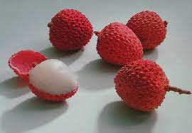

**Image file:** [`fruit-images/40-litchi.jpg`](fruit-images/40-litchi.jpg)  
**Original image:** [open full size](https://blogger.googleusercontent.com/img/b/R29vZ2xl/AVvXsEhvYg5bNgbjCpA5o4-8DL36VAxM_EUQV_rv0mWLrvIR0adeGtsMmEK_dQ5S1Medm5XBW8k6naARgPpNISTTfcsWzcLi433t6MFpghDbEookLK3DQdCRGIT7ylsTtX7HgGinMLQJ53ysQV3M/s1600/litchi.jpg)

### 41. Olives
**Telugu:** Olive (ఆలివ్)  
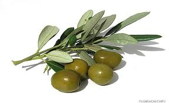

**Image file:** [`fruit-images/41-olives.jpg`](fruit-images/41-olives.jpg)  
**Original image:** [open full size](https://blogger.googleusercontent.com/img/b/R29vZ2xl/AVvXsEhYLU_MtU8lpVyun677fD4S5avzXsckh8Kydiq34SnTNDRvOQ_wa0iKqR1R-KZi6xgrDFx32OY_iTSYfsWHRWvMIZku37eNP1Mry-L279CQQR_xopoljsHmVYpmutcE2vXukrXbAmqOuHwA/s1600/olives.jpg)

### 42. Palmyrah
**Telugu:** Thati (తాటి)  
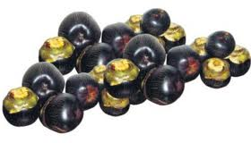

**Image file:** [`fruit-images/42-palmyrah.jpg`](fruit-images/42-palmyrah.jpg)  
**Original image:** [open full size](https://blogger.googleusercontent.com/img/b/R29vZ2xl/AVvXsEiTpIWbTu27qiO3ZEzxvuVMtP4lRXE__UpM_sEHDJok87hPs1q75dN-eh0HqwSIyYMBWqaX19vqc8eyhywVC3Xfhw0iyzUPke4R1EtRBH2M6owq5SjfHG95WwRthlQlaWKe7lUytkttX5zH/s1600/palmyrah.jpg)

### 43. Tender Palm
**Telugu:** Thati Munjelu (తాటి ముంజెలు)  
**Image:** none on the source page

### 44. Tender Palm Shoots
**Telugu:** Tegalu (తెగలు)  
**Image:** none on the source page

### 45. Pear
**Telugu:** Peri pandu (పెరి పండు)  
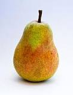

**Image file:** [`fruit-images/45-pear.jpg`](fruit-images/45-pear.jpg)  
**Original image:** [open full size](https://blogger.googleusercontent.com/img/b/R29vZ2xl/AVvXsEjlrIIjQmvaQObujfW2j95NYrx9f-tiX0u8MDDpTDA7-Mj8yXpwSqhK4mpDylVN4KbaFSKEeQb_NzbAfQ7bQcwYS3hCLx1cRS4qklXZDItRoCBjGzzhyf1F0HU0vd8HU-C4xlOf1g1btCeY/s1600/pear.jpg)

### 46. Peach
**Telugu:** Peach pandu (పీచ్ పండు)  
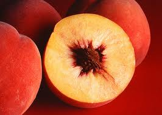

**Image file:** [`fruit-images/46-peach.jpg`](fruit-images/46-peach.jpg)  
**Original image:** [open full size](https://blogger.googleusercontent.com/img/b/R29vZ2xl/AVvXsEiNkXzJ05Bj44AgRLxLias_1_TzWI6RptAdYsQSjoGnehGiyw-nl6tiJWLHFZzKMjdUffXthj3XZg1hPKIXQCDnNEqmSS7cuB4f5vmLRIOe9ZVowvQrhhKK0miaH-v9WBJg4z55DLQoC6gL/s1600/peach.jpg)

### 47. Pitted Fruit/Stone Fruit/Wood Apple
**Telugu:** Velaga Pandu (వెలగ పండు)  
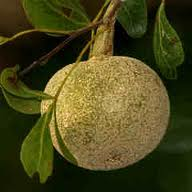

**Image file:** [`fruit-images/47-pitted-fruit-stone-fruit-wood-apple.jpg`](fruit-images/47-pitted-fruit-stone-fruit-wood-apple.jpg)  
**Original image:** [open full size](https://blogger.googleusercontent.com/img/b/R29vZ2xl/AVvXsEjwiTWhF6ySOJeMdr-TECnMkk7wV8sr3JWBBWyKUfw2YGPiiwtpHBHcrVIr8ZOmyEQHXDBtBZoDScChJeKNUBnbnKrnPRPjA3M2-I8QYTiY17wCnn6bhu_u1xjxYXmLAmdTaAIGlmQP4x1W/s1600/wood+apple.jpg)

### 48. Plum
**Telugu:** All Bokara (అల్ బొకార)  
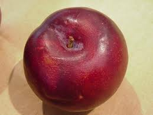

**Image file:** [`fruit-images/48-plum.jpg`](fruit-images/48-plum.jpg)  
**Original image:** [open full size](https://blogger.googleusercontent.com/img/b/R29vZ2xl/AVvXsEi8hWTiuxl4lGVcQQ5ZvAmLHlo8WRO06EYdMEoaPnwO3dT6Y5qcnnmPLsk13X8-h9-3eNNN8i8SP87LG7b447mWjmVXbbPt16srurdz7l1GYR22c1rZMOLg3K-Is5BHyrncW8WhikNNTS94/s1600/plum.jpg)

### 49. Prunes
**Telugu:** Prunes (ప్రున్స్)  
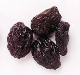

**Image file:** [`fruit-images/49-prunes.jpg`](fruit-images/49-prunes.jpg)  
**Original image:** [open full size](https://blogger.googleusercontent.com/img/b/R29vZ2xl/AVvXsEhlomSEd7ZexJiwxEdPcoAR7Bw6WmjZoaEpisoLamuBpi2WIUmlAIc6yyMNwOGqynFiErBXHGQqqqhYI8apdxPcU4oFJ07BkHu2wUxn-eyGJkswBih2QeXFxgZH8fiDrIiZc4E2-ZFJZX5B/s1600/prunes.jpg)

### 50. Raspberries
**Telugu:** Rasberries (రాస్ బెర్రీస్)  
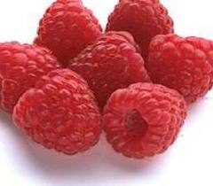

**Image file:** [`fruit-images/50-raspberries.jpg`](fruit-images/50-raspberries.jpg)  
**Original image:** [open full size](https://blogger.googleusercontent.com/img/b/R29vZ2xl/AVvXsEiQ8NpEBnpdWhrsvML_s6rrrgHD3evUXjlF9_mRxhyphenhyphen3jwf6NszZjwzOfEl6i1YLbwvKCcO1oZnHUV8-R6ewBTrRXb1HLI1-rQGPj3O884Pw7T2F2d4afDSNXQI4a9N5VbEG4K_IebvHGfs7/s1600/rasberries.jpg)

### 51. Raisin
**Telugu:** Endu Draksha (ఎండు ద్రాక్ష)  
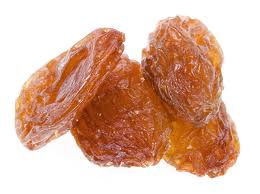

**Image file:** [`fruit-images/51-raisin.jpg`](fruit-images/51-raisin.jpg)  
**Original image:** [open full size](https://blogger.googleusercontent.com/img/b/R29vZ2xl/AVvXsEhpMRWeaAysWluFbY-dOZlmzGdC1sIoZ0gH3YWH7FqoOHvCGG7dQ7vjvkL11cUTboeC69-I7wa93_mmersJoku6XIyrDH4jyZ4Ges1XHBS0vjR-p0JfEbwe2MzP_i4cMOBrwNb6CDYhzYR3/s1600/raisin.jpg)

### 52. Sugarcane
**Telugu:** Cheruku Gada (చెరుకు గడ)  
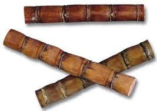

**Image file:** [`fruit-images/52-sugarcane.jpg`](fruit-images/52-sugarcane.jpg)  
**Original image:** [open full size](https://blogger.googleusercontent.com/img/b/R29vZ2xl/AVvXsEgBD6smjNK7tNV-_r9pTqmuxs8k9iDwktfwh9rKPl2k42TORQw595HNVfkAhbxiiQQ2bdttOeSpaY4sEreLupUD4TteNhPu3aTjfHhQDASr9n-t0XqRCp71Ocbi3LOGBHQEAS9qTuWIzZNq/s1600/sugar+cane.jpg)

### 53. Strawberry
**Telugu:** Straw Berry (straw బెర్రీ)  
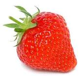

**Image file:** [`fruit-images/53-strawberry.jpg`](fruit-images/53-strawberry.jpg)  
**Original image:** [open full size](https://blogger.googleusercontent.com/img/b/R29vZ2xl/AVvXsEhXKXBmAzl26QyhEgT3Ex15I0dFJwY72uK1aGofg0tDOz1Ru29b0uAZy9fTeoCgEzZoJdlyMF1vjIHhj0jVZ37rh2H8G80zpPgZ227JIiT5QIuGe0zZAvxmOd2N9Qk7uKrg8cqp25Uvgztn/s1600/straw+berry.jpg)

### 54. Wild Date fruit
**Telugu:** Etha Pandu (ఈత పండు)  
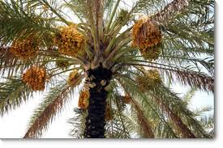

**Image file:** [`fruit-images/54-wild-date-fruit.jpg`](fruit-images/54-wild-date-fruit.jpg)  
**Original image:** [open full size](https://blogger.googleusercontent.com/img/b/R29vZ2xl/AVvXsEhFcvXxx8YkBvcFwylk6DwJLi85w_4P-aH9FKk0y9_MVqA2iFYMlESakdHZND1kurw6Vn9mbQG0H-R1YB8aw9gziel-0PCzSlQNsS2K3gB4jiseW4ErA67cthGdxlVpZ0mfJby3py7Ilare/s1600/wild+date+fruit.jpg)

## Notes

- Total **54 fruits**: **47 with images** and **7 without images** on the source page.
- Items without images: **Jackfruit** — Panasa pandu (పనస పండు); **Plum** — Regu (రేగు); **Bokhara Plum** — Sema Regu (సీమరేగు); **Bullock's Heart** — Rama Phalam (రామా ఫలం); **Citron** — Madi Phalam (మాది ఫలం); **Tender Palm** — Thati Munjelu (తాటి ముంజెలు); **Tender Palm Shoots** — Tegalu (తెగలు).
- **Plum** appears twice: #12 *Regu (రేగు)* and #48 *All Bokara (అల్ బొకార)*.
- This file is independent of `vegetables-english-telugu.md` and `spices-english-telugu.md`; the lists are **not merged**.