# Spice Names in English & Telugu — with Images

**Source:** [Common Spices Name in Telugu & English (with pictures)](https://www.toolsnepal.com/common-spices-name-in-telugu-english-with-pictures/)  
**Extracted:** 2026-11-01  
**Total items:** 65 — all with images  
**Images folder:** [`spice-images/`](spice-images/) (all downloaded locally)

> Telugu names follow the source page. Obvious English typos and spacing errors have been corrected (for example, *Fenugreek seeds* → *Fenugreek Seeds*). This is a separate list from the vegetable list and is not merged with it.

## Quick reference

| # | English | Telugu | Image |
|---:|---|---|---|
| 1 | Alkanet Root | ఆల్కనెట్ రూట్ | [Image](spice-images/01-alkanet-root.jpg) · [Source](https://i0.wp.com/i.zookti.com/common-spices/alkanet-root.jpg?w=720&quality=90&strip=all&ssl=1) |
| 2 | Amchoor | ఆమ్చూర్ | [Image](spice-images/02-amchoor.jpg) · [Source](https://i0.wp.com/i.zookti.com/common-spices/amchoor.jpg?w=720&quality=90&strip=all&ssl=1) |
| 3 | Asafoetida | ఇంగువ | [Image](spice-images/03-asafoetida.jpg) · [Source](https://i0.wp.com/i.zookti.com/common-spices/asafoetida.jpg?w=720&quality=90&strip=all&ssl=1) |
| 4 | Basil Seeds | తులసి విత్తనాలు | [Image](spice-images/04-basil-seeds.jpg) · [Source](https://i0.wp.com/i.zookti.com/dry-fruits/basil-seeds.jpg?w=720&quality=90&strip=all&ssl=1) |
| 5 | Black Cardamom | బ్లాక్ ఏలకులు | [Image](spice-images/05-black-cardamom.jpg) · [Source](https://i0.wp.com/i.zookti.com/common-spices/black-cardamom.jpg?w=720&quality=90&strip=all&ssl=1) |
| 6 | Black Cumin Seeds | నల్ల జీలకర్ర విత్తనాలు | [Image](spice-images/06-black-cumin-seeds.jpg) · [Source](https://i0.wp.com/i.zookti.com/common-spices/black-cumin-seeds.jpg?w=720&quality=90&strip=all&ssl=1) |
| 7 | Black Pepper | నల్ల మిరియాలు | [Image](spice-images/07-black-pepper.jpg) · [Source](https://i0.wp.com/i.zookti.com/common-spices/black-pepper.jpg?w=720&quality=90&strip=all&ssl=1) |
| 8 | Black Salt | నల్ల ఉప్పు | [Image](spice-images/08-black-salt.jpg) · [Source](https://i0.wp.com/i.zookti.com/common-spices/black-salt.jpg?w=720&quality=90&strip=all&ssl=1) |
| 9 | Black Stone Flower | బ్లాక్ స్టోన్ ఫ్లవర్ | [Image](spice-images/09-black-stone-flower.jpg) · [Source](https://i0.wp.com/i.zookti.com/common-spices/black-stone-flower.jpg?w=720&quality=90&strip=all&ssl=1) |
| 10 | Bouquet Garni | బొకే గార్ని | [Image](spice-images/10-bouquet-garni.jpg) · [Source](https://i0.wp.com/i.zookti.com/common-spices/bouquet-garni.jpg?w=720&quality=90&strip=all&ssl=1) |
| 11 | Caraway Seeds | కారవే విత్తనాలు | [Image](spice-images/11-caraway-seeds.jpg) · [Source](https://i0.wp.com/i.zookti.com/common-spices/caraway-seeds.jpg?w=720&quality=90&strip=all&ssl=1) |
| 12 | Celery Seeds | సెలెరీ విత్తనాలు | [Image](spice-images/12-celery-seeds.jpg) · [Source](https://i0.wp.com/i.zookti.com/common-spices/celery-seeds.jpg?w=720&quality=90&strip=all&ssl=1) |
| 13 | Chilli Powder | కారం పొడి | [Image](spice-images/13-chilli-powder.jpg) · [Source](https://i0.wp.com/i.zookti.com/common-spices/chilli-powder.jpg?w=720&quality=90&strip=all&ssl=1) |
| 14 | Cinnamon | దాల్చిన చెక్క | [Image](spice-images/14-cinnamon.jpg) · [Source](https://i0.wp.com/i.zookti.com/common-spices/cinnamon.jpg?w=720&quality=90&strip=all&ssl=1) |
| 15 | Cloves | లవంగాలు | [Image](spice-images/15-cloves.jpg) · [Source](https://i0.wp.com/i.zookti.com/common-spices/cloves.jpg?w=720&quality=90&strip=all&ssl=1) |
| 16 | Coriander Leaves or Cilantro | కొత్తిమీర లేదా కొత్తిమీర | [Image](spice-images/16-coriander-leaves-or-cilantro.jpg) · [Source](https://i0.wp.com/i.zookti.com/common-spices/coriander-leaves-or-cilantro.jpg?w=720&quality=90&strip=all&ssl=1) |
| 17 | Coriander Seeds and Coriander Powder | కొత్తిమీర గింజలు మరియు కొత్తిమీర పొడి | [Image](spice-images/17-coriander-seeds-and-coriander-powder.jpg) · [Source](https://i0.wp.com/i.zookti.com/common-spices/coriander-seeds-and-coriander-powder.jpg?w=720&quality=90&strip=all&ssl=1) |
| 18 | Cumin Seeds and Cumin Powder | జీలకర్ర గింజలు మరియు జీలకర్ర పొడి | [Image](spice-images/18-cumin-seeds-and-cumin-powder.jpg) · [Source](https://i0.wp.com/i.zookti.com/common-spices/cumin-seeds-and-cumin-powder.jpg?w=720&quality=90&strip=all&ssl=1) |
| 19 | Curry Leaves and Curry Powder | కరివేపాకు మరియు కరివేపాకు పొడి | [Image](spice-images/19-curry-leaves-and-curry-powder.jpg) · [Source](https://i0.wp.com/i.zookti.com/common-spices/curry-leaves-and-curry-powder.jpg?w=720&quality=90&strip=all&ssl=1) |
| 20 | Dry Fenugreek Leaves | పొడి మెంతి ఆకులు | [Image](spice-images/20-dry-fenugreek-leaves.jpg) · [Source](https://i0.wp.com/i.zookti.com/common-spices/dry-fenugreek-leaves.jpg?w=720&quality=90&strip=all&ssl=1) |
| 21 | Dry Garlic Powder | పొడి వెల్లుల్లి పొడి | [Image](spice-images/21-dry-garlic-powder.jpg) · [Source](https://i0.wp.com/i.zookti.com/common-spices/dry-garlic-powder.jpg?w=720&quality=90&strip=all&ssl=1) |
| 22 | Dry Ginger Powder | పొడి అల్లం పొడి | [Image](spice-images/22-dry-ginger-powder.jpg) · [Source](https://i0.wp.com/i.zookti.com/common-spices/dry-ginger-powder.jpg?w=720&quality=90&strip=all&ssl=1) |
| 23 | Dry Pomegranate Seeds | పొడి దానిమ్మ గింజలు | [Image](spice-images/23-dry-pomegranate-seeds.jpg) · [Source](https://i0.wp.com/i.zookti.com/common-spices/dry-pomegranate-seeds.jpg?w=720&quality=90&strip=all&ssl=1) |
| 24 | Fennel Seeds | ఫెన్నెల్ విత్తనాలు | [Image](spice-images/24-fennel-seeds.jpg) · [Source](https://i0.wp.com/i.zookti.com/dry-fruits/fennel-seeds.jpg?w=720&quality=90&strip=all&ssl=1) |
| 25 | Fenugreek Seeds | మెంతులు | [Image](spice-images/25-fenugreek-seeds.jpg) · [Source](https://i0.wp.com/i.zookti.com/common-spices/fenugreek-seeds.jpg?w=720&quality=90&strip=all&ssl=1) |
| 26 | Garcinia Cambogia | గార్సినియా కంబోజియా | [Image](spice-images/26-garcinia-cambogia.jpg) · [Source](https://i0.wp.com/i.zookti.com/common-spices/garcinia-cambogia.jpg?w=720&quality=90&strip=all&ssl=1) |
| 27 | Garlic | వెల్లుల్లి | [Image](spice-images/27-garlic.jpg) · [Source](https://i0.wp.com/i.zookti.com/common-spices/garlic.jpg?w=720&quality=90&strip=all&ssl=1) |
| 28 | Ginger | అల్లం | [Image](spice-images/28-ginger.jpg) · [Source](https://i0.wp.com/i.zookti.com/common-spices/ginger.jpg?w=720&quality=90&strip=all&ssl=1) |
| 29 | Green Cardamom | గ్రీన్ ఏలకులు | [Image](spice-images/29-green-cardamom.jpg) · [Source](https://i0.wp.com/i.zookti.com/common-spices/green-cardamom.jpg?w=720&quality=90&strip=all&ssl=1) |
| 30 | Green Chilli | పచ్చి మిర్చి | [Image](spice-images/30-green-chilli.jpg) · [Source](https://i0.wp.com/i.zookti.com/common-spices/green-chilli.jpg?w=720&quality=90&strip=all&ssl=1) |
| 31 | Gum Tragacanth | గమ్ ట్రాగాకాంత్ | [Image](spice-images/31-gum-tragacanth.jpg) · [Source](https://i0.wp.com/i.zookti.com/common-spices/gum-tragacanth.jpg?w=720&quality=90&strip=all&ssl=1) |
| 32 | Holy Basil | పవిత్ర తులసి | [Image](spice-images/32-holy-basil.jpg) · [Source](https://i0.wp.com/i.zookti.com/common-spices/holy-basil.jpg?w=720&quality=90&strip=all&ssl=1) |
| 33 | Hot Spices | వేడి మసాలా దినుసులు | [Image](spice-images/33-hot-spices.jpg) · [Source](https://i0.wp.com/i.zookti.com/common-spices/hot-spices.jpg?w=720&quality=90&strip=all&ssl=1) |
| 34 | Indian Bay Leaf | ఇండియన్ బే లీఫ్ | [Image](spice-images/34-indian-bay-leaf.jpg) · [Source](https://i0.wp.com/i.zookti.com/common-spices/indian-bay-leaf.jpg?w=720&quality=90&strip=all&ssl=1) |
| 35 | Indian Gooseberry | భారతీయ గూస్బెర్రీ | [Image](spice-images/35-indian-gooseberry.jpg) · [Source](https://i0.wp.com/i.zookti.com/common-spices/indian-gooseberry.jpg?w=720&quality=90&strip=all&ssl=1) |
| 36 | Inknut | ఇంక్నట్ | [Image](spice-images/36-inknut.jpg) · [Source](https://i0.wp.com/i.zookti.com/common-spices/inknut.jpg?w=720&quality=90&strip=all&ssl=1) |
| 37 | Kokum Rinds | కోకుమ్ రిండ్స్ | [Image](spice-images/37-kokum-rinds.jpg) · [Source](https://i0.wp.com/i.zookti.com/common-spices/kokum-rinds.jpg?w=720&quality=90&strip=all&ssl=1) |
| 38 | Licorice Powder | లైకోరైస్ పౌడర్ | [Image](spice-images/38-licorice-powder.jpg) · [Source](https://i0.wp.com/i.zookti.com/common-spices/licorice-powder.jpg?w=720&quality=90&strip=all&ssl=1) |
| 39 | Lime | నిమ్మకాయ | [Image](spice-images/39-lime.jpeg) · [Source](https://i0.wp.com/i.zookti.com/fruits/lime.jpeg?w=720&quality=90&strip=all&ssl=1) |
| 40 | Long Pepper | లాంగ్ పెప్పర్ | [Image](spice-images/40-long-pepper.jpg) · [Source](https://i0.wp.com/i.zookti.com/common-spices/long-pepper.jpg?w=720&quality=90&strip=all&ssl=1) |
| 41 | Mace | జాపత్రి | [Image](spice-images/41-mace.jpg) · [Source](https://i0.wp.com/i.zookti.com/common-spices/mace.jpg?w=720&quality=90&strip=all&ssl=1) |
| 42 | Marjoram | మార్జోరామ్ | [Image](spice-images/42-marjoram.jpg) · [Source](https://i0.wp.com/i.zookti.com/common-spices/marjoram.jpg?w=720&quality=90&strip=all&ssl=1) |
| 43 | Mint | పుదీనా | [Image](spice-images/43-mint.jpg) · [Source](https://i0.wp.com/i.zookti.com/common-spices/mint.jpg?w=720&quality=90&strip=all&ssl=1) |
| 44 | Mustard Seeds | ఆవ గింజలు | [Image](spice-images/44-mustard-seeds.jpg) · [Source](https://i0.wp.com/i.zookti.com/common-spices/mustard-seeds.jpg?w=720&quality=90&strip=all&ssl=1) |
| 45 | Nigella Seeds | నిగెల్లా విత్తనాలు | [Image](spice-images/45-nigella-seeds.jpg) · [Source](https://i0.wp.com/i.zookti.com/common-spices/nigella-seeds.jpg?w=720&quality=90&strip=all&ssl=1) |
| 46 | Nutmeg | జాజికాయ | [Image](spice-images/46-nutmeg.jpg) · [Source](https://i0.wp.com/i.zookti.com/common-spices/nutmeg.jpg?w=720&quality=90&strip=all&ssl=1) |
| 47 | Oregano | ఒరేగానో | [Image](spice-images/47-oregano.jpg) · [Source](https://i0.wp.com/i.zookti.com/common-spices/oregano.jpg?w=720&quality=90&strip=all&ssl=1) |
| 48 | Paprika | మిరపకాయ | [Image](spice-images/48-paprika.jpg) · [Source](https://i0.wp.com/i.zookti.com/common-spices/paprika.jpg?w=720&quality=90&strip=all&ssl=1) |
| 49 | Peanuts | వేరుశెనగ | [Image](spice-images/49-peanuts.jpg) · [Source](https://i0.wp.com/i.zookti.com/common-spices/peanuts.jpg?w=720&quality=90&strip=all&ssl=1) |
| 50 | Poppy Seeds | గసగసాలు | [Image](spice-images/50-poppy-seeds.jpg) · [Source](https://i0.wp.com/i.zookti.com/common-spices/poppy-seeds.jpg?w=720&quality=90&strip=all&ssl=1) |
| 51 | Red Chilli | ఎర్ర మిరపకాయ | [Image](spice-images/51-red-chilli.jpg) · [Source](https://i0.wp.com/i.zookti.com/common-spices/red-chilli.jpg?w=720&quality=90&strip=all&ssl=1) |
| 52 | Rock Salt | కల్లు ఉప్పు | [Image](spice-images/52-rock-salt.jpg) · [Source](https://i0.wp.com/i.zookti.com/common-spices/rock-salt.jpg?w=720&quality=90&strip=all&ssl=1) |
| 53 | Rosemary | రోజ్మేరీ | [Image](spice-images/53-rosemary.jpg) · [Source](https://i0.wp.com/i.zookti.com/common-spices/rosemary.jpg?w=720&quality=90&strip=all&ssl=1) |
| 54 | Saffron | కుంకుమపువ్వు | [Image](spice-images/54-saffron.jpg) · [Source](https://i0.wp.com/i.zookti.com/common-spices/saffron.jpg?w=720&quality=90&strip=all&ssl=1) |
| 55 | Salt | ఉప్పు | [Image](spice-images/55-salt.jpg) · [Source](https://i0.wp.com/i.zookti.com/common-spices/salt.jpg?w=720&quality=90&strip=all&ssl=1) |
| 56 | Sesame Seeds | నువ్వు గింజలు | [Image](spice-images/56-sesame-seeds.jpg) · [Source](https://i0.wp.com/i.zookti.com/common-spices/sesame-seeds.jpg?w=720&quality=90&strip=all&ssl=1) |
| 57 | Sichuan Pepper | సిచువాన్ పెప్పర్ | [Image](spice-images/57-sichuan-pepper.jpg) · [Source](https://i0.wp.com/i.zookti.com/common-spices/sichuan-pepper.jpg?w=720&quality=90&strip=all&ssl=1) |
| 58 | Star Anise | స్టార్ సోంపు | [Image](spice-images/58-star-anise.jpg) · [Source](https://i0.wp.com/i.zookti.com/common-spices/star-anise.jpg?w=720&quality=90&strip=all&ssl=1) |
| 59 | Tamarind | చింతపండు | [Image](spice-images/59-tamarind.jpg) · [Source](https://i0.wp.com/i.zookti.com/common-spices/tamarind.jpg?w=720&quality=90&strip=all&ssl=1) |
| 60 | Tarragon | టార్రాగన్ | [Image](spice-images/60-tarragon.jpg) · [Source](https://i0.wp.com/i.zookti.com/common-spices/tarragon.jpg?w=720&quality=90&strip=all&ssl=1) |
| 61 | Thyme | థైమ్ | [Image](spice-images/61-thyme.jpg) · [Source](https://i0.wp.com/i.zookti.com/common-spices/thyme.jpg?w=720&quality=90&strip=all&ssl=1) |
| 62 | Turmeric | పసుపు | [Image](spice-images/62-turmeric.jpg) · [Source](https://i0.wp.com/i.zookti.com/common-spices/turmeric.jpg?w=720&quality=90&strip=all&ssl=1) |
| 63 | Vinegar | వెనిగర్ | [Image](spice-images/63-vinegar.jpg) · [Source](https://i0.wp.com/i.zookti.com/common-spices/vinegar.jpg?w=720&quality=90&strip=all&ssl=1) |
| 64 | White Peppercorns | వైట్ పెప్పర్ కార్న్స్ | [Image](spice-images/64-white-peppercorns.jpg) · [Source](https://i0.wp.com/i.zookti.com/common-spices/white-peppercorns.jpg?w=720&quality=90&strip=all&ssl=1) |
| 65 | Yellow Mustard Seed | పసుపు ఆవాలు | [Image](spice-images/65-yellow-mustard-seed.jpg) · [Source](https://i0.wp.com/i.zookti.com/common-spices/yellow-mustard-seed.jpg?w=720&quality=90&strip=all&ssl=1) |

## Gallery

### 1. Alkanet Root
**Telugu:** ఆల్కనెట్ రూట్  
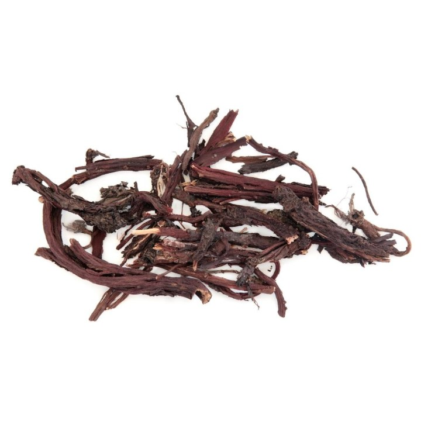

**Image file:** [`spice-images/01-alkanet-root.jpg`](spice-images/01-alkanet-root.jpg)  
**Original image:** [open full size](https://i0.wp.com/i.zookti.com/common-spices/alkanet-root.jpg?w=720&quality=90&strip=all&ssl=1)

### 2. Amchoor
**Telugu:** ఆమ్చూర్  
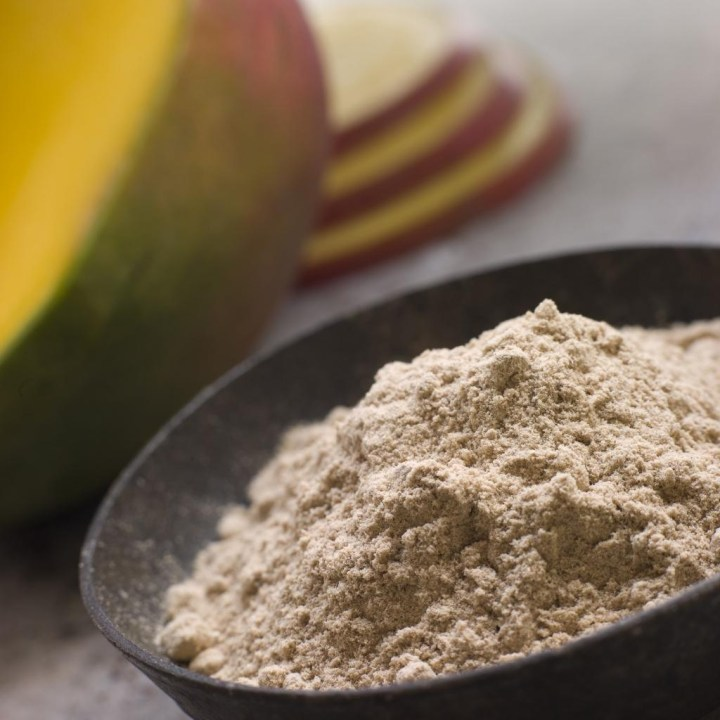

**Image file:** [`spice-images/02-amchoor.jpg`](spice-images/02-amchoor.jpg)  
**Original image:** [open full size](https://i0.wp.com/i.zookti.com/common-spices/amchoor.jpg?w=720&quality=90&strip=all&ssl=1)

### 3. Asafoetida
**Telugu:** ఇంగువ  
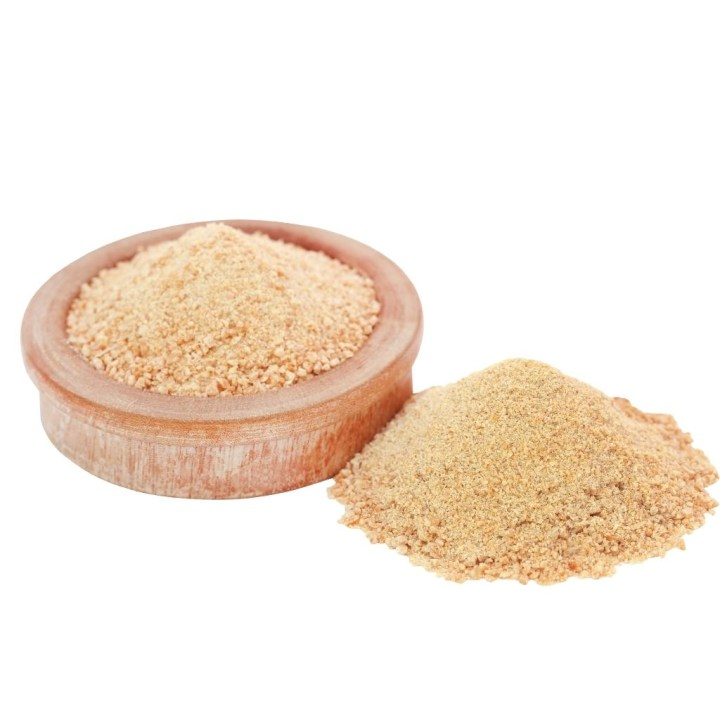

**Image file:** [`spice-images/03-asafoetida.jpg`](spice-images/03-asafoetida.jpg)  
**Original image:** [open full size](https://i0.wp.com/i.zookti.com/common-spices/asafoetida.jpg?w=720&quality=90&strip=all&ssl=1)

### 4. Basil Seeds
**Telugu:** తులసి విత్తనాలు  
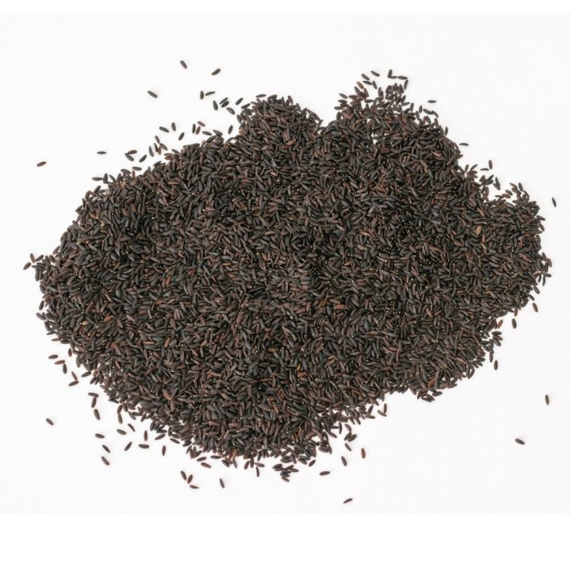

**Image file:** [`spice-images/04-basil-seeds.jpg`](spice-images/04-basil-seeds.jpg)  
**Original image:** [open full size](https://i0.wp.com/i.zookti.com/dry-fruits/basil-seeds.jpg?w=720&quality=90&strip=all&ssl=1)

### 5. Black Cardamom
**Telugu:** బ్లాక్ ఏలకులు  
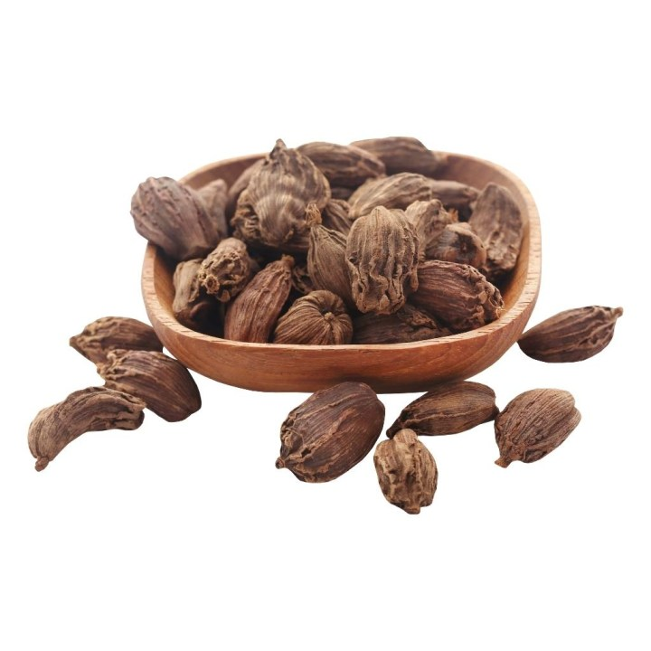

**Image file:** [`spice-images/05-black-cardamom.jpg`](spice-images/05-black-cardamom.jpg)  
**Original image:** [open full size](https://i0.wp.com/i.zookti.com/common-spices/black-cardamom.jpg?w=720&quality=90&strip=all&ssl=1)

### 6. Black Cumin Seeds
**Telugu:** నల్ల జీలకర్ర విత్తనాలు  

**Image file:** [`spice-images/06-black-cumin-seeds.jpg`](spice-images/06-black-cumin-seeds.jpg)  
**Original image:** [open full size](https://i0.wp.com/i.zookti.com/common-spices/black-cumin-seeds.jpg?w=720&quality=90&strip=all&ssl=1)

### 7. Black Pepper
**Telugu:** నల్ల మిరియాలు  
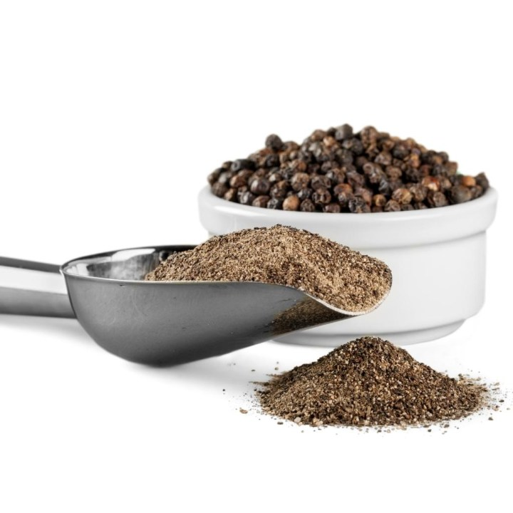

**Image file:** [`spice-images/07-black-pepper.jpg`](spice-images/07-black-pepper.jpg)  
**Original image:** [open full size](https://i0.wp.com/i.zookti.com/common-spices/black-pepper.jpg?w=720&quality=90&strip=all&ssl=1)

### 8. Black Salt
**Telugu:** నల్ల ఉప్పు  
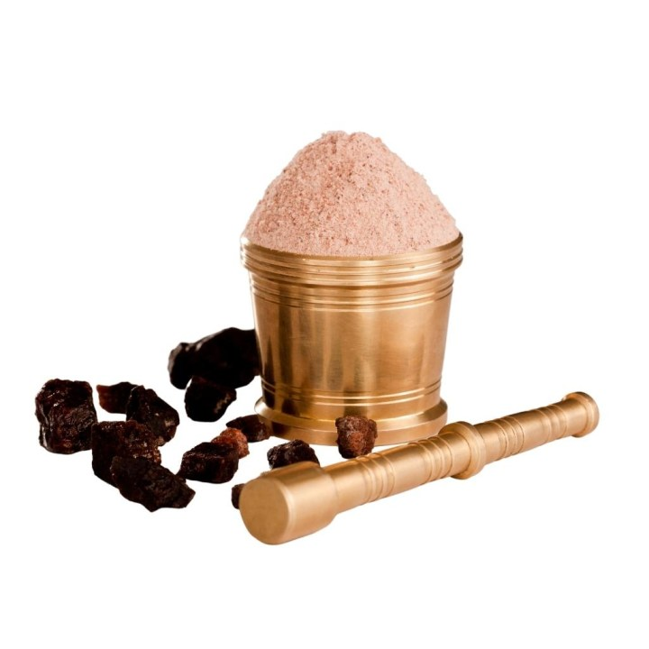

**Image file:** [`spice-images/08-black-salt.jpg`](spice-images/08-black-salt.jpg)  
**Original image:** [open full size](https://i0.wp.com/i.zookti.com/common-spices/black-salt.jpg?w=720&quality=90&strip=all&ssl=1)

### 9. Black Stone Flower
**Telugu:** బ్లాక్ స్టోన్ ఫ్లవర్  
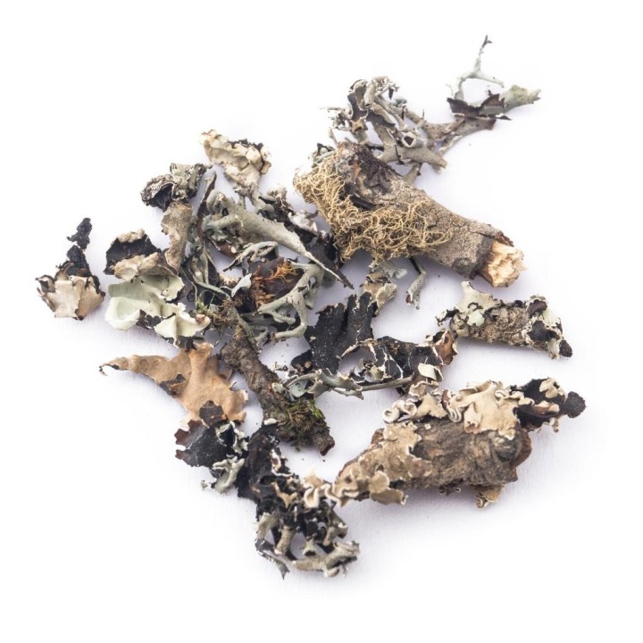

**Image file:** [`spice-images/09-black-stone-flower.jpg`](spice-images/09-black-stone-flower.jpg)  
**Original image:** [open full size](https://i0.wp.com/i.zookti.com/common-spices/black-stone-flower.jpg?w=720&quality=90&strip=all&ssl=1)

### 10. Bouquet Garni
**Telugu:** బొకే గార్ని  
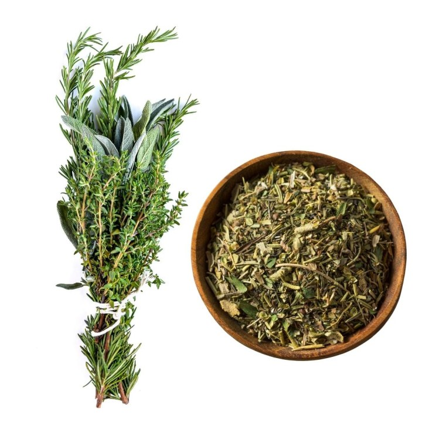

**Image file:** [`spice-images/10-bouquet-garni.jpg`](spice-images/10-bouquet-garni.jpg)  
**Original image:** [open full size](https://i0.wp.com/i.zookti.com/common-spices/bouquet-garni.jpg?w=720&quality=90&strip=all&ssl=1)

### 11. Caraway Seeds
**Telugu:** కారవే విత్తనాలు  
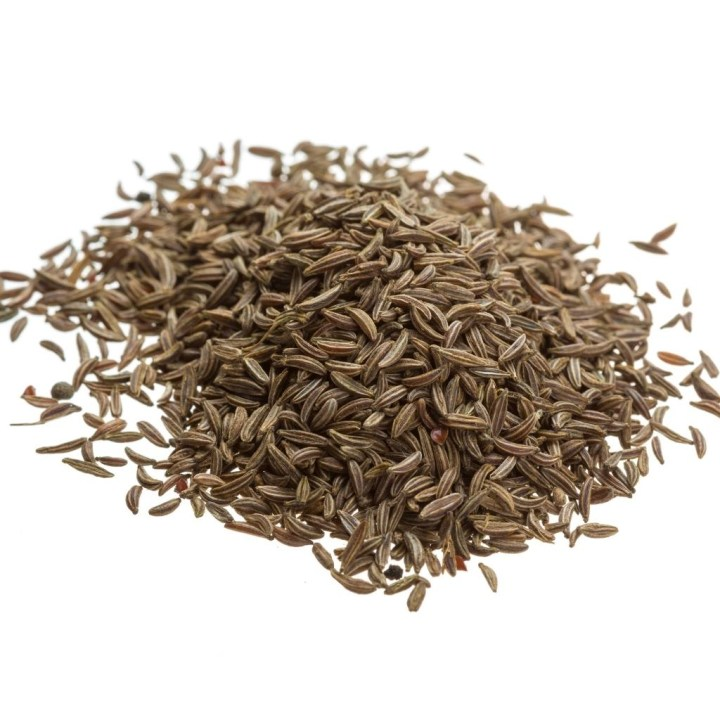

**Image file:** [`spice-images/11-caraway-seeds.jpg`](spice-images/11-caraway-seeds.jpg)  
**Original image:** [open full size](https://i0.wp.com/i.zookti.com/common-spices/caraway-seeds.jpg?w=720&quality=90&strip=all&ssl=1)

### 12. Celery Seeds
**Telugu:** సెలెరీ విత్తనాలు  
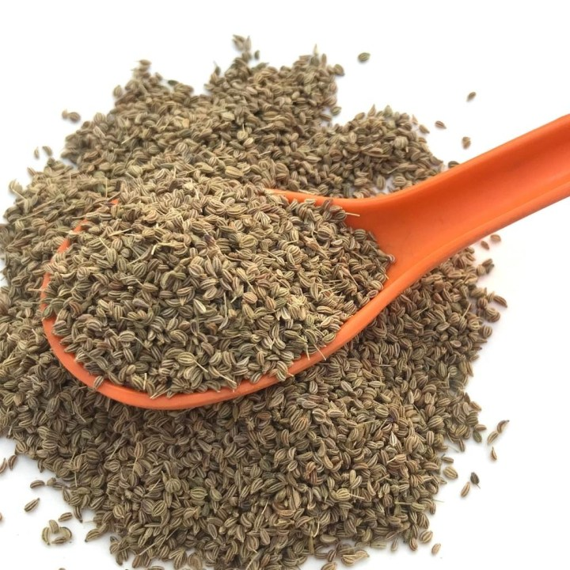

**Image file:** [`spice-images/12-celery-seeds.jpg`](spice-images/12-celery-seeds.jpg)  
**Original image:** [open full size](https://i0.wp.com/i.zookti.com/common-spices/celery-seeds.jpg?w=720&quality=90&strip=all&ssl=1)

### 13. Chilli Powder
**Telugu:** కారం పొడి  
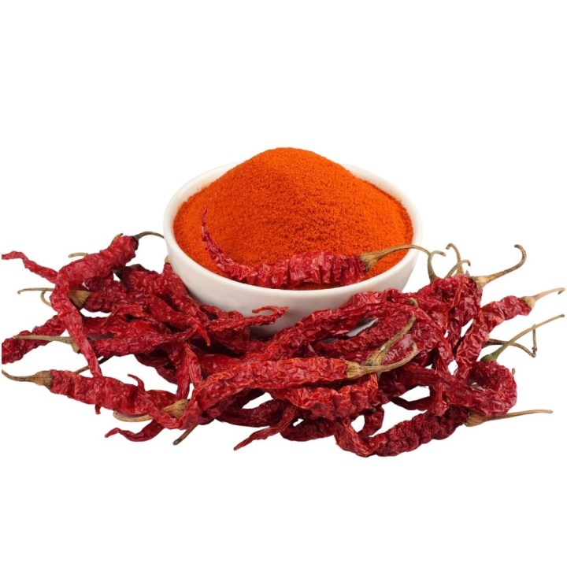

**Image file:** [`spice-images/13-chilli-powder.jpg`](spice-images/13-chilli-powder.jpg)  
**Original image:** [open full size](https://i0.wp.com/i.zookti.com/common-spices/chilli-powder.jpg?w=720&quality=90&strip=all&ssl=1)

### 14. Cinnamon
**Telugu:** దాల్చిన చెక్క  
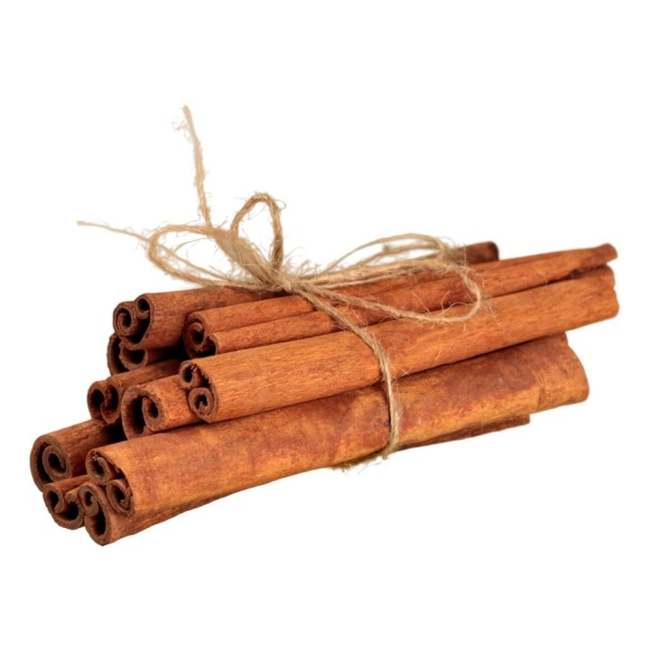

**Image file:** [`spice-images/14-cinnamon.jpg`](spice-images/14-cinnamon.jpg)  
**Original image:** [open full size](https://i0.wp.com/i.zookti.com/common-spices/cinnamon.jpg?w=720&quality=90&strip=all&ssl=1)

### 15. Cloves
**Telugu:** లవంగాలు  
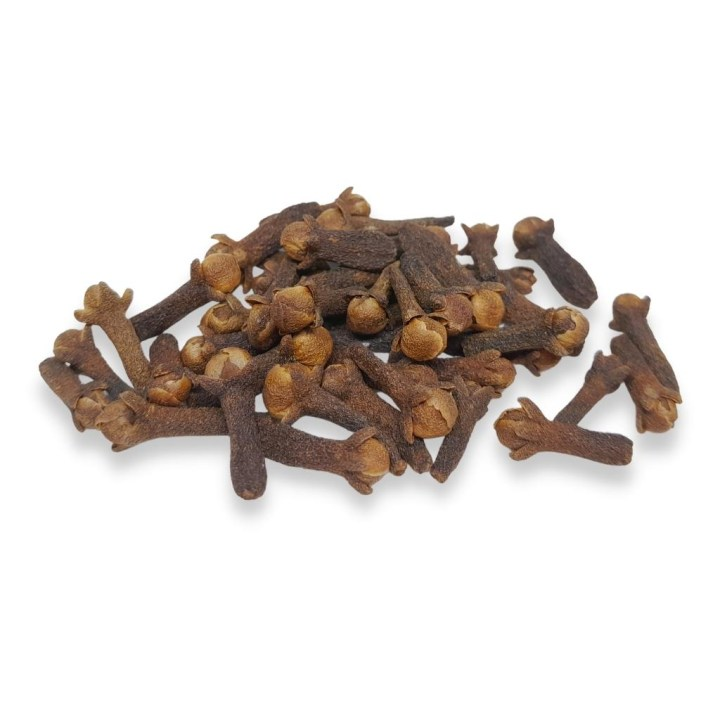

**Image file:** [`spice-images/15-cloves.jpg`](spice-images/15-cloves.jpg)  
**Original image:** [open full size](https://i0.wp.com/i.zookti.com/common-spices/cloves.jpg?w=720&quality=90&strip=all&ssl=1)

### 16. Coriander Leaves or Cilantro
**Telugu:** కొత్తిమీర లేదా కొత్తిమీర  
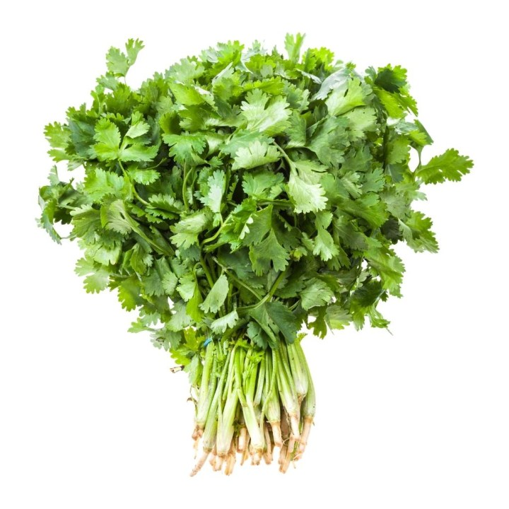

**Image file:** [`spice-images/16-coriander-leaves-or-cilantro.jpg`](spice-images/16-coriander-leaves-or-cilantro.jpg)  
**Original image:** [open full size](https://i0.wp.com/i.zookti.com/common-spices/coriander-leaves-or-cilantro.jpg?w=720&quality=90&strip=all&ssl=1)

### 17. Coriander Seeds and Coriander Powder
**Telugu:** కొత్తిమీర గింజలు మరియు కొత్తిమీర పొడి  
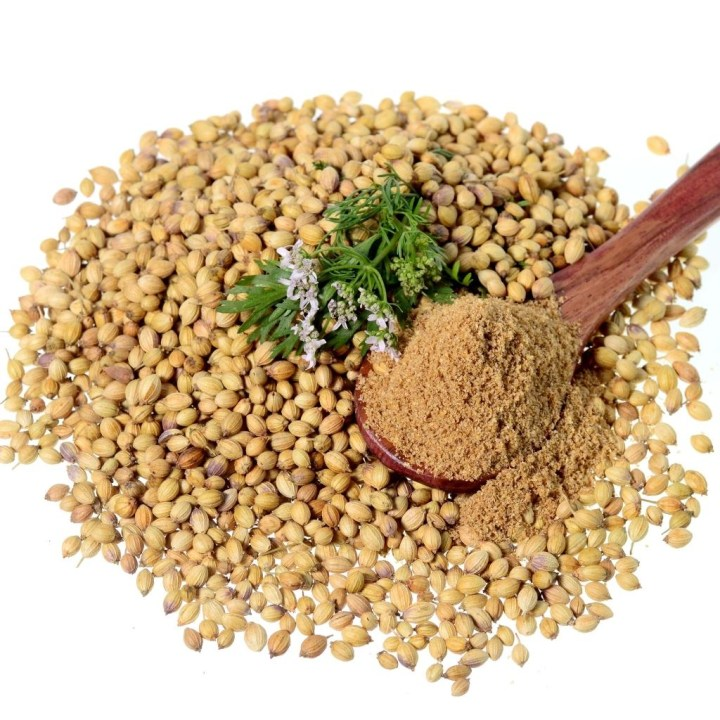

**Image file:** [`spice-images/17-coriander-seeds-and-coriander-powder.jpg`](spice-images/17-coriander-seeds-and-coriander-powder.jpg)  
**Original image:** [open full size](https://i0.wp.com/i.zookti.com/common-spices/coriander-seeds-and-coriander-powder.jpg?w=720&quality=90&strip=all&ssl=1)

### 18. Cumin Seeds and Cumin Powder
**Telugu:** జీలకర్ర గింజలు మరియు జీలకర్ర పొడి  
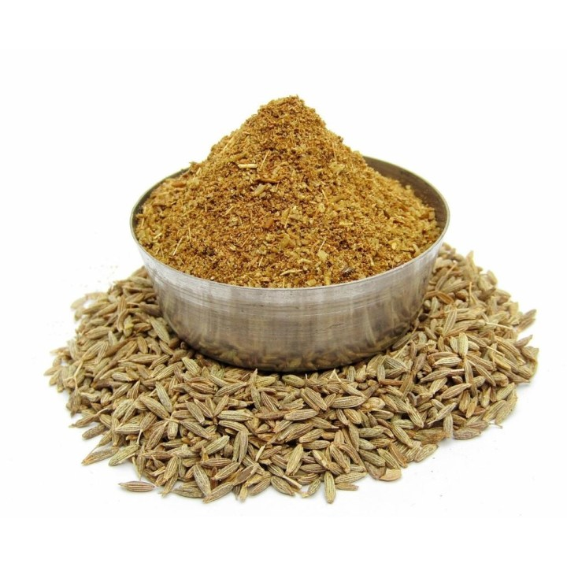

**Image file:** [`spice-images/18-cumin-seeds-and-cumin-powder.jpg`](spice-images/18-cumin-seeds-and-cumin-powder.jpg)  
**Original image:** [open full size](https://i0.wp.com/i.zookti.com/common-spices/cumin-seeds-and-cumin-powder.jpg?w=720&quality=90&strip=all&ssl=1)

### 19. Curry Leaves and Curry Powder
**Telugu:** కరివేపాకు మరియు కరివేపాకు పొడి  
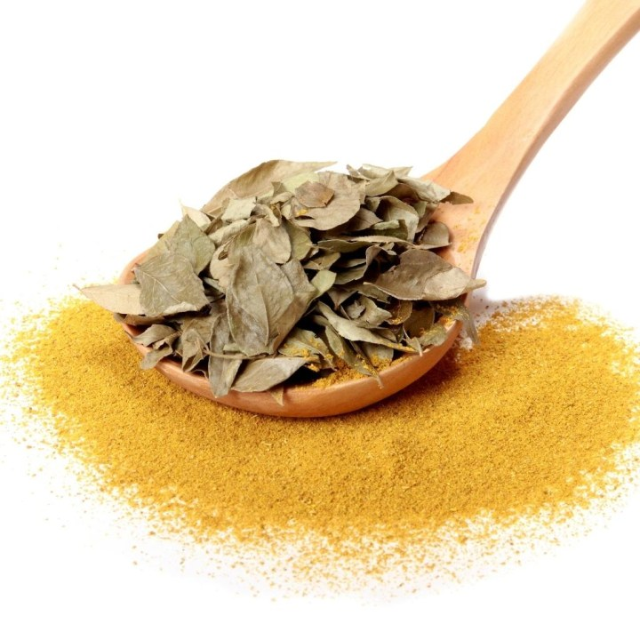

**Image file:** [`spice-images/19-curry-leaves-and-curry-powder.jpg`](spice-images/19-curry-leaves-and-curry-powder.jpg)  
**Original image:** [open full size](https://i0.wp.com/i.zookti.com/common-spices/curry-leaves-and-curry-powder.jpg?w=720&quality=90&strip=all&ssl=1)

### 20. Dry Fenugreek Leaves
**Telugu:** పొడి మెంతి ఆకులు  
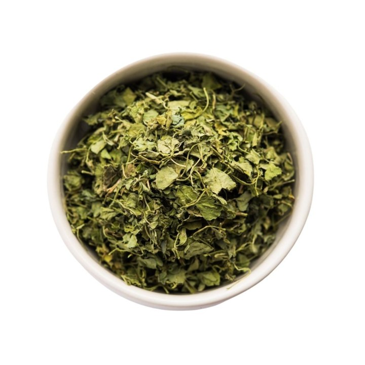

**Image file:** [`spice-images/20-dry-fenugreek-leaves.jpg`](spice-images/20-dry-fenugreek-leaves.jpg)  
**Original image:** [open full size](https://i0.wp.com/i.zookti.com/common-spices/dry-fenugreek-leaves.jpg?w=720&quality=90&strip=all&ssl=1)

### 21. Dry Garlic Powder
**Telugu:** పొడి వెల్లుల్లి పొడి  
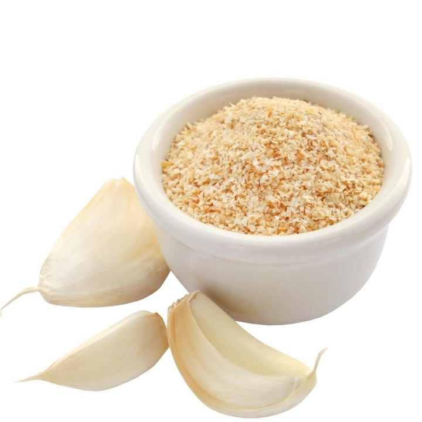

**Image file:** [`spice-images/21-dry-garlic-powder.jpg`](spice-images/21-dry-garlic-powder.jpg)  
**Original image:** [open full size](https://i0.wp.com/i.zookti.com/common-spices/dry-garlic-powder.jpg?w=720&quality=90&strip=all&ssl=1)

### 22. Dry Ginger Powder
**Telugu:** పొడి అల్లం పొడి  
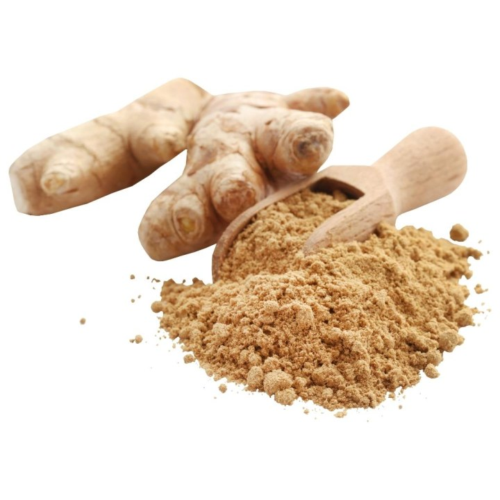

**Image file:** [`spice-images/22-dry-ginger-powder.jpg`](spice-images/22-dry-ginger-powder.jpg)  
**Original image:** [open full size](https://i0.wp.com/i.zookti.com/common-spices/dry-ginger-powder.jpg?w=720&quality=90&strip=all&ssl=1)

### 23. Dry Pomegranate Seeds
**Telugu:** పొడి దానిమ్మ గింజలు  
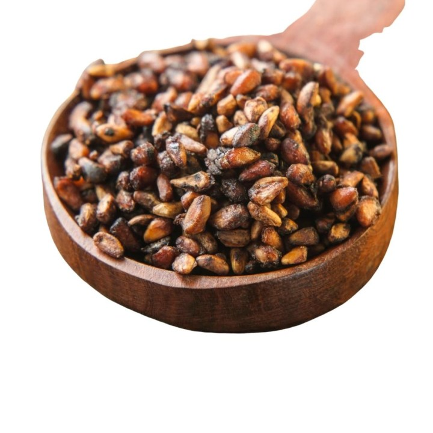

**Image file:** [`spice-images/23-dry-pomegranate-seeds.jpg`](spice-images/23-dry-pomegranate-seeds.jpg)  
**Original image:** [open full size](https://i0.wp.com/i.zookti.com/common-spices/dry-pomegranate-seeds.jpg?w=720&quality=90&strip=all&ssl=1)

### 24. Fennel Seeds
**Telugu:** ఫెన్నెల్ విత్తనాలు  
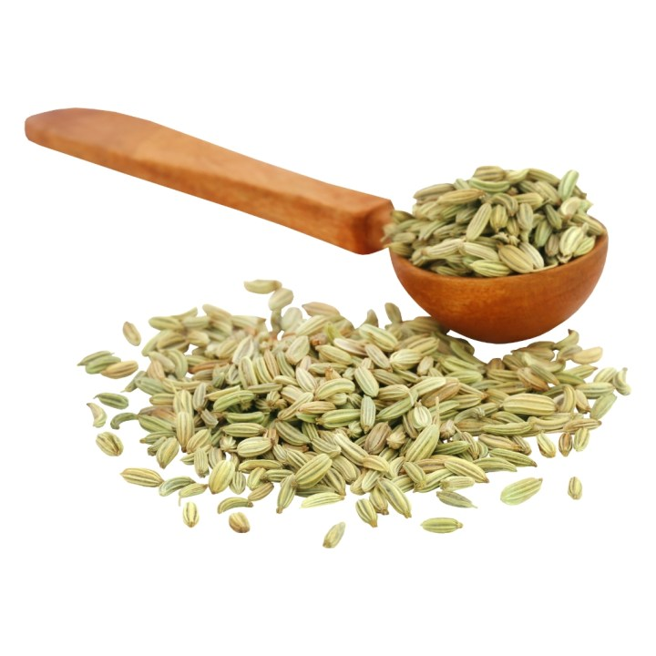

**Image file:** [`spice-images/24-fennel-seeds.jpg`](spice-images/24-fennel-seeds.jpg)  
**Original image:** [open full size](https://i0.wp.com/i.zookti.com/dry-fruits/fennel-seeds.jpg?w=720&quality=90&strip=all&ssl=1)

### 25. Fenugreek Seeds
**Telugu:** మెంతులు  
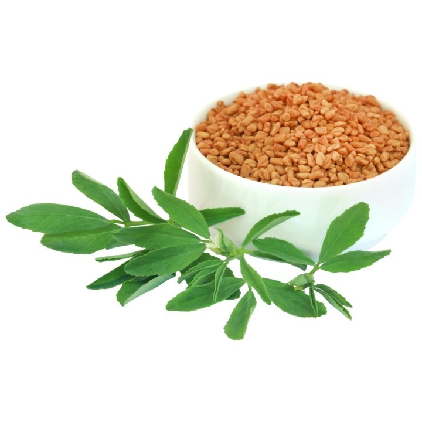

**Image file:** [`spice-images/25-fenugreek-seeds.jpg`](spice-images/25-fenugreek-seeds.jpg)  
**Original image:** [open full size](https://i0.wp.com/i.zookti.com/common-spices/fenugreek-seeds.jpg?w=720&quality=90&strip=all&ssl=1)

### 26. Garcinia Cambogia
**Telugu:** గార్సినియా కంబోజియా  
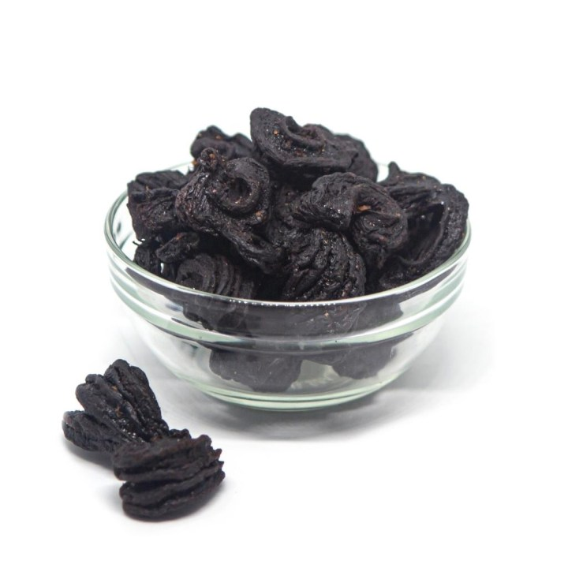

**Image file:** [`spice-images/26-garcinia-cambogia.jpg`](spice-images/26-garcinia-cambogia.jpg)  
**Original image:** [open full size](https://i0.wp.com/i.zookti.com/common-spices/garcinia-cambogia.jpg?w=720&quality=90&strip=all&ssl=1)

### 27. Garlic
**Telugu:** వెల్లుల్లి  
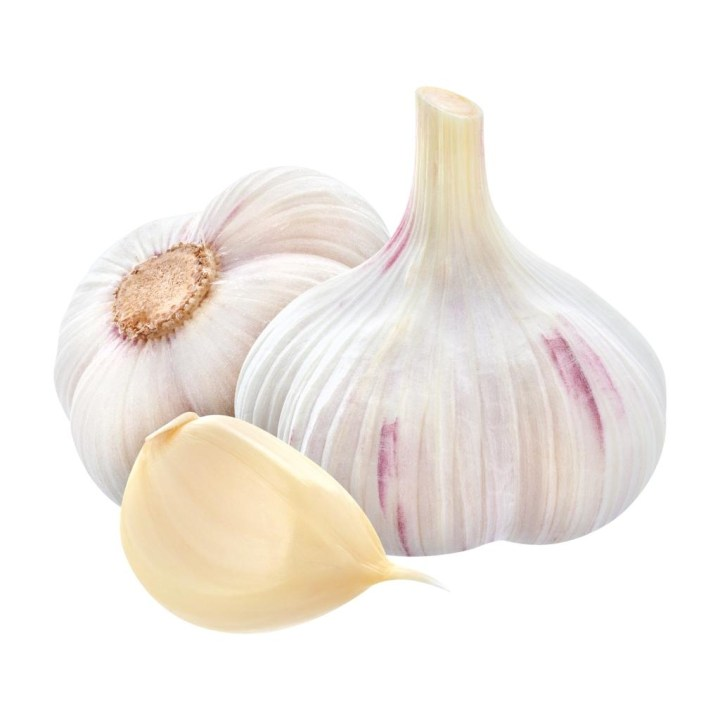

**Image file:** [`spice-images/27-garlic.jpg`](spice-images/27-garlic.jpg)  
**Original image:** [open full size](https://i0.wp.com/i.zookti.com/common-spices/garlic.jpg?w=720&quality=90&strip=all&ssl=1)

### 28. Ginger
**Telugu:** అల్లం  
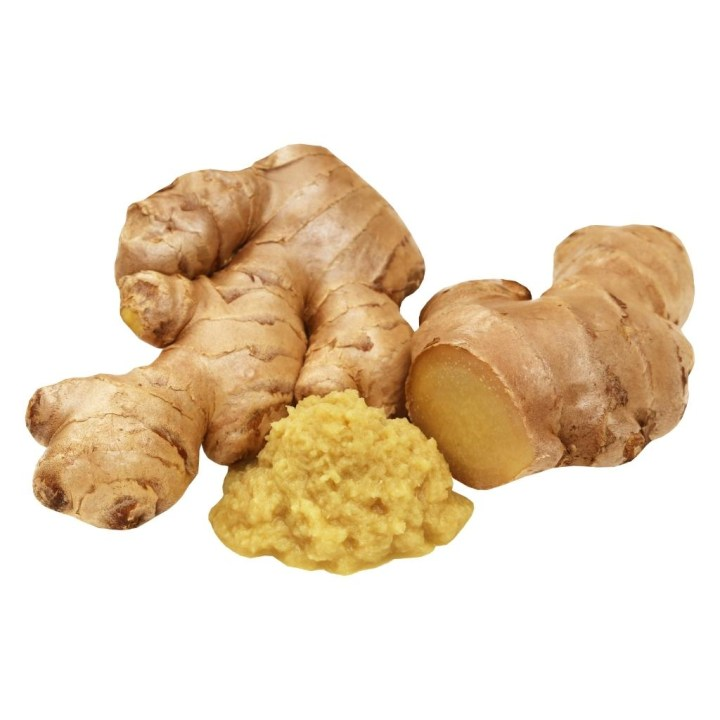

**Image file:** [`spice-images/28-ginger.jpg`](spice-images/28-ginger.jpg)  
**Original image:** [open full size](https://i0.wp.com/i.zookti.com/common-spices/ginger.jpg?w=720&quality=90&strip=all&ssl=1)

### 29. Green Cardamom
**Telugu:** గ్రీన్ ఏలకులు  
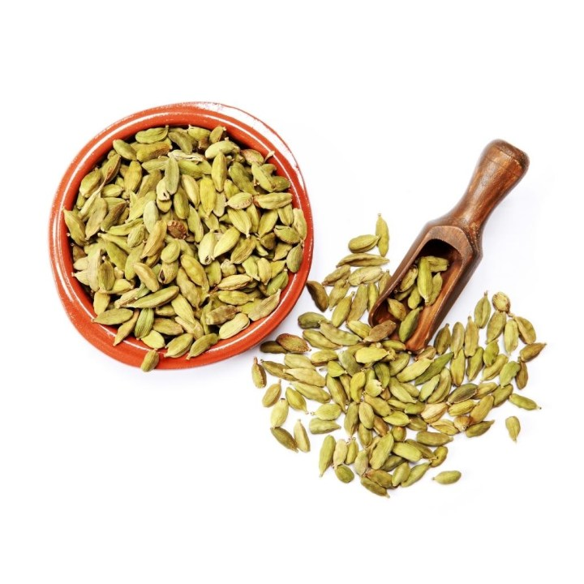

**Image file:** [`spice-images/29-green-cardamom.jpg`](spice-images/29-green-cardamom.jpg)  
**Original image:** [open full size](https://i0.wp.com/i.zookti.com/common-spices/green-cardamom.jpg?w=720&quality=90&strip=all&ssl=1)

### 30. Green Chilli
**Telugu:** పచ్చి మిర్చి  
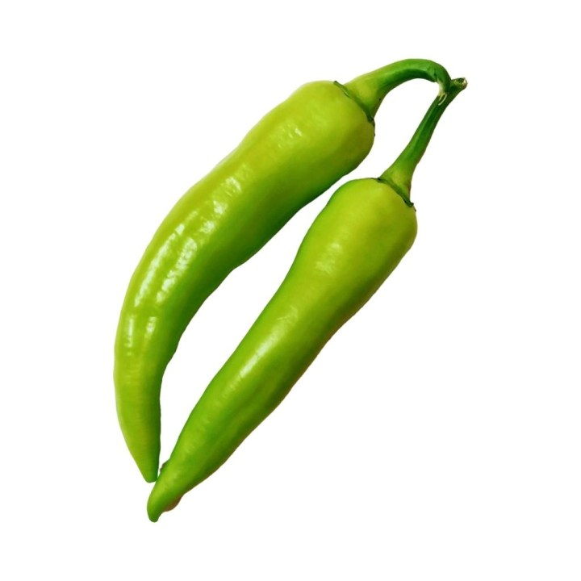

**Image file:** [`spice-images/30-green-chilli.jpg`](spice-images/30-green-chilli.jpg)  
**Original image:** [open full size](https://i0.wp.com/i.zookti.com/common-spices/green-chilli.jpg?w=720&quality=90&strip=all&ssl=1)

### 31. Gum Tragacanth
**Telugu:** గమ్ ట్రాగాకాంత్  
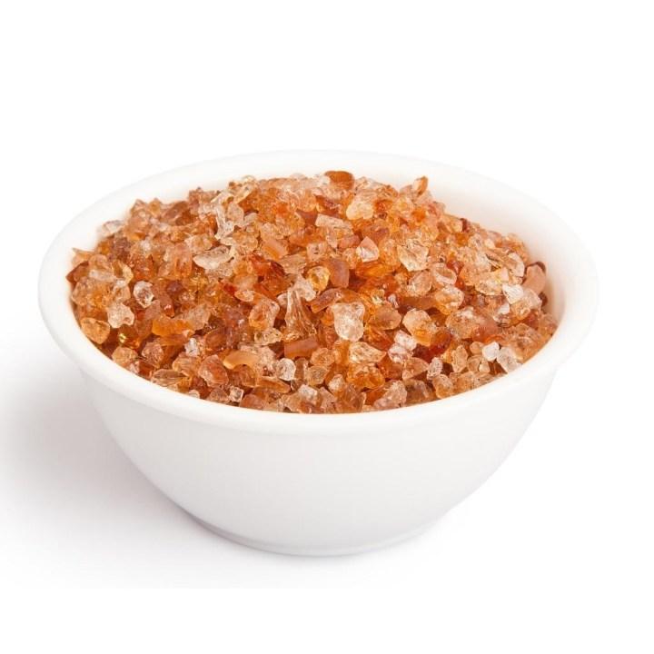

**Image file:** [`spice-images/31-gum-tragacanth.jpg`](spice-images/31-gum-tragacanth.jpg)  
**Original image:** [open full size](https://i0.wp.com/i.zookti.com/common-spices/gum-tragacanth.jpg?w=720&quality=90&strip=all&ssl=1)

### 32. Holy Basil
**Telugu:** పవిత్ర తులసి  
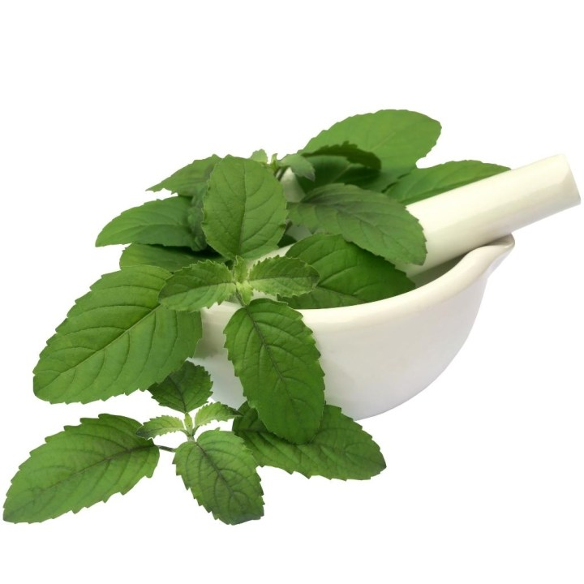

**Image file:** [`spice-images/32-holy-basil.jpg`](spice-images/32-holy-basil.jpg)  
**Original image:** [open full size](https://i0.wp.com/i.zookti.com/common-spices/holy-basil.jpg?w=720&quality=90&strip=all&ssl=1)

### 33. Hot Spices
**Telugu:** వేడి మసాలా దినుసులు  
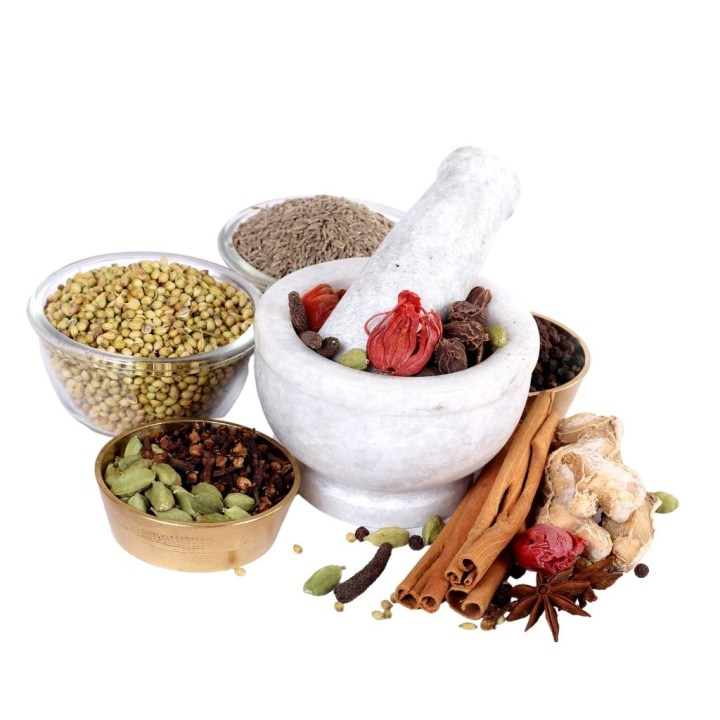

**Image file:** [`spice-images/33-hot-spices.jpg`](spice-images/33-hot-spices.jpg)  
**Original image:** [open full size](https://i0.wp.com/i.zookti.com/common-spices/hot-spices.jpg?w=720&quality=90&strip=all&ssl=1)

### 34. Indian Bay Leaf
**Telugu:** ఇండియన్ బే లీఫ్  
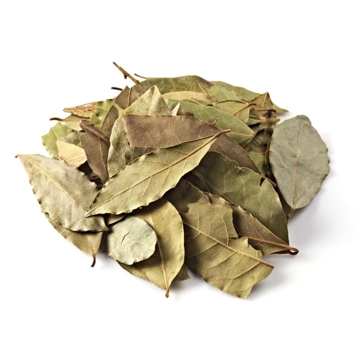

**Image file:** [`spice-images/34-indian-bay-leaf.jpg`](spice-images/34-indian-bay-leaf.jpg)  
**Original image:** [open full size](https://i0.wp.com/i.zookti.com/common-spices/indian-bay-leaf.jpg?w=720&quality=90&strip=all&ssl=1)

### 35. Indian Gooseberry
**Telugu:** భారతీయ గూస్బెర్రీ  
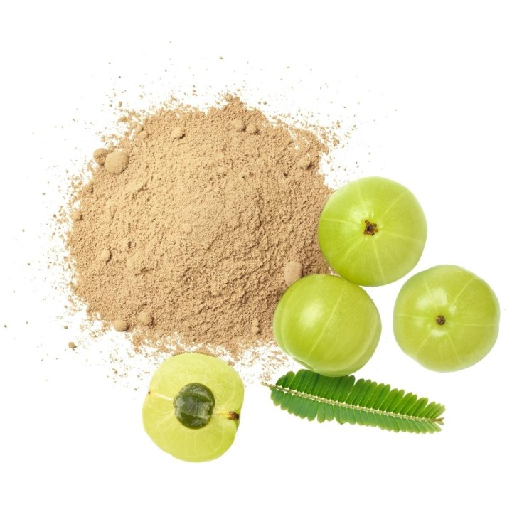

**Image file:** [`spice-images/35-indian-gooseberry.jpg`](spice-images/35-indian-gooseberry.jpg)  
**Original image:** [open full size](https://i0.wp.com/i.zookti.com/common-spices/indian-gooseberry.jpg?w=720&quality=90&strip=all&ssl=1)

### 36. Inknut
**Telugu:** ఇంక్నట్  
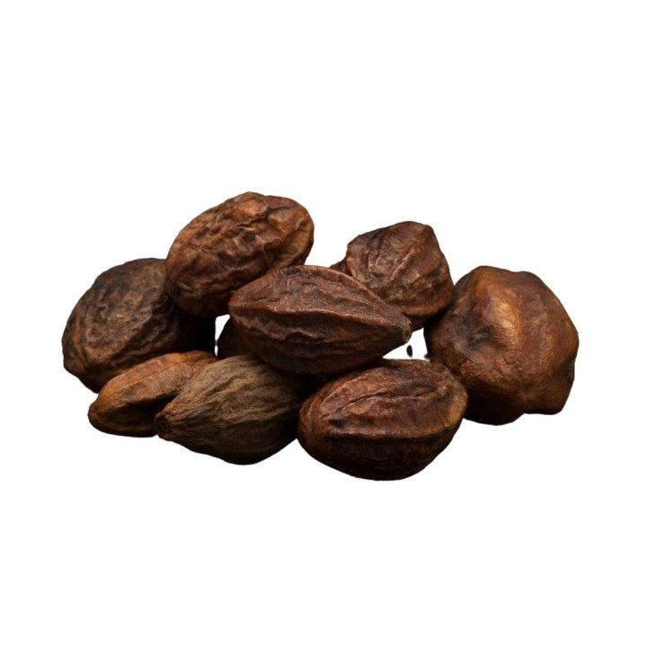

**Image file:** [`spice-images/36-inknut.jpg`](spice-images/36-inknut.jpg)  
**Original image:** [open full size](https://i0.wp.com/i.zookti.com/common-spices/inknut.jpg?w=720&quality=90&strip=all&ssl=1)

### 37. Kokum Rinds
**Telugu:** కోకుమ్ రిండ్స్  
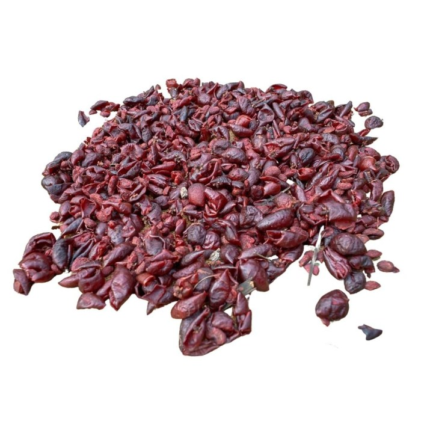

**Image file:** [`spice-images/37-kokum-rinds.jpg`](spice-images/37-kokum-rinds.jpg)  
**Original image:** [open full size](https://i0.wp.com/i.zookti.com/common-spices/kokum-rinds.jpg?w=720&quality=90&strip=all&ssl=1)

### 38. Licorice Powder
**Telugu:** లైకోరైస్ పౌడర్  
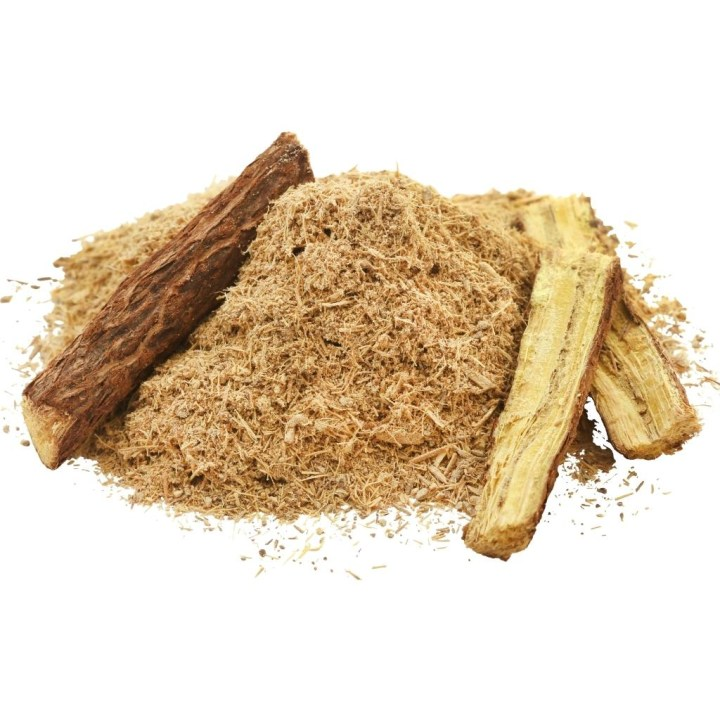

**Image file:** [`spice-images/38-licorice-powder.jpg`](spice-images/38-licorice-powder.jpg)  
**Original image:** [open full size](https://i0.wp.com/i.zookti.com/common-spices/licorice-powder.jpg?w=720&quality=90&strip=all&ssl=1)

### 39. Lime
**Telugu:** నిమ్మకాయ  
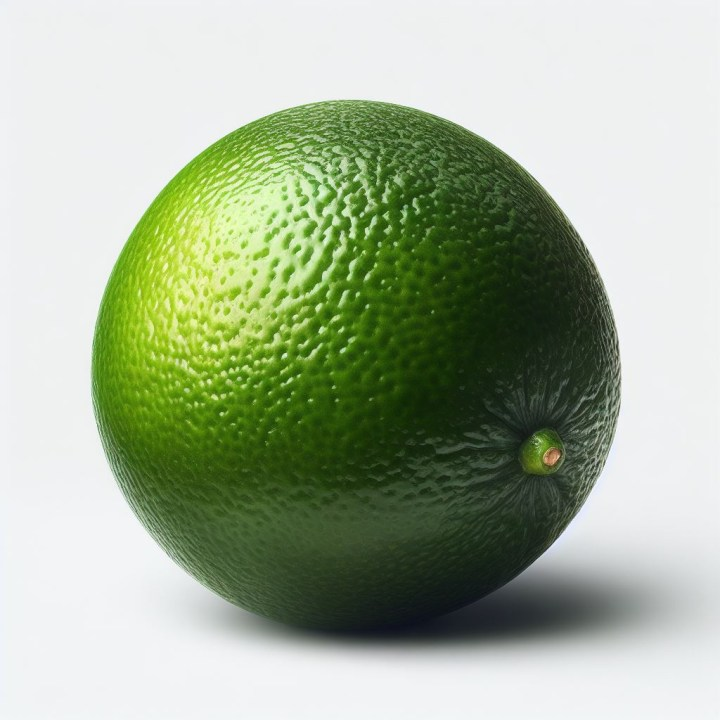

**Image file:** [`spice-images/39-lime.jpeg`](spice-images/39-lime.jpeg)  
**Original image:** [open full size](https://i0.wp.com/i.zookti.com/fruits/lime.jpeg?w=720&quality=90&strip=all&ssl=1)

### 40. Long Pepper
**Telugu:** లాంగ్ పెప్పర్  
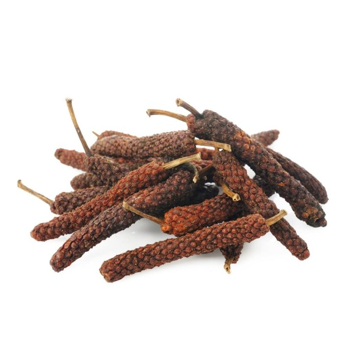

**Image file:** [`spice-images/40-long-pepper.jpg`](spice-images/40-long-pepper.jpg)  
**Original image:** [open full size](https://i0.wp.com/i.zookti.com/common-spices/long-pepper.jpg?w=720&quality=90&strip=all&ssl=1)

### 41. Mace
**Telugu:** జాపత్రి  
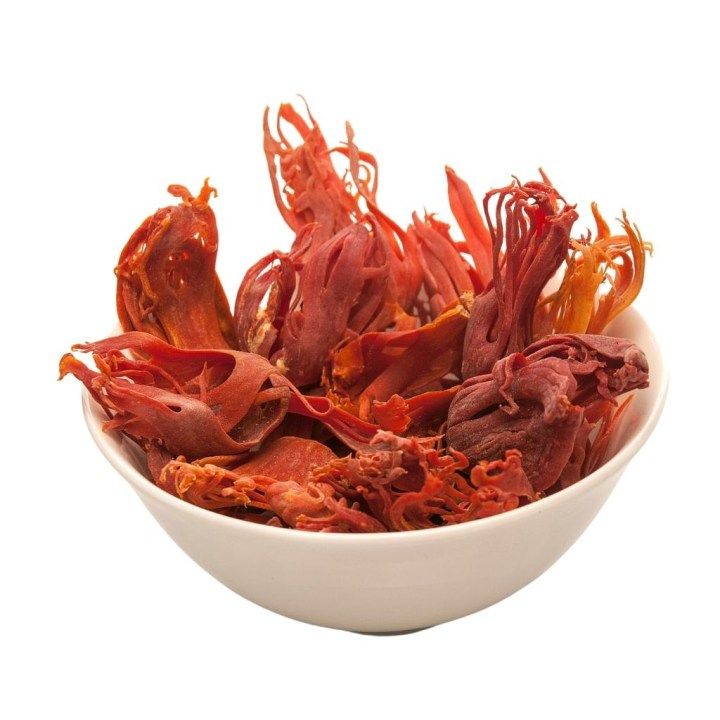

**Image file:** [`spice-images/41-mace.jpg`](spice-images/41-mace.jpg)  
**Original image:** [open full size](https://i0.wp.com/i.zookti.com/common-spices/mace.jpg?w=720&quality=90&strip=all&ssl=1)

### 42. Marjoram
**Telugu:** మార్జోరామ్  
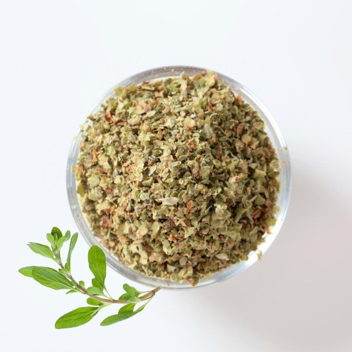

**Image file:** [`spice-images/42-marjoram.jpg`](spice-images/42-marjoram.jpg)  
**Original image:** [open full size](https://i0.wp.com/i.zookti.com/common-spices/marjoram.jpg?w=720&quality=90&strip=all&ssl=1)

### 43. Mint
**Telugu:** పుదీనా  
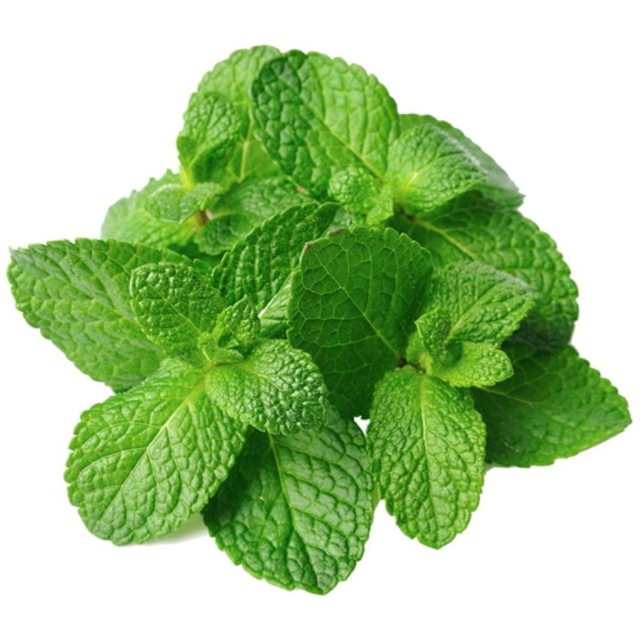

**Image file:** [`spice-images/43-mint.jpg`](spice-images/43-mint.jpg)  
**Original image:** [open full size](https://i0.wp.com/i.zookti.com/common-spices/mint.jpg?w=720&quality=90&strip=all&ssl=1)

### 44. Mustard Seeds
**Telugu:** ఆవ గింజలు  
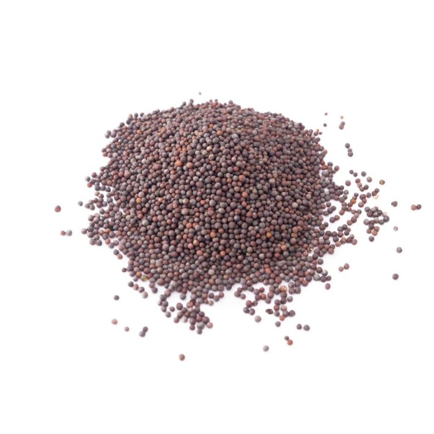

**Image file:** [`spice-images/44-mustard-seeds.jpg`](spice-images/44-mustard-seeds.jpg)  
**Original image:** [open full size](https://i0.wp.com/i.zookti.com/common-spices/mustard-seeds.jpg?w=720&quality=90&strip=all&ssl=1)

### 45. Nigella Seeds
**Telugu:** నిగెల్లా విత్తనాలు  
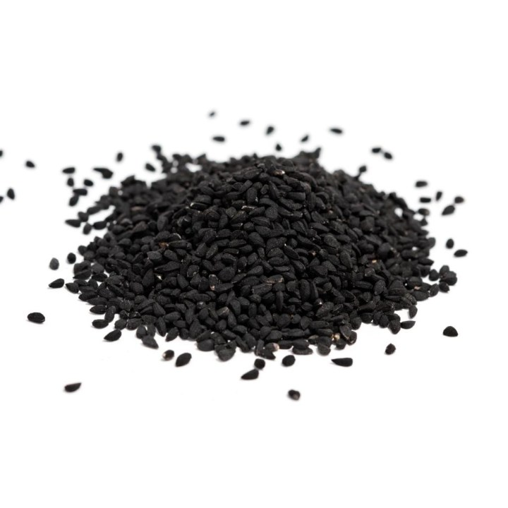

**Image file:** [`spice-images/45-nigella-seeds.jpg`](spice-images/45-nigella-seeds.jpg)  
**Original image:** [open full size](https://i0.wp.com/i.zookti.com/common-spices/nigella-seeds.jpg?w=720&quality=90&strip=all&ssl=1)

### 46. Nutmeg
**Telugu:** జాజికాయ  
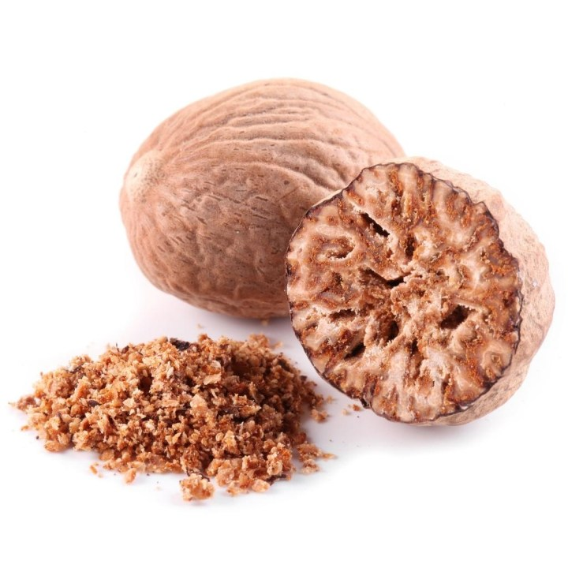

**Image file:** [`spice-images/46-nutmeg.jpg`](spice-images/46-nutmeg.jpg)  
**Original image:** [open full size](https://i0.wp.com/i.zookti.com/common-spices/nutmeg.jpg?w=720&quality=90&strip=all&ssl=1)

### 47. Oregano
**Telugu:** ఒరేగానో  
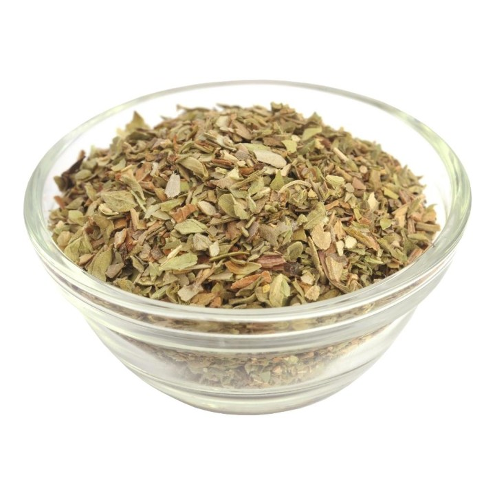

**Image file:** [`spice-images/47-oregano.jpg`](spice-images/47-oregano.jpg)  
**Original image:** [open full size](https://i0.wp.com/i.zookti.com/common-spices/oregano.jpg?w=720&quality=90&strip=all&ssl=1)

### 48. Paprika
**Telugu:** మిరపకాయ  
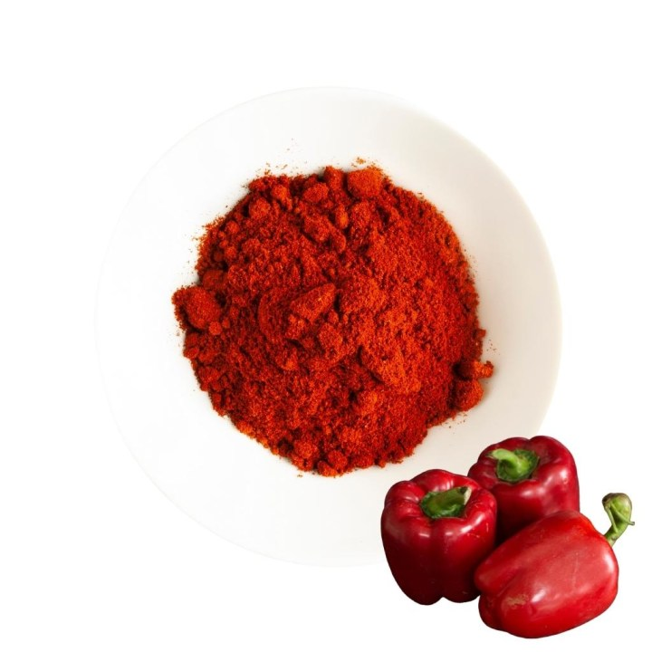

**Image file:** [`spice-images/48-paprika.jpg`](spice-images/48-paprika.jpg)  
**Original image:** [open full size](https://i0.wp.com/i.zookti.com/common-spices/paprika.jpg?w=720&quality=90&strip=all&ssl=1)

### 49. Peanuts
**Telugu:** వేరుశెనగ  
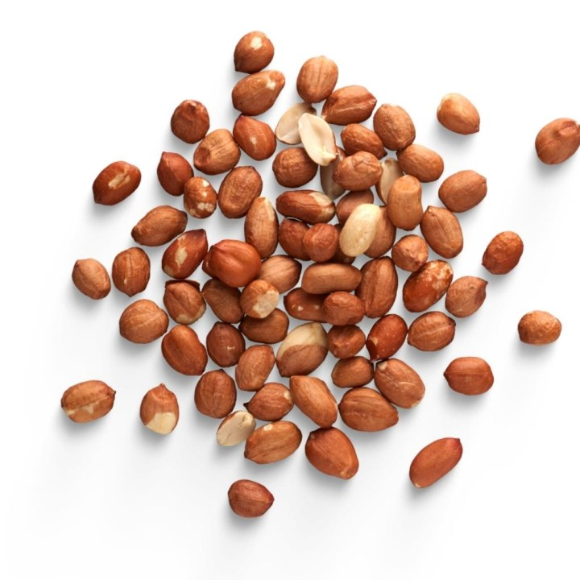

**Image file:** [`spice-images/49-peanuts.jpg`](spice-images/49-peanuts.jpg)  
**Original image:** [open full size](https://i0.wp.com/i.zookti.com/common-spices/peanuts.jpg?w=720&quality=90&strip=all&ssl=1)

### 50. Poppy Seeds
**Telugu:** గసగసాలు  
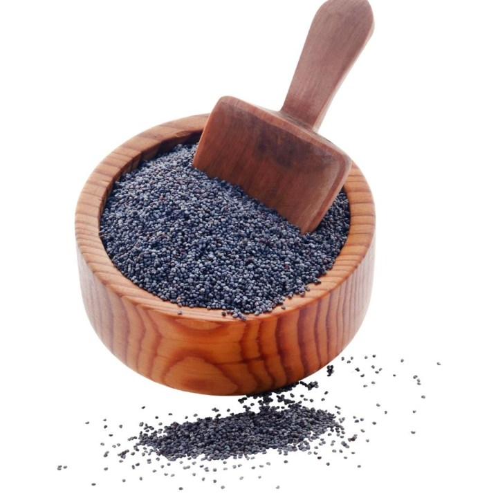

**Image file:** [`spice-images/50-poppy-seeds.jpg`](spice-images/50-poppy-seeds.jpg)  
**Original image:** [open full size](https://i0.wp.com/i.zookti.com/common-spices/poppy-seeds.jpg?w=720&quality=90&strip=all&ssl=1)

### 51. Red Chilli
**Telugu:** ఎర్ర మిరపకాయ  
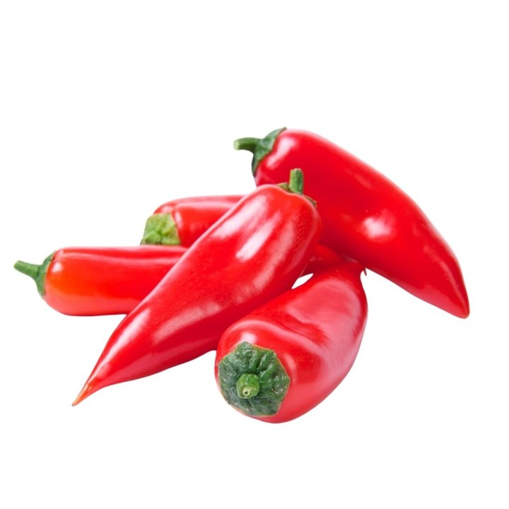

**Image file:** [`spice-images/51-red-chilli.jpg`](spice-images/51-red-chilli.jpg)  
**Original image:** [open full size](https://i0.wp.com/i.zookti.com/common-spices/red-chilli.jpg?w=720&quality=90&strip=all&ssl=1)

### 52. Rock Salt
**Telugu:** కల్లు ఉప్పు  

**Image file:** [`spice-images/52-rock-salt.jpg`](spice-images/52-rock-salt.jpg)  
**Original image:** [open full size](https://i0.wp.com/i.zookti.com/common-spices/rock-salt.jpg?w=720&quality=90&strip=all&ssl=1)

### 53. Rosemary
**Telugu:** రోజ్మేరీ  

**Image file:** [`spice-images/53-rosemary.jpg`](spice-images/53-rosemary.jpg)  
**Original image:** [open full size](https://i0.wp.com/i.zookti.com/common-spices/rosemary.jpg?w=720&quality=90&strip=all&ssl=1)

### 54. Saffron
**Telugu:** కుంకుమపువ్వు  

**Image file:** [`spice-images/54-saffron.jpg`](spice-images/54-saffron.jpg)  
**Original image:** [open full size](https://i0.wp.com/i.zookti.com/common-spices/saffron.jpg?w=720&quality=90&strip=all&ssl=1)

### 55. Salt
**Telugu:** ఉప్పు  

**Image file:** [`spice-images/55-salt.jpg`](spice-images/55-salt.jpg)  
**Original image:** [open full size](https://i0.wp.com/i.zookti.com/common-spices/salt.jpg?w=720&quality=90&strip=all&ssl=1)

### 56. Sesame Seeds
**Telugu:** నువ్వు గింజలు  

**Image file:** [`spice-images/56-sesame-seeds.jpg`](spice-images/56-sesame-seeds.jpg)  
**Original image:** [open full size](https://i0.wp.com/i.zookti.com/common-spices/sesame-seeds.jpg?w=720&quality=90&strip=all&ssl=1)

### 57. Sichuan Pepper
**Telugu:** సిచువాన్ పెప్పర్  

**Image file:** [`spice-images/57-sichuan-pepper.jpg`](spice-images/57-sichuan-pepper.jpg)  
**Original image:** [open full size](https://i0.wp.com/i.zookti.com/common-spices/sichuan-pepper.jpg?w=720&quality=90&strip=all&ssl=1)

### 58. Star Anise
**Telugu:** స్టార్ సోంపు  

**Image file:** [`spice-images/58-star-anise.jpg`](spice-images/58-star-anise.jpg)  
**Original image:** [open full size](https://i0.wp.com/i.zookti.com/common-spices/star-anise.jpg?w=720&quality=90&strip=all&ssl=1)

### 59. Tamarind
**Telugu:** చింతపండు  

**Image file:** [`spice-images/59-tamarind.jpg`](spice-images/59-tamarind.jpg)  
**Original image:** [open full size](https://i0.wp.com/i.zookti.com/common-spices/tamarind.jpg?w=720&quality=90&strip=all&ssl=1)

### 60. Tarragon
**Telugu:** టార్రాగన్  

**Image file:** [`spice-images/60-tarragon.jpg`](spice-images/60-tarragon.jpg)  
**Original image:** [open full size](https://i0.wp.com/i.zookti.com/common-spices/tarragon.jpg?w=720&quality=90&strip=all&ssl=1)

### 61. Thyme
**Telugu:** థైమ్  

**Image file:** [`spice-images/61-thyme.jpg`](spice-images/61-thyme.jpg)  
**Original image:** [open full size](https://i0.wp.com/i.zookti.com/common-spices/thyme.jpg?w=720&quality=90&strip=all&ssl=1)

### 62. Turmeric
**Telugu:** పసుపు  

**Image file:** [`spice-images/62-turmeric.jpg`](spice-images/62-turmeric.jpg)  
**Original image:** [open full size](https://i0.wp.com/i.zookti.com/common-spices/turmeric.jpg?w=720&quality=90&strip=all&ssl=1)

### 63. Vinegar
**Telugu:** వెనిగర్  

**Image file:** [`spice-images/63-vinegar.jpg`](spice-images/63-vinegar.jpg)  
**Original image:** [open full size](https://i0.wp.com/i.zookti.com/common-spices/vinegar.jpg?w=720&quality=90&strip=all&ssl=1)

### 64. White Peppercorns
**Telugu:** వైట్ పెప్పర్ కార్న్స్  

**Image file:** [`spice-images/64-white-peppercorns.jpg`](spice-images/64-white-peppercorns.jpg)  
**Original image:** [open full size](https://i0.wp.com/i.zookti.com/common-spices/white-peppercorns.jpg?w=720&quality=90&strip=all&ssl=1)

### 65. Yellow Mustard Seed
**Telugu:** పసుపు ఆవాలు  

**Image file:** [`spice-images/65-yellow-mustard-seed.jpg`](spice-images/65-yellow-mustard-seed.jpg)  
**Original image:** [open full size](https://i0.wp.com/i.zookti.com/common-spices/yellow-mustard-seed.jpg?w=720&quality=90&strip=all&ssl=1)

## Notes

- Total **65 spices**, each with a picture on the source page.
- **Black Cumin Seeds** (#6) and **Nigella Seeds** (#45) share the same picture on the source site (they are closely related spices).
- Telugu spelling `ఉ ప్పు` (#55) was corrected to `ఉప్పు`.
- This file is independent of `vegetables-english-telugu.md`; the two lists are **not merged**.