# Vegetable Names in English & Telugu — with Images

**Source:** [vegetable names in english and telugu with pictures](https://www.osmanian.com/2022/03/vegetable-names-in-english-and-telugu.html)  
**Extracted:** 2026-11-01  
**Total items:** 47 (45 with images, 2 without images on the source page)  
**Images folder:** [`vegetable-images/`](vegetable-images/) (all downloaded locally)

> Telugu spellings and transliterations follow the source page. Obvious English typos have been corrected (for example, *Cabage* → *Cabbage*). Some vegetables appear more than once on the source page — all rows are kept and the duplicates are noted at the end.

## Quick reference

| # | English | Telugu | Image |
|---:|---|---|---|
| 1 | Raw banana | అరటికాయ Arati Kaaya | [Image](vegetable-images/01-raw-banana.png) · [Source](https://blogger.googleusercontent.com/img/b/R29vZ2xl/AVvXsEg5-o5IT19b8qmcukob-71voK3ZyypBRCpdvYFfldxYZPL_lKfdO66rted5qAQwNQDd4cRR4xtjqZl8rDxjq8cTXmOCzr7H7_Vw2XN9niEZetkQ5Nc9brTnvZylETcOtdHxr9ttm95Uma5V/s1600/Banana+vegetable+names+in+english+and+telugu+with+pictures.png) |
| 2 | Bottle Gourd | ఆనపకాయ Anapakaya/Sorakaya | [Image](vegetable-images/02-bottle-gourd.png) · [Source](https://blogger.googleusercontent.com/img/b/R29vZ2xl/AVvXsEjaaEkFYtG9Wb7ep2YCX1Ub0UC7PDQQf5tWDDBUIJ5z34lQQuys6Sij4TE9M0F_Qy-iMxA5QitOmivXI1j0GPr4WE8flIqFcyp6wlZ5JsmSJ-jPRrgBgUp1Qk67VV6r-2kmauoobGPaRokf/s1600/bottle+Gourd+vegetable+names+in+english+and+telugu+with+pictures.png) |
| 3 | Potato | ఆలుగడ్డ Alugadda/Bangala dumpa | [Image](vegetable-images/03-potato.png) · [Source](https://blogger.googleusercontent.com/img/b/R29vZ2xl/AVvXsEhk-QLfa_QWBVdpj16C6-R_mx1_iGHcnL7M-OBHR7FeuzX2oLf2alM6XqRBTKIFRP9s_B7GgszJi8bnz6tw61OIBbJfVkxGXO3j8rzZFL-sRhavB3kILT0CsYTdqEj5IueTuykLQSzPHL-D/s1600/potato+vegetable+names+in+english+and+telugu+with+pictures.png) |
| 4 | Goose Berry | ఉసిరికాయ Usirikaaya | [Image](vegetable-images/04-goose-berry.png) · [Source](https://blogger.googleusercontent.com/img/b/R29vZ2xl/AVvXsEg37Cw3QXU1SdBuTxWVrneq8rOVTBw3QY7EeqZjbe5cNnc1osAMR5kwYCDZAgClJYjwJ1Z98RHIg4R6hpPEbp8g09z5WZA30x72rkYFdYD14MDihMQL89V88XcVGeceG4hAd9ZZRNzomVZ9/s1600/goose+berry+vegetable+names+in+english+and+telugu+with+pictures.png) |
| 5 | Red Chilli | ఎండు మిరపకాయ Yendu mirapa kaaya | [Image](vegetable-images/05-red-chilli.png) · [Source](https://blogger.googleusercontent.com/img/b/R29vZ2xl/AVvXsEjMuiowQ4oErFlDNxFomnxm513LnlBrjB9nsIa156c149QLC2NvgDHS5q35c5-HmBHDvR0D7XwDHv1MqzYNDo7kae6NJ0XpHog_iIaK-x7spAYC9nltxbloA0Ey_kh1Unsi7MS_dz-VdgT5/s1600/red+chilli+vegetable+names+in+english+and+telugu+with+pictures.png) |
| 6 | Bitter Gourd | కాకర కాయ Kaakarkaaya | [Image](vegetable-images/06-bitter-gourd.png) · [Source](https://blogger.googleusercontent.com/img/b/R29vZ2xl/AVvXsEjGYE3z51XXlkrvnLAnURIxSjH-WtVWoUpz5EVAmVHlYvleB7Id2iA6_V2U-XexoV_FmaPiBjr9JMFarLopWhjLkJ5VIMik6nyXVKYFzlTCdPGgS3UDCQTOBHi1HHCu6jBc0UFp3EaHYLYQ/s1600/bitter+gourd+vegetable+names+in+english+and+telugu+with+pictures.png) |
| 7 | Coriander | కొత్తిమీర Kothimeera | [Image](vegetable-images/07-coriander.jpg) · [Source](https://blogger.googleusercontent.com/img/b/R29vZ2xl/AVvXsEhFtNH3FTlJYsXo1mZR0BjIRnOSx5Xfl59Eg4LCyq9xC5q2X500dynaQPWM73nVm2A3Cll-y5WOKdYhnVl1-e8-eARPc-1cQlktco4swu9G7khrHqlcRDX499beStR2fSCz4PreqLSAq8BN/s1600/Coriander+vegetable+names+in+english+and+telugu+with+pictures.jpg) |
| 8 | Curry Leaves | కరివేపాకు Karivepaku | [Image](vegetable-images/08-curry-leaves.png) · [Source](https://blogger.googleusercontent.com/img/b/R29vZ2xl/AVvXsEi31sa1vS9c2dFPLI8JfFVw9Gj2oOplzXkVGFqIf-I3ytI1cvV12ZUWWpGfctCbDX0w8kYbGn9ifZdtzqIKctvl4xgYxl_LEsHkpEB-O6IevQdQ4hmM9hJkKHG3yD6QiV47xwOszhKT0MZF/s1600/Curry+Leaves+vegetable+names+in+english+and+telugu+with+pictures.png) |
| 9 | Suran / Yam | కందగడ్డ Kandagadda | [Image](vegetable-images/09-suran-yam.png) · [Source](https://blogger.googleusercontent.com/img/b/R29vZ2xl/AVvXsEgvfhpjPKWfpbelaCE2EgFjR1k0hkymyoBPvq32_2DKpsg1nz9WaEShZQQygjVV7lxICYaJ0-JbeqqO7uTA30osRWJEU5z4pqj9EUaASL0hwdM7BE3uX_y-XLq-1UKZlsUohS506tx1j0LT/s1600/suran+or+yam+vegetable+names+in+english+and+telugu+with+pictures.png) |
| 10 | Cauliflower | కాలి ఫ్లవర్ Cauliflower/Gobi | [Image](vegetable-images/10-cauliflower.png) · [Source](https://blogger.googleusercontent.com/img/b/R29vZ2xl/AVvXsEgcLcNWcbvZKBmls5g0imfktkAnQB3SlrL71GAUBd5br0KBpecg2eafM32VmUAvbTf-2o9xephq5H3DCcwlIonyM_WARsLHizmdi9PgOwRCpyCQQkx973QwbNk3iqPoVWfQVVL0apAq5Cap/s1600/cauliflower+vegetable+names+in+english+and+telugu+with+pictures.png) |
| 11 | Cabbage | క్యాబేజ్ Cabbage | [Image](vegetable-images/11-cabbage.png) · [Source](https://blogger.googleusercontent.com/img/b/R29vZ2xl/AVvXsEiqNdVdfg6e84ZhBVJ8mD-dhlm3u7-FECWxihZHFmgYq-WAGPt6tvtrfopiFzWEXCr0MW4wK3zhA7ClhtYTyeKrgpWM73TNwuLMlIFdYhmKs8i5smM1qYIkYacK1pqtM6lRTp6nn-Ehnu1c/s1600/cabbage+vegetable+names+in+english+and+telugu+with+pictures.png) |
| 12 | Coconut | కొబ్బరికాయ Kobbari Kaaya | [Image](vegetable-images/12-coconut.png) · [Source](https://blogger.googleusercontent.com/img/b/R29vZ2xl/AVvXsEhJYaJM6nBZg8v4sTPe7rDnyapQ3oTN04N2-aiCAteU-fsdfMOD4H7MbTYoML7E3FCvfvbxh6MIQori7L82C8UxQ0-MHSkQWSRu64xjwH4dED2ZZIlsIX5ttxgAhkZui-HToim5ZsW25mIf/s1600/coconut+vegetable+names+in+english+and+telugu+with+pictures.png) |
| 13 | Kenaf / Roselle | గోంగూర Gongura | [Image](vegetable-images/13-kenaf-roselle.png) · [Source](https://blogger.googleusercontent.com/img/b/R29vZ2xl/AVvXsEhHXK8BV1R1x6rH4YV6fRKpNFr3GCOMfmQ-1HXz-icU3vCLVHvqoVjveWNd_ovUKybAx20GAdfJKiCO-vapRE84lEtNyWSWSWcHY3f7TmCaJNZZbAUJGw8rBwlwRkSxJ257bPMrEBhTD7zS/s1600/roselle++kenaf+vegetable+names+in+english+and+telugu+with+pictures.png) |
| 14 | Cluster beans | గోకర కాయం Goru chikkudu | [Image](vegetable-images/14-cluster-beans.png) · [Source](https://blogger.googleusercontent.com/img/b/R29vZ2xl/AVvXsEjPlUDeyzbyLmhOc-gicttXYccMO8iWioYLAoROuMjFjIS-UIi3BHGbaTWxaTZ8-hWSyyMyHqTtFUMqiCpBavjORodASz-j3ejCznSLji-tacVfnPsAZKKIMzs9qTOxsrZHVqDWYxOOokjq/s1600/cluser+beans+vegetable+names+in+english+and+telugu+with+pictures.png) |
| 15 | Cluster beans | గోరు చిక్కుడు Goru chikkudu | [Image](vegetable-images/15-cluster-beans.png) · [Source](https://blogger.googleusercontent.com/img/b/R29vZ2xl/AVvXsEjPlUDeyzbyLmhOc-gicttXYccMO8iWioYLAoROuMjFjIS-UIi3BHGbaTWxaTZ8-hWSyyMyHqTtFUMqiCpBavjORodASz-j3ejCznSLji-tacVfnPsAZKKIMzs9qTOxsrZHVqDWYxOOokjq/s1600/cluser+beans+vegetable+names+in+english+and+telugu+with+pictures.png) |
| 16 | Cauliflower | గోబిపువ్వు - Gobi / Cauliflower | — (no image on source page) |
| 17 | Broad beans | చిక్కుడు కాయ Chikkudu Kaaya | [Image](vegetable-images/17-broad-beans.png) · [Source](https://blogger.googleusercontent.com/img/b/R29vZ2xl/AVvXsEgOP6qVQOZMEVajh6DmfcRvhJYkpBrgW9QUCr4E1V2ZUc9_kNGTu5khp6-dY-dnubJuXz2yTsBgGdJE38bSywTQ_By2CFWDj9QtB89bIylAZCMy8aF5balYavcYPUonQc7Wyq0JOerBBXGe/s1600/braod+beans+vegetable+names+in+english+and+telugu+with+pictures.png) |
| 18 | Colocasia / Taro Root | చీమదుంప Chema Dumpa chaam Dumpa / Chama Gadda | [Image](vegetable-images/18-colocasia-taro-root.png) · [Source](https://blogger.googleusercontent.com/img/b/R29vZ2xl/AVvXsEg922JQarGVtVnkXT96MUf-PQi8LSLcVoakQMNui-Dx_gviuI-osLR9cLcvkTHGiNScDqYweje2ej9MJ4IDANqBAgFU5_HY5MN6wXVVbVz_QZwDArynV3KNFTlhvM1iCAP7creoU4nSrOaU/s1600/Colacasia+vegetable+names+in+english+and+telugu+with+pictures.png) |
| 19 | Red sorrel | చుక్కకూర Chukka koora | [Image](vegetable-images/19-red-sorrel.png) · [Source](https://blogger.googleusercontent.com/img/b/R29vZ2xl/AVvXsEiW9WSEeJWFoIw9lidXh77fl53_9q4dwiiF3ZkPrdFdxm85ZOYham7S5b_W1OI1AYqC_c7JJZlK-znhvKh3HHCJMHGF_KKUg39VZPHh65k0jflLb_8OSPaGiWoZId1eJX1RZZrh-MM7Zvpg/s1600/red+sorrel+vegetable+names+in+english+and+telugu+with+pictures.png) |
| 20 | Tomato | టమాట Tamata | [Image](vegetable-images/20-tomato.png) · [Source](https://blogger.googleusercontent.com/img/b/R29vZ2xl/AVvXsEhqw3tqI7vo9tixuzZp0ChZSKKH5CS9sM-d_hr4oiMPkgHl3fCBsvxutfFB6w2GcQAIVVOwYPSnPu9T5z-mVj5fSBWFu6xHYjDDD9JXPRyThvBn6rZVIzraOztXnLN-J1-1spSTahHwfunr/s1600/tomato.png) |
| 21 | Amaranthus | తోటకూర Thotakoora | [Image](vegetable-images/21-amaranthus.png) · [Source](https://blogger.googleusercontent.com/img/b/R29vZ2xl/AVvXsEgM9C-JzvWSwGle1HfDA2vzchUfDVwPH6Z5JRBCRw15p3bOtVUv_RFKEPZsA89JQcv4xvd_k7mBFN6Z_2IGwAz1RShTVhGXjWK3SmqBKA4NkTGQkcK-owIrkfWgtRPiHdwIEiaJzGZZNm-L/s1600/amaranthus+vegetable+names+in+english+and+telugu+with+pictures.png) |
| 22 | Tindoora | దొండకాయ Dondakaya | [Image](vegetable-images/22-tindoora.png) · [Source](https://blogger.googleusercontent.com/img/b/R29vZ2xl/AVvXsEgg4JnZKD9zi8luZ-EOK7zGoMSfephHZTkjXM2xDhDJoYTqd-7LFLD2XlXf2YkutMenbMwpZQ4NPVKYgMTEt8ULvhND-C8Kx3R9xpnrKDYrW5HNJsBkPq1-HFca8SOt3Ajdle64t9gW8pv_/s1600/tindora+vegetable+names+in+english+and+telugu+with+pictures.png) |
| 23 | Cucumber | దోసకాయ Dosakaya | [Image](vegetable-images/23-cucumber.png) · [Source](https://blogger.googleusercontent.com/img/b/R29vZ2xl/AVvXsEi-Qb6Jt8kP_mlFKQOOHojhDoktbbOql71wZNo9UWndR0ITUK8jiBtiBLJWgVNhk3ldxvxMMTMi5bELxWr6qVHrJcrx9V9IdIi3fNyqFZAAwmF1uA1iL7ffizEIiECwym5POKZvQLYUyN7w/s1600/cucumber+vegetable+names+in+english+and+telugu+with+pictures.png) |
| 24 | Green Chilli | పచ్చి మిరపకాయ Pachchi Mirapa Kaaya | [Image](vegetable-images/24-green-chilli.png) · [Source](https://blogger.googleusercontent.com/img/b/R29vZ2xl/AVvXsEgHmOrtU6-JjNouFpxfeBJPh1Ve0IIE_s-wKzr5w2YNId9Axo5cBTM5cQPeHYKN8NwMBYhCnC-sZ_iDL63YHY6Pa4Mnv7u0Bq9NliLudH0nFnWD1yCzQSMxWgC5a_RqkBHJi2DEj7nEp1dF/s1600/green+chilli+vegetable+names+in+english+and+telugu+with+pictures.png) |
| 25 | Raw jackfruit | పనసకాయ Panasa kaaya | [Image](vegetable-images/25-raw-jack-fruit.png) · [Source](https://blogger.googleusercontent.com/img/b/R29vZ2xl/AVvXsEg0HktMadSHOctT0B-Uc3triCwBXzXmJRgmB0X9emoTKIDhqkqITxwm6JOEMNtD4cAWaUK6oFyG1cX91vzKFlZthg62zIkJ7PSSIqzu7rU1ekDClrbiXgkRT1Z_EUoq9Qyf4m0eRerEDgPo/s1600/raw+jack+fruit+vegetable+names+in+english+and+telugu+with+pictures.png) |
| 26 | Sorrel | పాలకూర Paalakoora | [Image](vegetable-images/26-sorrel.png) · [Source](https://blogger.googleusercontent.com/img/b/R29vZ2xl/AVvXsEgDpz8ONWoXdEUcHMXcLUAQv2spWuvNfpn-doPoi6Uc20JkmYOEubHgvSYzejObnhuXHqRiIp2k2wj-OokaHpm6HRjvLiDd_YBw2zmXEPpNFBl7Xamg4FBclanUSyCCYTUIA2V7UMCQMwsb/s1600/sorrel+vegetable+names+in+english+and+telugu+with+pictures.png) |
| 27 | Mushroom | పుట్టగొడుగులు Puttagodugulu | [Image](vegetable-images/27-mushroom.png) · [Source](https://blogger.googleusercontent.com/img/b/R29vZ2xl/AVvXsEhVu51_KKY4QZj69nY8g1ZH38qix-icnJvUM7ZLxnzsJMhKmolzEUvzr-IQN-hZP9DoY6SLnbf61OGKVJ38oz_nQKnqKkXhuNY6K8JmNmge4KXnmEkf91u9CYEk7keQTn9UwRUGysM7bMUx/s1600/mushroom+vegetable+names+in+english+and+telugu+with+pictures.png) |
| 28 | Mint Leaves | పుదీన pudina Akulu | [Image](vegetable-images/28-mint-leaves.png) · [Source](https://blogger.googleusercontent.com/img/b/R29vZ2xl/AVvXsEi-o8D_rVN5BZuWYEbziRFdVWBZGP41jU8oSISlM7GyVJdDLXestPJ-KZ186VzD564GZar3FhneC1x-Jw9jrP1vKq7BeZ90C2izBKl3GwS35JgqwOKw9KvH0uxSwNr2zsn8j2WeQiDzKnon/s1600/mint+leaves+vegetable+names+in+english+and+telugu+with+pictures.png) |
| 29 | Snake Gourd | పొట్లకాయ Potlakaya | [Image](vegetable-images/29-snake-gourd.png) · [Source](https://blogger.googleusercontent.com/img/b/R29vZ2xl/AVvXsEgSDNUKApfXu_ytdGEouAea6s2FsbY_hx8eFn55QA5yFUJC-cyh5pmFUSFUEUkeKxRidwMBMw6jSEfAFqGZl_ok3MxWVMkxbvWPzNum92k3YKfdIdxX-6V8ZQ2fG30R48nJuPJV5DagKG0q/s1600/snake+gourd+vegetable+names+in+english+and+telugu+with+pictures.png) |
| 30 | Green Peas | బఠాని Bataani | [Image](vegetable-images/30-green-peas.png) · [Source](https://blogger.googleusercontent.com/img/b/R29vZ2xl/AVvXsEidCnLJ423fqy4gucHxTViNxhqEf0_QbptEeYRx4Ewi_rz8QlWtPvTUBMP48yok_xnjSaMRS3j9-0RTv7qk5NiMlm1jeJPgwmMZyK8aAdd6x_9ZTbkqot3ApeAOcTxc8KST3fH_gXAYMf2J/s1600/green+peas+vegetable+names+in+english+and+telugu+with+pictures.png) |
| 31 | Beetroot | బీట్ రూట్ Beetroot | [Image](vegetable-images/31-beetroot.png) · [Source](https://blogger.googleusercontent.com/img/b/R29vZ2xl/AVvXsEj7IAdVZSuOldzNZgfUgxLEar3lSbdvXFbd-zxAsBqm06kdCMzSXi1QzNQVXSfdXfgnJ-rul9Q3UZq4svtZ6dP0K4LGbvc4x-ft1t8hO_bvIjVcF4sM5M5X42faP3PhRC7Unf7eYJ-WGzZr/s1600/beetroot+vegetable+names+in+english+and+telugu+with+pictures.png) |
| 32 | Spinach | బచ్చలి కూర Bachalikoora | [Image](vegetable-images/32-spinach.png) · [Source](https://blogger.googleusercontent.com/img/b/R29vZ2xl/AVvXsEhqvGyn-PQmpu7fFmR2nsoIw1lpumC6fLxJCjnZdqmURX9gEkmSilCsAe6GVWKeeUQc5EKqp5yz4129nBFJLXbAyoSJb8JrZsdEGFDTTMhHq8Tvq3TjX15pFPNSEAcXKTVeR6_j7dpYu78p/s1600/spinach+vegetable+names+in+english+and+telugu+with+pictures.png) |
| 33 | Potato | బంగాళా దుంప Bangala dumpa /Aalugadda | [Image](vegetable-images/33-potato.png) · [Source](https://blogger.googleusercontent.com/img/b/R29vZ2xl/AVvXsEhk-QLfa_QWBVdpj16C6-R_mx1_iGHcnL7M-OBHR7FeuzX2oLf2alM6XqRBTKIFRP9s_B7GgszJi8bnz6tw61OIBbJfVkxGXO3j8rzZFL-sRhavB3kILT0CsYTdqEj5IueTuykLQSzPHL-D/s1600/potato+vegetable+names+in+english+and+telugu+with+pictures.png) |
| 34 | Ridge Gourd | బీరకాయ Beerakaaya | [Image](vegetable-images/34-ridge-gourd.png) · [Source](https://blogger.googleusercontent.com/img/b/R29vZ2xl/AVvXsEgjNBrBwt6yihexVuqlufC1xW04hl0E5gejvlWxwaJTC8VX5lk5rOEZBcuNU8zq_DWNIcusIecROkTTa1CLXpfJDkuCEENclEbOCFBdK5y8dxEJgLiTdgMRHq13Kp82Abfwk5uxuw6Ujp3w/s1600/Ridge+Gourd+vegetable+names+in+english+and+telugu+with+pictures.png) |
| 35 | Ash gourd | బూడిది గుమ్మడికాయ Boodidhi Gummadi kaaya | [Image](vegetable-images/35-ash-gourd.png) · [Source](https://blogger.googleusercontent.com/img/b/R29vZ2xl/AVvXsEjiP2BtchGylUUbUSpw1MNllF_OSEtYFj9_FD2rZYgundLhbhm6ULJnlQg3TnEnSbciX0HSXNiZAOjr7gihdJfUqVjf1OBCv5Yyx9B7re1Lq_Kvnrj2nB8efxyIxe9a04dZuhdjSwtNQte0/s1600/ash+gourd+vegetable+names+in+english+and+telugu+with+pictures.png) |
| 36 | Capsicum | బెంగుళూరు మిర్చి Bangalore Mirchi | [Image](vegetable-images/36-capsicum.png) · [Source](https://blogger.googleusercontent.com/img/b/R29vZ2xl/AVvXsEi63RHyXI5YUSjx22_LrV1Nn5-T1yfM4PJjuqOHYEeapxE03dHZ98PYi12xWgPN6FfkEoQBcBebGXFv80Mprxbkm5ZQnzdGRjiiRCgXTywEMHgT-219NzIQtZVzUKjDYeBQt1VRRQbvwHMa/s1600/Capsicum+vegetable+names+in+english+and+telugu+with+pictures.png) |
| 37 | Lady's finger (Okra) | బెండకాయ Bendakaya | [Image](vegetable-images/37-lady-s-finger-okra.png) · [Source](https://blogger.googleusercontent.com/img/b/R29vZ2xl/AVvXsEjbr-cVhL6rZ5tY4s8guvO6d_W8ne3uEy_mjLCbW0vM79oR3oALrK86fCiP-YSxyi8nbwK-SJHzhqsxuZcGeRnxrbkWDY_Wp98kW6Wh_QjrnylRz_lg1trXepynk-C14PRZlR5GMLrG3m6u/s1600/ladys+finger+vegetable+names+in+english+and+telugu+with+pictures.png) |
| 38 | Raw Mango | మామిడి కాయ Maamidi Kaaya | [Image](vegetable-images/38-raw-mango.png) · [Source](https://blogger.googleusercontent.com/img/b/R29vZ2xl/AVvXsEgBfO87EPJGGY4nPdZrdYwyhlkivB8j_zZfuXLl14oYPNVlHZ6bswK3S52MrfstrI8D6vferS-yA63mb-Am0SaoPMdGxsVXanFfYk9bAEhK6fvsoFkClaK6cN-1xT_aFCk-zYUPl4DjgtQ4/s1600/raw+mango+vegetable+names+in+english+and+telugu+with+pictures.png) |
| 39 | Drumstick | ములక్కాయ మొనక్కాయ Mulakkaaya | [Image](vegetable-images/39-drumstick.png) · [Source](https://blogger.googleusercontent.com/img/b/R29vZ2xl/AVvXsEi4iBX0f3_w6I7-x20bBGVN5cGSAdVuGqpIzV5bv_K0VnGwQFQec6UJ6Ly1nUtnd7V4VBm4Pb_gT4scmfC6Pr4wmmCpvETFp0NDUueOfXY-rvY73OBYGMj-te93vvn59u8m2U0UAj-OvtQw/s1600/drum+sticks+vegetable+names+in+english+and+telugu+with+pictures.png) |
| 40 | Radish | ముల్లంగి Mullangi | [Image](vegetable-images/40-radish.png) · [Source](https://blogger.googleusercontent.com/img/b/R29vZ2xl/AVvXsEiqQrSmWXCTQ0Q5bTcLNutL6iTRkySP8nyFSvk-jyJeqiOIbDl2biBkHUp54r_cidnLU4qsjVgsETWNeGDAHX97IFWGGZLVOGSW1q1b0RwikBian0BdnwyMB0yuBMeioQHktEi4fMSe4uqo/s1600/radish+vegetable+names+in+english+and+telugu+with+pictures.png) |
| 41 | Fenugreek Leaves | మెంతి కూర Menthi Koora | [Image](vegetable-images/41-fenugreek-leaves.png) · [Source](https://blogger.googleusercontent.com/img/b/R29vZ2xl/AVvXsEjs3UEwLHepu_EBZhUO1xN7ls87tpRbw2zy6lVCfxEUU9icTzbDElpzJpfUR8NnyklhSeOiXt1G8a8rTtzrgudzwzlPps6B4YfAOm8gQsIRvPBaWEPpxAJ_L29hj95eYthbNF-KqZacgobX/s1600/fenugreek+leaves+vegetable+names+in+english+and+telugu+with+pictures.png) |
| 42 | Corn | మొక్క జొన్న Mokkajonna | [Image](vegetable-images/42-corn.png) · [Source](https://blogger.googleusercontent.com/img/b/R29vZ2xl/AVvXsEjUbv0mFAahykSnHtzGNt4fsuXzvze4Hyftk-FP4AqM2b3AZT3wBzucKqsZuGqsCTaOKU84JuV9BQQKxY5k3r8Pj6kGT6ggkgyzVD_i7_SS1thukoYqhZQPxXz5A3YCrerVig3ioPvrQqWX/s1600/corn+vegetable+names+in+english+and+telugu+with+pictures.png) |
| 43 | Sweet Potato | మోరం గడ్డ Moram Gadda | [Image](vegetable-images/43-sweet-potato.png) · [Source](https://blogger.googleusercontent.com/img/b/R29vZ2xl/AVvXsEhEgp5nkeh5vPNO_6A0vs6a8UhKuOl97sOK3CrLrvtqP27AOp2cCvtIBS8lXSCFdKmIUhMsyStmpd7UoIdhpJDuact7tTHiXbAOk8VZLWGd1VG49hUv2iuOKnEBo5MRd34vo5v1uXor9k49/s1600/sweet+potato+vegetable+names+in+english+and+telugu+with+pictures.png) |
| 44 | Brinjal | వంకాయ Vankaya | [Image](vegetable-images/44-brinjal.png) · [Source](https://blogger.googleusercontent.com/img/b/R29vZ2xl/AVvXsEgEAmbMjrX1Ri8y80c6oJCXeschfUapXY8kglN561l38X0bIf8FMXnLjmQiI6kxehomtfUm3DbJV_jcCYvHEeojSqT5tFQ9kJWGiVCO0H1sw6Vxq6De8zzNMOOsY_8q19rnTQGrnaq0fsov/s1600/brinjal+vegetable+names+in+english+and+telugu+with+pictures.png) |
| 45 | Garlic | వెల్లుల్లి Vellulli | [Image](vegetable-images/45-garlic.png) · [Source](https://blogger.googleusercontent.com/img/b/R29vZ2xl/AVvXsEjipz4O9ir9gRKn9aBYsJBAZ4JIXzC2WDrVZOOnrv1wYme87UPQLwARGzw5GN_Q_LCRUWWA9L_Mc0kc0mqQ_RNwwIWP-_QMtFdM5rFNsj5WG_3R7SlqgaWyn0EMUwE-ranQVxl1gF2elc3j/s1600/garlic+vegetable+names+in+english+and+telugu+with+pictures.png) |
| 46 | Hill glory bower | సరస్వతి ఆకు Saraswathi Aaku | — (no image on source page) |
| 47 | Bottle Gourd | సొరకాయ Sorakaya/Anapakaaya | [Image](vegetable-images/47-bottle-gourd.png) · [Source](https://blogger.googleusercontent.com/img/b/R29vZ2xl/AVvXsEjaaEkFYtG9Wb7ep2YCX1Ub0UC7PDQQf5tWDDBUIJ5z34lQQuys6Sij4TE9M0F_Qy-iMxA5QitOmivXI1j0GPr4WE8flIqFcyp6wlZ5JsmSJ-jPRrgBgUp1Qk67VV6r-2kmauoobGPaRokf/s1600/bottle+Gourd+vegetable+names+in+english+and+telugu+with+pictures.png) |

## Gallery

### 1. Raw banana
**Telugu:** అరటికాయ Arati Kaaya  

**Image file:** [`vegetable-images/01-raw-banana.png`](vegetable-images/01-raw-banana.png)
**Original image:** [open full size](https://blogger.googleusercontent.com/img/b/R29vZ2xl/AVvXsEg5-o5IT19b8qmcukob-71voK3ZyypBRCpdvYFfldxYZPL_lKfdO66rted5qAQwNQDd4cRR4xtjqZl8rDxjq8cTXmOCzr7H7_Vw2XN9niEZetkQ5Nc9brTnvZylETcOtdHxr9ttm95Uma5V/s1600/Banana+vegetable+names+in+english+and+telugu+with+pictures.png)

### 2. Bottle Gourd
**Telugu:** ఆనపకాయ Anapakaya/Sorakaya  

**Image file:** [`vegetable-images/02-bottle-gourd.png`](vegetable-images/02-bottle-gourd.png)
**Original image:** [open full size](https://blogger.googleusercontent.com/img/b/R29vZ2xl/AVvXsEjaaEkFYtG9Wb7ep2YCX1Ub0UC7PDQQf5tWDDBUIJ5z34lQQuys6Sij4TE9M0F_Qy-iMxA5QitOmivXI1j0GPr4WE8flIqFcyp6wlZ5JsmSJ-jPRrgBgUp1Qk67VV6r-2kmauoobGPaRokf/s1600/bottle+Gourd+vegetable+names+in+english+and+telugu+with+pictures.png)

### 3. Potato
**Telugu:** ఆలుగడ్డ Alugadda/Bangala dumpa  
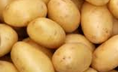

**Image file:** [`vegetable-images/03-potato.png`](vegetable-images/03-potato.png)
**Original image:** [open full size](https://blogger.googleusercontent.com/img/b/R29vZ2xl/AVvXsEhk-QLfa_QWBVdpj16C6-R_mx1_iGHcnL7M-OBHR7FeuzX2oLf2alM6XqRBTKIFRP9s_B7GgszJi8bnz6tw61OIBbJfVkxGXO3j8rzZFL-sRhavB3kILT0CsYTdqEj5IueTuykLQSzPHL-D/s1600/potato+vegetable+names+in+english+and+telugu+with+pictures.png)

### 4. Goose Berry
**Telugu:** ఉసిరికాయ Usirikaaya  
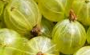

**Image file:** [`vegetable-images/04-goose-berry.png`](vegetable-images/04-goose-berry.png)
**Original image:** [open full size](https://blogger.googleusercontent.com/img/b/R29vZ2xl/AVvXsEg37Cw3QXU1SdBuTxWVrneq8rOVTBw3QY7EeqZjbe5cNnc1osAMR5kwYCDZAgClJYjwJ1Z98RHIg4R6hpPEbp8g09z5WZA30x72rkYFdYD14MDihMQL89V88XcVGeceG4hAd9ZZRNzomVZ9/s1600/goose+berry+vegetable+names+in+english+and+telugu+with+pictures.png)

### 5. Red Chilli
**Telugu:** ఎండు మిరపకాయ Yendu mirapa kaaya  

**Image file:** [`vegetable-images/05-red-chilli.png`](vegetable-images/05-red-chilli.png)
**Original image:** [open full size](https://blogger.googleusercontent.com/img/b/R29vZ2xl/AVvXsEjMuiowQ4oErFlDNxFomnxm513LnlBrjB9nsIa156c149QLC2NvgDHS5q35c5-HmBHDvR0D7XwDHv1MqzYNDo7kae6NJ0XpHog_iIaK-x7spAYC9nltxbloA0Ey_kh1Unsi7MS_dz-VdgT5/s1600/red+chilli+vegetable+names+in+english+and+telugu+with+pictures.png)

### 6. Bitter Gourd
**Telugu:** కాకర కాయ Kaakarkaaya  
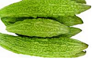

**Image file:** [`vegetable-images/06-bitter-gourd.png`](vegetable-images/06-bitter-gourd.png)
**Original image:** [open full size](https://blogger.googleusercontent.com/img/b/R29vZ2xl/AVvXsEjGYE3z51XXlkrvnLAnURIxSjH-WtVWoUpz5EVAmVHlYvleB7Id2iA6_V2U-XexoV_FmaPiBjr9JMFarLopWhjLkJ5VIMik6nyXVKYFzlTCdPGgS3UDCQTOBHi1HHCu6jBc0UFp3EaHYLYQ/s1600/bitter+gourd+vegetable+names+in+english+and+telugu+with+pictures.png)

### 7. Coriander
**Telugu:** కొత్తిమీర Kothimeera  
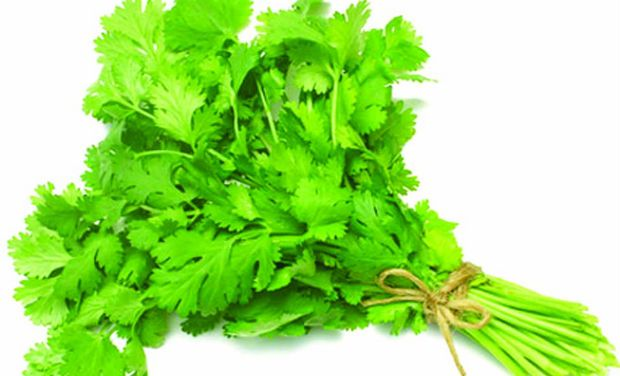

**Image file:** [`vegetable-images/07-coriander.jpg`](vegetable-images/07-coriander.jpg)
**Original image:** [open full size](https://blogger.googleusercontent.com/img/b/R29vZ2xl/AVvXsEhFtNH3FTlJYsXo1mZR0BjIRnOSx5Xfl59Eg4LCyq9xC5q2X500dynaQPWM73nVm2A3Cll-y5WOKdYhnVl1-e8-eARPc-1cQlktco4swu9G7khrHqlcRDX499beStR2fSCz4PreqLSAq8BN/s1600/Coriander+vegetable+names+in+english+and+telugu+with+pictures.jpg)

### 8. Curry Leaves
**Telugu:** కరివేపాకు Karivepaku  
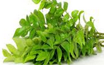

**Image file:** [`vegetable-images/08-curry-leaves.png`](vegetable-images/08-curry-leaves.png)
**Original image:** [open full size](https://blogger.googleusercontent.com/img/b/R29vZ2xl/AVvXsEi31sa1vS9c2dFPLI8JfFVw9Gj2oOplzXkVGFqIf-I3ytI1cvV12ZUWWpGfctCbDX0w8kYbGn9ifZdtzqIKctvl4xgYxl_LEsHkpEB-O6IevQdQ4hmM9hJkKHG3yD6QiV47xwOszhKT0MZF/s1600/Curry+Leaves+vegetable+names+in+english+and+telugu+with+pictures.png)

### 9. Suran / Yam
**Telugu:** కందగడ్డ Kandagadda  
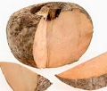

**Image file:** [`vegetable-images/09-suran-yam.png`](vegetable-images/09-suran-yam.png)
**Original image:** [open full size](https://blogger.googleusercontent.com/img/b/R29vZ2xl/AVvXsEgvfhpjPKWfpbelaCE2EgFjR1k0hkymyoBPvq32_2DKpsg1nz9WaEShZQQygjVV7lxICYaJ0-JbeqqO7uTA30osRWJEU5z4pqj9EUaASL0hwdM7BE3uX_y-XLq-1UKZlsUohS506tx1j0LT/s1600/suran+or+yam+vegetable+names+in+english+and+telugu+with+pictures.png)

### 10. Cauliflower
**Telugu:** కాలి ఫ్లవర్ Cauliflower/Gobi  
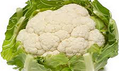

**Image file:** [`vegetable-images/10-cauliflower.png`](vegetable-images/10-cauliflower.png)
**Original image:** [open full size](https://blogger.googleusercontent.com/img/b/R29vZ2xl/AVvXsEgcLcNWcbvZKBmls5g0imfktkAnQB3SlrL71GAUBd5br0KBpecg2eafM32VmUAvbTf-2o9xephq5H3DCcwlIonyM_WARsLHizmdi9PgOwRCpyCQQkx973QwbNk3iqPoVWfQVVL0apAq5Cap/s1600/cauliflower+vegetable+names+in+english+and+telugu+with+pictures.png)

### 11. Cabbage
**Telugu:** క్యాబేజ్ Cabbage  
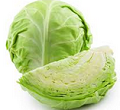

**Image file:** [`vegetable-images/11-cabbage.png`](vegetable-images/11-cabbage.png)
**Original image:** [open full size](https://blogger.googleusercontent.com/img/b/R29vZ2xl/AVvXsEiqNdVdfg6e84ZhBVJ8mD-dhlm3u7-FECWxihZHFmgYq-WAGPt6tvtrfopiFzWEXCr0MW4wK3zhA7ClhtYTyeKrgpWM73TNwuLMlIFdYhmKs8i5smM1qYIkYacK1pqtM6lRTp6nn-Ehnu1c/s1600/cabbage+vegetable+names+in+english+and+telugu+with+pictures.png)

### 12. Coconut
**Telugu:** కొబ్బరికాయ Kobbari Kaaya  
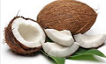

**Image file:** [`vegetable-images/12-coconut.png`](vegetable-images/12-coconut.png)
**Original image:** [open full size](https://blogger.googleusercontent.com/img/b/R29vZ2xl/AVvXsEhJYaJM6nBZg8v4sTPe7rDnyapQ3oTN04N2-aiCAteU-fsdfMOD4H7MbTYoML7E3FCvfvbxh6MIQori7L82C8UxQ0-MHSkQWSRu64xjwH4dED2ZZIlsIX5ttxgAhkZui-HToim5ZsW25mIf/s1600/coconut+vegetable+names+in+english+and+telugu+with+pictures.png)

### 13. Kenaf / Roselle
**Telugu:** గోంగూర Gongura  
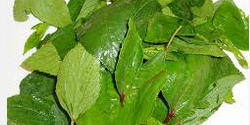

**Image file:** [`vegetable-images/13-kenaf-roselle.png`](vegetable-images/13-kenaf-roselle.png)
**Original image:** [open full size](https://blogger.googleusercontent.com/img/b/R29vZ2xl/AVvXsEhHXK8BV1R1x6rH4YV6fRKpNFr3GCOMfmQ-1HXz-icU3vCLVHvqoVjveWNd_ovUKybAx20GAdfJKiCO-vapRE84lEtNyWSWSWcHY3f7TmCaJNZZbAUJGw8rBwlwRkSxJ257bPMrEBhTD7zS/s1600/roselle++kenaf+vegetable+names+in+english+and+telugu+with+pictures.png)

### 14. Cluster beans
**Telugu:** గోకర కాయం Goru chikkudu  
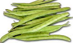

**Image file:** [`vegetable-images/14-cluster-beans.png`](vegetable-images/14-cluster-beans.png)
**Original image:** [open full size](https://blogger.googleusercontent.com/img/b/R29vZ2xl/AVvXsEjPlUDeyzbyLmhOc-gicttXYccMO8iWioYLAoROuMjFjIS-UIi3BHGbaTWxaTZ8-hWSyyMyHqTtFUMqiCpBavjORodASz-j3ejCznSLji-tacVfnPsAZKKIMzs9qTOxsrZHVqDWYxOOokjq/s1600/cluser+beans+vegetable+names+in+english+and+telugu+with+pictures.png)

### 15. Cluster beans
**Telugu:** గోరు చిక్కుడు Goru chikkudu  

**Image file:** [`vegetable-images/15-cluster-beans.png`](vegetable-images/15-cluster-beans.png)
**Original image:** [open full size](https://blogger.googleusercontent.com/img/b/R29vZ2xl/AVvXsEjPlUDeyzbyLmhOc-gicttXYccMO8iWioYLAoROuMjFjIS-UIi3BHGbaTWxaTZ8-hWSyyMyHqTtFUMqiCpBavjORodASz-j3ejCznSLji-tacVfnPsAZKKIMzs9qTOxsrZHVqDWYxOOokjq/s1600/cluser+beans+vegetable+names+in+english+and+telugu+with+pictures.png)

### 16. Cauliflower
**Telugu:** గోబిపువ్వు - Gobi / Cauliflower  
**Image:** none on the source page

### 17. Broad beans
**Telugu:** చిక్కుడు కాయ Chikkudu Kaaya  
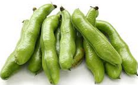

**Image file:** [`vegetable-images/17-broad-beans.png`](vegetable-images/17-broad-beans.png)
**Original image:** [open full size](https://blogger.googleusercontent.com/img/b/R29vZ2xl/AVvXsEgOP6qVQOZMEVajh6DmfcRvhJYkpBrgW9QUCr4E1V2ZUc9_kNGTu5khp6-dY-dnubJuXz2yTsBgGdJE38bSywTQ_By2CFWDj9QtB89bIylAZCMy8aF5balYavcYPUonQc7Wyq0JOerBBXGe/s1600/braod+beans+vegetable+names+in+english+and+telugu+with+pictures.png)

### 18. Colocasia / Taro Root
**Telugu:** చీమదుంప Chema Dumpa chaam Dumpa / Chama Gadda  
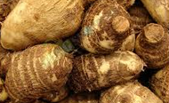

**Image file:** [`vegetable-images/18-colocasia-taro-root.png`](vegetable-images/18-colocasia-taro-root.png)
**Original image:** [open full size](https://blogger.googleusercontent.com/img/b/R29vZ2xl/AVvXsEg922JQarGVtVnkXT96MUf-PQi8LSLcVoakQMNui-Dx_gviuI-osLR9cLcvkTHGiNScDqYweje2ej9MJ4IDANqBAgFU5_HY5MN6wXVVbVz_QZwDArynV3KNFTlhvM1iCAP7creoU4nSrOaU/s1600/Colacasia+vegetable+names+in+english+and+telugu+with+pictures.png)

### 19. Red sorrel
**Telugu:** చుక్కకూర Chukka koora  
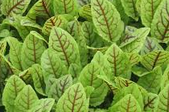

**Image file:** [`vegetable-images/19-red-sorrel.png`](vegetable-images/19-red-sorrel.png)
**Original image:** [open full size](https://blogger.googleusercontent.com/img/b/R29vZ2xl/AVvXsEiW9WSEeJWFoIw9lidXh77fl53_9q4dwiiF3ZkPrdFdxm85ZOYham7S5b_W1OI1AYqC_c7JJZlK-znhvKh3HHCJMHGF_KKUg39VZPHh65k0jflLb_8OSPaGiWoZId1eJX1RZZrh-MM7Zvpg/s1600/red+sorrel+vegetable+names+in+english+and+telugu+with+pictures.png)

### 20. Tomato
**Telugu:** టమాట Tamata  
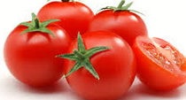

**Image file:** [`vegetable-images/20-tomato.png`](vegetable-images/20-tomato.png)
**Original image:** [open full size](https://blogger.googleusercontent.com/img/b/R29vZ2xl/AVvXsEhqw3tqI7vo9tixuzZp0ChZSKKH5CS9sM-d_hr4oiMPkgHl3fCBsvxutfFB6w2GcQAIVVOwYPSnPu9T5z-mVj5fSBWFu6xHYjDDD9JXPRyThvBn6rZVIzraOztXnLN-J1-1spSTahHwfunr/s1600/tomato.png)

### 21. Amaranthus
**Telugu:** తోటకూర Thotakoora  
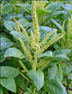

**Image file:** [`vegetable-images/21-amaranthus.png`](vegetable-images/21-amaranthus.png)
**Original image:** [open full size](https://blogger.googleusercontent.com/img/b/R29vZ2xl/AVvXsEgM9C-JzvWSwGle1HfDA2vzchUfDVwPH6Z5JRBCRw15p3bOtVUv_RFKEPZsA89JQcv4xvd_k7mBFN6Z_2IGwAz1RShTVhGXjWK3SmqBKA4NkTGQkcK-owIrkfWgtRPiHdwIEiaJzGZZNm-L/s1600/amaranthus+vegetable+names+in+english+and+telugu+with+pictures.png)

### 22. Tindoora
**Telugu:** దొండకాయ Dondakaya  
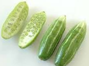

**Image file:** [`vegetable-images/22-tindoora.png`](vegetable-images/22-tindoora.png)
**Original image:** [open full size](https://blogger.googleusercontent.com/img/b/R29vZ2xl/AVvXsEgg4JnZKD9zi8luZ-EOK7zGoMSfephHZTkjXM2xDhDJoYTqd-7LFLD2XlXf2YkutMenbMwpZQ4NPVKYgMTEt8ULvhND-C8Kx3R9xpnrKDYrW5HNJsBkPq1-HFca8SOt3Ajdle64t9gW8pv_/s1600/tindora+vegetable+names+in+english+and+telugu+with+pictures.png)

### 23. Cucumber
**Telugu:** దోసకాయ Dosakaya  
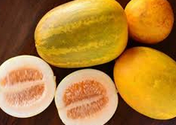

**Image file:** [`vegetable-images/23-cucumber.png`](vegetable-images/23-cucumber.png)
**Original image:** [open full size](https://blogger.googleusercontent.com/img/b/R29vZ2xl/AVvXsEi-Qb6Jt8kP_mlFKQOOHojhDoktbbOql71wZNo9UWndR0ITUK8jiBtiBLJWgVNhk3ldxvxMMTMi5bELxWr6qVHrJcrx9V9IdIi3fNyqFZAAwmF1uA1iL7ffizEIiECwym5POKZvQLYUyN7w/s1600/cucumber+vegetable+names+in+english+and+telugu+with+pictures.png)

### 24. Green Chilli
**Telugu:** పచ్చి మిరపకాయ Pachchi Mirapa Kaaya  
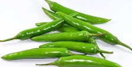

**Image file:** [`vegetable-images/24-green-chilli.png`](vegetable-images/24-green-chilli.png)
**Original image:** [open full size](https://blogger.googleusercontent.com/img/b/R29vZ2xl/AVvXsEgHmOrtU6-JjNouFpxfeBJPh1Ve0IIE_s-wKzr5w2YNId9Axo5cBTM5cQPeHYKN8NwMBYhCnC-sZ_iDL63YHY6Pa4Mnv7u0Bq9NliLudH0nFnWD1yCzQSMxWgC5a_RqkBHJi2DEj7nEp1dF/s1600/green+chilli+vegetable+names+in+english+and+telugu+with+pictures.png)

### 25. Raw jackfruit
**Telugu:** పనసకాయ Panasa kaaya  
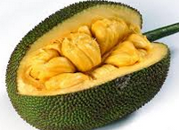

**Image file:** [`vegetable-images/25-raw-jack-fruit.png`](vegetable-images/25-raw-jack-fruit.png)
**Original image:** [open full size](https://blogger.googleusercontent.com/img/b/R29vZ2xl/AVvXsEg0HktMadSHOctT0B-Uc3triCwBXzXmJRgmB0X9emoTKIDhqkqITxwm6JOEMNtD4cAWaUK6oFyG1cX91vzKFlZthg62zIkJ7PSSIqzu7rU1ekDClrbiXgkRT1Z_EUoq9Qyf4m0eRerEDgPo/s1600/raw+jack+fruit+vegetable+names+in+english+and+telugu+with+pictures.png)

### 26. Sorrel
**Telugu:** పాలకూర Paalakoora  
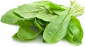

**Image file:** [`vegetable-images/26-sorrel.png`](vegetable-images/26-sorrel.png)
**Original image:** [open full size](https://blogger.googleusercontent.com/img/b/R29vZ2xl/AVvXsEgDpz8ONWoXdEUcHMXcLUAQv2spWuvNfpn-doPoi6Uc20JkmYOEubHgvSYzejObnhuXHqRiIp2k2wj-OokaHpm6HRjvLiDd_YBw2zmXEPpNFBl7Xamg4FBclanUSyCCYTUIA2V7UMCQMwsb/s1600/sorrel+vegetable+names+in+english+and+telugu+with+pictures.png)

### 27. Mushroom
**Telugu:** పుట్టగొడుగులు Puttagodugulu  
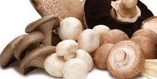

**Image file:** [`vegetable-images/27-mushroom.png`](vegetable-images/27-mushroom.png)
**Original image:** [open full size](https://blogger.googleusercontent.com/img/b/R29vZ2xl/AVvXsEhVu51_KKY4QZj69nY8g1ZH38qix-icnJvUM7ZLxnzsJMhKmolzEUvzr-IQN-hZP9DoY6SLnbf61OGKVJ38oz_nQKnqKkXhuNY6K8JmNmge4KXnmEkf91u9CYEk7keQTn9UwRUGysM7bMUx/s1600/mushroom+vegetable+names+in+english+and+telugu+with+pictures.png)

### 28. Mint Leaves
**Telugu:** పుదీన pudina Akulu  
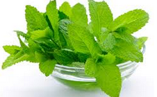

**Image file:** [`vegetable-images/28-mint-leaves.png`](vegetable-images/28-mint-leaves.png)
**Original image:** [open full size](https://blogger.googleusercontent.com/img/b/R29vZ2xl/AVvXsEi-o8D_rVN5BZuWYEbziRFdVWBZGP41jU8oSISlM7GyVJdDLXestPJ-KZ186VzD564GZar3FhneC1x-Jw9jrP1vKq7BeZ90C2izBKl3GwS35JgqwOKw9KvH0uxSwNr2zsn8j2WeQiDzKnon/s1600/mint+leaves+vegetable+names+in+english+and+telugu+with+pictures.png)

### 29. Snake Gourd
**Telugu:** పొట్లకాయ Potlakaya  
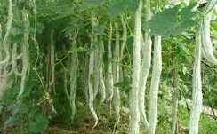

**Image file:** [`vegetable-images/29-snake-gourd.png`](vegetable-images/29-snake-gourd.png)
**Original image:** [open full size](https://blogger.googleusercontent.com/img/b/R29vZ2xl/AVvXsEgSDNUKApfXu_ytdGEouAea6s2FsbY_hx8eFn55QA5yFUJC-cyh5pmFUSFUEUkeKxRidwMBMw6jSEfAFqGZl_ok3MxWVMkxbvWPzNum92k3YKfdIdxX-6V8ZQ2fG30R48nJuPJV5DagKG0q/s1600/snake+gourd+vegetable+names+in+english+and+telugu+with+pictures.png)

### 30. Green Peas
**Telugu:** బఠాని Bataani  
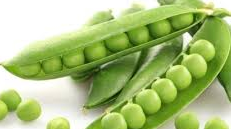

**Image file:** [`vegetable-images/30-green-peas.png`](vegetable-images/30-green-peas.png)
**Original image:** [open full size](https://blogger.googleusercontent.com/img/b/R29vZ2xl/AVvXsEidCnLJ423fqy4gucHxTViNxhqEf0_QbptEeYRx4Ewi_rz8QlWtPvTUBMP48yok_xnjSaMRS3j9-0RTv7qk5NiMlm1jeJPgwmMZyK8aAdd6x_9ZTbkqot3ApeAOcTxc8KST3fH_gXAYMf2J/s1600/green+peas+vegetable+names+in+english+and+telugu+with+pictures.png)

### 31. Beetroot
**Telugu:** బీట్ రూట్ Beetroot  
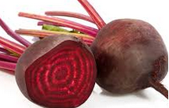

**Image file:** [`vegetable-images/31-beetroot.png`](vegetable-images/31-beetroot.png)
**Original image:** [open full size](https://blogger.googleusercontent.com/img/b/R29vZ2xl/AVvXsEj7IAdVZSuOldzNZgfUgxLEar3lSbdvXFbd-zxAsBqm06kdCMzSXi1QzNQVXSfdXfgnJ-rul9Q3UZq4svtZ6dP0K4LGbvc4x-ft1t8hO_bvIjVcF4sM5M5X42faP3PhRC7Unf7eYJ-WGzZr/s1600/beetroot+vegetable+names+in+english+and+telugu+with+pictures.png)

### 32. Spinach
**Telugu:** బచ్చలి కూర Bachalikoora  
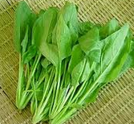

**Image file:** [`vegetable-images/32-spinach.png`](vegetable-images/32-spinach.png)
**Original image:** [open full size](https://blogger.googleusercontent.com/img/b/R29vZ2xl/AVvXsEhqvGyn-PQmpu7fFmR2nsoIw1lpumC6fLxJCjnZdqmURX9gEkmSilCsAe6GVWKeeUQc5EKqp5yz4129nBFJLXbAyoSJb8JrZsdEGFDTTMhHq8Tvq3TjX15pFPNSEAcXKTVeR6_j7dpYu78p/s1600/spinach+vegetable+names+in+english+and+telugu+with+pictures.png)

### 33. Potato
**Telugu:** బంగాళా దుంప Bangala dumpa /Aalugadda  

**Image file:** [`vegetable-images/33-potato.png`](vegetable-images/33-potato.png)
**Original image:** [open full size](https://blogger.googleusercontent.com/img/b/R29vZ2xl/AVvXsEhk-QLfa_QWBVdpj16C6-R_mx1_iGHcnL7M-OBHR7FeuzX2oLf2alM6XqRBTKIFRP9s_B7GgszJi8bnz6tw61OIBbJfVkxGXO3j8rzZFL-sRhavB3kILT0CsYTdqEj5IueTuykLQSzPHL-D/s1600/potato+vegetable+names+in+english+and+telugu+with+pictures.png)

### 34. Ridge Gourd
**Telugu:** బీరకాయ Beerakaaya  
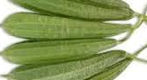

**Image file:** [`vegetable-images/34-ridge-gourd.png`](vegetable-images/34-ridge-gourd.png)
**Original image:** [open full size](https://blogger.googleusercontent.com/img/b/R29vZ2xl/AVvXsEgjNBrBwt6yihexVuqlufC1xW04hl0E5gejvlWxwaJTC8VX5lk5rOEZBcuNU8zq_DWNIcusIecROkTTa1CLXpfJDkuCEENclEbOCFBdK5y8dxEJgLiTdgMRHq13Kp82Abfwk5uxuw6Ujp3w/s1600/Ridge+Gourd+vegetable+names+in+english+and+telugu+with+pictures.png)

### 35. Ash gourd
**Telugu:** బూడిది గుమ్మడికాయ Boodidhi Gummadi kaaya  
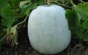

**Image file:** [`vegetable-images/35-ash-gourd.png`](vegetable-images/35-ash-gourd.png)
**Original image:** [open full size](https://blogger.googleusercontent.com/img/b/R29vZ2xl/AVvXsEjiP2BtchGylUUbUSpw1MNllF_OSEtYFj9_FD2rZYgundLhbhm6ULJnlQg3TnEnSbciX0HSXNiZAOjr7gihdJfUqVjf1OBCv5Yyx9B7re1Lq_Kvnrj2nB8efxyIxe9a04dZuhdjSwtNQte0/s1600/ash+gourd+vegetable+names+in+english+and+telugu+with+pictures.png)

### 36. Capsicum
**Telugu:** బెంగుళూరు మిర్చి Bangalore Mirchi  
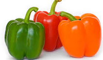

**Image file:** [`vegetable-images/36-capsicum.png`](vegetable-images/36-capsicum.png)
**Original image:** [open full size](https://blogger.googleusercontent.com/img/b/R29vZ2xl/AVvXsEi63RHyXI5YUSjx22_LrV1Nn5-T1yfM4PJjuqOHYEeapxE03dHZ98PYi12xWgPN6FfkEoQBcBebGXFv80Mprxbkm5ZQnzdGRjiiRCgXTywEMHgT-219NzIQtZVzUKjDYeBQt1VRRQbvwHMa/s1600/Capsicum+vegetable+names+in+english+and+telugu+with+pictures.png)

### 37. Lady's finger (Okra)
**Telugu:** బెండకాయ Bendakaya  
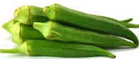

**Image file:** [`vegetable-images/37-lady-s-finger-okra.png`](vegetable-images/37-lady-s-finger-okra.png)
**Original image:** [open full size](https://blogger.googleusercontent.com/img/b/R29vZ2xl/AVvXsEjbr-cVhL6rZ5tY4s8guvO6d_W8ne3uEy_mjLCbW0vM79oR3oALrK86fCiP-YSxyi8nbwK-SJHzhqsxuZcGeRnxrbkWDY_Wp98kW6Wh_QjrnylRz_lg1trXepynk-C14PRZlR5GMLrG3m6u/s1600/ladys+finger+vegetable+names+in+english+and+telugu+with+pictures.png)

### 38. Raw Mango
**Telugu:** మామిడి కాయ Maamidi Kaaya  
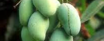

**Image file:** [`vegetable-images/38-raw-mango.png`](vegetable-images/38-raw-mango.png)
**Original image:** [open full size](https://blogger.googleusercontent.com/img/b/R29vZ2xl/AVvXsEgBfO87EPJGGY4nPdZrdYwyhlkivB8j_zZfuXLl14oYPNVlHZ6bswK3S52MrfstrI8D6vferS-yA63mb-Am0SaoPMdGxsVXanFfYk9bAEhK6fvsoFkClaK6cN-1xT_aFCk-zYUPl4DjgtQ4/s1600/raw+mango+vegetable+names+in+english+and+telugu+with+pictures.png)

### 39. Drumstick
**Telugu:** ములక్కాయ మొనక్కాయ Mulakkaaya  
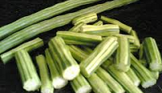

**Image file:** [`vegetable-images/39-drumstick.png`](vegetable-images/39-drumstick.png)
**Original image:** [open full size](https://blogger.googleusercontent.com/img/b/R29vZ2xl/AVvXsEi4iBX0f3_w6I7-x20bBGVN5cGSAdVuGqpIzV5bv_K0VnGwQFQec6UJ6Ly1nUtnd7V4VBm4Pb_gT4scmfC6Pr4wmmCpvETFp0NDUueOfXY-rvY73OBYGMj-te93vvn59u8m2U0UAj-OvtQw/s1600/drum+sticks+vegetable+names+in+english+and+telugu+with+pictures.png)

### 40. Radish
**Telugu:** ముల్లంగి Mullangi  

**Image file:** [`vegetable-images/40-radish.png`](vegetable-images/40-radish.png)
**Original image:** [open full size](https://blogger.googleusercontent.com/img/b/R29vZ2xl/AVvXsEiqQrSmWXCTQ0Q5bTcLNutL6iTRkySP8nyFSvk-jyJeqiOIbDl2biBkHUp54r_cidnLU4qsjVgsETWNeGDAHX97IFWGGZLVOGSW1q1b0RwikBian0BdnwyMB0yuBMeioQHktEi4fMSe4uqo/s1600/radish+vegetable+names+in+english+and+telugu+with+pictures.png)

### 41. Fenugreek Leaves
**Telugu:** మెంతి కూర Menthi Koora  
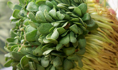

**Image file:** [`vegetable-images/41-fenugreek-leaves.png`](vegetable-images/41-fenugreek-leaves.png)
**Original image:** [open full size](https://blogger.googleusercontent.com/img/b/R29vZ2xl/AVvXsEjs3UEwLHepu_EBZhUO1xN7ls87tpRbw2zy6lVCfxEUU9icTzbDElpzJpfUR8NnyklhSeOiXt1G8a8rTtzrgudzwzlPps6B4YfAOm8gQsIRvPBaWEPpxAJ_L29hj95eYthbNF-KqZacgobX/s1600/fenugreek+leaves+vegetable+names+in+english+and+telugu+with+pictures.png)

### 42. Corn
**Telugu:** మొక్క జొన్న Mokkajonna  
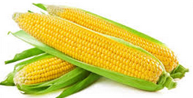

**Image file:** [`vegetable-images/42-corn.png`](vegetable-images/42-corn.png)
**Original image:** [open full size](https://blogger.googleusercontent.com/img/b/R29vZ2xl/AVvXsEjUbv0mFAahykSnHtzGNt4fsuXzvze4Hyftk-FP4AqM2b3AZT3wBzucKqsZuGqsCTaOKU84JuV9BQQKxY5k3r8Pj6kGT6ggkgyzVD_i7_SS1thukoYqhZQPxXz5A3YCrerVig3ioPvrQqWX/s1600/corn+vegetable+names+in+english+and+telugu+with+pictures.png)

### 43. Sweet Potato
**Telugu:** మోరం గడ్డ Moram Gadda  

**Image file:** [`vegetable-images/43-sweet-potato.png`](vegetable-images/43-sweet-potato.png)
**Original image:** [open full size](https://blogger.googleusercontent.com/img/b/R29vZ2xl/AVvXsEhEgp5nkeh5vPNO_6A0vs6a8UhKuOl97sOK3CrLrvtqP27AOp2cCvtIBS8lXSCFdKmIUhMsyStmpd7UoIdhpJDuact7tTHiXbAOk8VZLWGd1VG49hUv2iuOKnEBo5MRd34vo5v1uXor9k49/s1600/sweet+potato+vegetable+names+in+english+and+telugu+with+pictures.png)

### 44. Brinjal
**Telugu:** వంకాయ Vankaya  
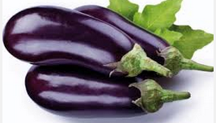

**Image file:** [`vegetable-images/44-brinjal.png`](vegetable-images/44-brinjal.png)
**Original image:** [open full size](https://blogger.googleusercontent.com/img/b/R29vZ2xl/AVvXsEgEAmbMjrX1Ri8y80c6oJCXeschfUapXY8kglN561l38X0bIf8FMXnLjmQiI6kxehomtfUm3DbJV_jcCYvHEeojSqT5tFQ9kJWGiVCO0H1sw6Vxq6De8zzNMOOsY_8q19rnTQGrnaq0fsov/s1600/brinjal+vegetable+names+in+english+and+telugu+with+pictures.png)

### 45. Garlic
**Telugu:** వెల్లుల్లి Vellulli  
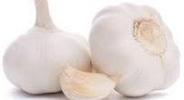

**Image file:** [`vegetable-images/45-garlic.png`](vegetable-images/45-garlic.png)
**Original image:** [open full size](https://blogger.googleusercontent.com/img/b/R29vZ2xl/AVvXsEjipz4O9ir9gRKn9aBYsJBAZ4JIXzC2WDrVZOOnrv1wYme87UPQLwARGzw5GN_Q_LCRUWWA9L_Mc0kc0mqQ_RNwwIWP-_QMtFdM5rFNsj5WG_3R7SlqgaWyn0EMUwE-ranQVxl1gF2elc3j/s1600/garlic+vegetable+names+in+english+and+telugu+with+pictures.png)

### 46. Hill glory bower
**Telugu:** సరస్వతి ఆకు Saraswathi Aaku  
**Image:** none on the source page

### 47. Bottle Gourd
**Telugu:** సొరకాయ Sorakaya/Anapakaaya  
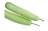

**Image file:** [`vegetable-images/47-bottle-gourd.png`](vegetable-images/47-bottle-gourd.png)
**Original image:** [open full size](https://blogger.googleusercontent.com/img/b/R29vZ2xl/AVvXsEjaaEkFYtG9Wb7ep2YCX1Ub0UC7PDQQf5tWDDBUIJ5z34lQQuys6Sij4TE9M0F_Qy-iMxA5QitOmivXI1j0GPr4WE8flIqFcyp6wlZ5JsmSJ-jPRrgBgUp1Qk67VV6r-2kmauoobGPaRokf/s1600/bottle+Gourd+vegetable+names+in+english+and+telugu+with+pictures.png)

## Notes

- **Potato** appears twice: *ఆలుగడ్డ Alugadda/Bangala dumpa* (#3) and *బంగాళా దుంప Bangala dumpa /Aalugadda* (#33).
- **Cauliflower** appears twice: #10 *కాలి ఫ్లవర్ Cauliflower/Gobi* and #16 *గోబిపువ్వు - Gobi / Cauliflower* (no image on the source page).
- **Cluster beans** appears twice: #14 *గోకర కాయం Goru chikkudu* (source typo; standard: *గోరు చిక్కుడు*) and #15 *గోరు చిక్కుడు Goru chikkudu*.
- **Bottle Gourd** appears twice: #2 *ఆనపకాయ Anapakaya/Sorakaya* and #47 *సొరకాయ Sorakaya/Anapakaaya*.
- Items **#16 (Gobi / Cauliflower)** and **#46 (Saraswathi Aaku / Hill glory bower)** have no images on the source page.
- Images are saved with the same names as their English entries; duplicate entries share the same picture.